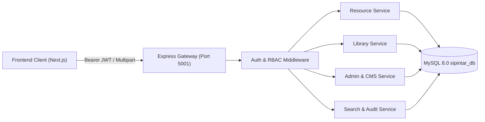

# Panduan Integrasi RESTful API SIPINTAR Sespimma Lemdiklat Polri
**Sistem Informasi Pembelajaran INovatif Terpadu, Adaptif, dan Responsif**  
*Sespimma Sespim Lemdiklat Polri — Proyek Perubahan PKN Tingkat II Angkatan XXIX Nawasena TA 2026*

---

## 1. Ikhtisar Arsitektur & Konvensi Komunikasi

Dokumen ini disusun sebagai **buku panduan integrasi resmi** bagi pengembang antarmuka **Frontend (Next.js / TypeScript)** untuk berkomunikasi dengan **Backend RESTful API** (`sipintarsespimmaAPI`).

### A. Informasi Dasar Server
- **Base URL API:** `http://localhost:5001/api/v1`
- **Interactive Swagger UI (Browser):** `http://localhost:5001/docs` atau `http://localhost:5001/api/docs`
- **Spesifikasi OpenAPI 3.0 (JSON):** `http://localhost:5001/openapi.json`
- **Koleksi Postman Resmi:** `collection.json` (v2.1.0, 33 Request)
- **Format Pertukaran Data:** JSON (`Content-Type: application/json; charset=utf-8`) atau `multipart/form-data` (untuk unggah naskah/buku/foto).
- **Protokol Keamanan:** Helmet HTTP Security Headers, Express Brute-force & Rate Limiting, CORS terisolasi, JWT Bearer Token, dan Audit Trail Logging pada MySQL 8.0.

---

### B. Header Permintaan Standar (*Request Headers*)
Setiap panggilan ke endpoint terproteksi wajib menyertakan:
```http
Authorization: Bearer <jwt_token_pengguna>
Content-Type: application/json
Accept: application/json
```
> [!IMPORTANT]
> **Catatan Khusus Pengiriman Berkas (`multipart/form-data`):**
> Saat mengirim `FormData` menggunakan `fetch` atau `axios` di browser, **JANGAN** menyetel header `Content-Type` secara manual. Browser akan secara otomatis menetapkan `multipart/form-data; boundary=----WebKitFormBoundary...`.

---

### C. Standarisasi Amplop Respons JSON (*Standardized Response Envelope*)

#### 1. Format Respons Berhasil (HTTP 200 / 201)
```json
{
  "success": true,
  "message": "Deskripsi hasil tindakan berhasil",
  "data": { ... },
  "meta": {
    "page": 1,
    "limit": 10,
    "total": 100,
    "totalPages": 10
  }
}
```
*(Catatan: Field `meta` bersifat opsional dan otomatis disertakan pada endpoint yang memiliki paginasi).*

#### 2. Format Respons Gagal / Validasi (HTTP 400 / 401 / 403 / 404 / 409 / 429 / 500)
```json
{
  "success": false,
  "error": {
    "code": "VALIDATION_ERROR | UNAUTHORIZED | FORBIDDEN | NOT_FOUND | DUPLICATE_ENTRY | RATE_LIMIT_EXCEEDED | INTERNAL_ERROR",
    "message": "Pesan kesalahan dalam bahasa Indonesia yang ramah pengguna",
    "details": [
      { "field": "email", "issue": "Format email kedinasan tidak valid" }
    ]
  }
}
```

---

### D. Akun Pengujian Kedinasan Resmi (*Seed Accounts*)
Semua akun pengujian di bawah ini aktif dengan kata sandi bawaan: **`Password123!`**

| No | Peran (*Role*) | NRP / NIP | Nama Lengkap & Gelar | Email Kedinasan | Hak Akses Utama |
|---|---|---|---|---|---|
| 1 | **Superadmin / Admin** | `99999999` | Super Administrator SIPINTAR | `superadmin@sespimma.polri.go.id` | CRUD Penuh, Kelola Pengguna, Ekspor/Impor, Log Audit |
| 2 | **Admin Sistem** | `85071534` | KOMPOL Arya Wicaksana, S.I.K., M.Si. | `arya.wicaksana@sespimma.polri.go.id` | Konfigurasi sistem, manajemen naskah, monitoring |
| 3 | **Tim Verifikator** | `78100412` | KBP Bambang Tejo, S.H., M.M. | `bambang.tejo@sespimma.polri.go.id` | Persetujuan/Penolakan/Revisi antrean naskah Bag Jarlat |
| 4 | **Tenaga Pendidik (Gadik)**| `72040311` | AKBP Dr. Hendro Prasetyo, M.Hum. | `hendro.prasetyo@sespimma.polri.go.id` | Unggah naskah draf, kelola materi ajar mandiri |
| 5 | **Pengelola Pustaka** | `198506152010121002` | Dra. Sulastri, M.Lib. | `sulastri.pustaka@sespimma.polri.go.id` | Kelola katalog buku fisik, e-book, dan naskah Taskap |
| 6 | **Peserta Didik (Serdik)** | `89031201` | AKP Denny Setiawan, S.T. | `denny.setiawan@serdik.sespimma.polri.go.id` | Membaca & streaming naskah publikasi resmi |
| 7 | **Pimpinan Sespimma** | `68010214` | BRIGJEN POL Raden Mas Daryono | `kasespimma@sespimma.polri.go.id` | Dasbor pemantauan eksekutif & agregasi data |

---

### E. 4 Klasifikasi Hak Akses Naskah (*Access Classifications*)
1. `Terbuka`: Naskah dapat dibaca dan diunduh oleh publik/seluruh pengguna yang telah terotentikasi.
2. `Internal`: Terbatas hanya untuk sivitas akademika resmi Sespimma (Serdik aktif, Gadik, dan Staf).
3. `Terbatas`: Hanya dapat diakses oleh Pokja Kurikulum, Gadik pengampu mata ajaran terkait, Verifikator, dan Administrator.
4. `Metadata Saja`: Hanya judul, abstrak/sinopsis, penulis, dan metadata yang dapat ditampilkan di antarmuka. **Pengunduhan dokumen PDF/digital DILARANG KERAS** oleh sistem (berlaku wajib untuk naskah Taskap siswa dan buku fisik koleksi perpustakaan).

---

### F. 5 Status Siklus Hidup Naskah (*Lifecycle State Machine*)
1. `Draft`: Naskah baru diunggah oleh Gadik/Pokja, belum diverifikasi. Hanya dapat dilihat pemilik dan verifikator.
2. `Diverifikasi`: Naskah telah ditinjau dan sedang menunggu validasi akhir Bag Jarlat.
3. `Dipublikasikan`: Naskah resmi telah disetujui (*Approve*) dan aktif dapat diakses sesuai klasifikasi hak akses.
4. `Tidak Aktif`: Naskah ditolak (*Reject*) atau ditarik sementara dari sirkulasi akademik.
5. `Arsip`: Naskah lawas/kadaluwarsa diarsipkan (*Archive*) untuk preservasi jejak rekam akademik tanpa penghapusan permanen.

---

## 2. Katalog Endpoint Terperinci & Contoh Payload



---

### Modul 1: Sistem & Health Check

#### 1.1 Health Check API & Basis Data
- **Endpoint:** `GET /api/v1/health`
- **Akses:** Publik (Tanpa Token)
- **Deskripsi:** Memeriksa status kesehatan server backend dan ketersediaan koneksi pool basis data MySQL `sipintar_db`.
- **Response Success (HTTP 200 OK):**
```json
{
  "success": true,
  "message": "SIPINTAR REST API beroperasi normal",
  "data": {
    "status": "UP",
    "timestamp": "2026-11-18T01:50:00.123Z",
    "uptime_seconds": 12450.45,
    "database": {
      "status": "CONNECTED",
      "host": "localhost",
      "port": 3306,
      "database": "sipintar_db"
    },
    "version": "1.0.0"
  }
}
```

---

### Modul 2: Autentikasi & Akun Pengguna

#### 2.1 Masuk Akun (*Login*)
- **Endpoint:** `POST /api/v1/auth/login`
- **Akses:** Publik (Dilindungi Rate Limiter 10 req/15 mnt)
- **Headers:** `Content-Type: application/json`
- **Request Body:**
```json
{
  "identifier": "superadmin@sespimma.polri.go.id",
  "password": "Password123!"
}
```
*(Catatan: Field `identifier` dapat berupa alamat **Email** kedinasan maupun nomor **NRP / NIP**).*
- **Response Success (HTTP 200 OK):**
```json
{
  "success": true,
  "message": "Autentikasi berhasil",
  "data": {
    "token": "eyJhbGciOiJIUzI1NiIsInR5cCI6IkpXVCJ9...",
    "token_type": "Bearer",
    "expires_in": "24h",
    "user": {
      "id": 1,
      "uuid": "a1b2c3d4-e5f6-7890-abcd-ef1234567890",
      "nrp_nip": "99999999",
      "nama_lengkap": "Super Administrator SIPINTAR",
      "email": "superadmin@sespimma.polri.go.id",
      "role": "admin",
      "role_code": "admin",
      "role_name": "Administrator Sistem",
      "phone_number": "081299999999",
      "is_active": 1,
      "last_login_at": "2026-11-18T01:45:12.000Z"
    }
  }
}
```
- **Response Error (HTTP 401 Unauthorized):**
```json
{
  "success": false,
  "error": {
    "code": "UNAUTHORIZED",
    "message": "Kredensial tidak valid: NRP/Email atau kata sandi salah"
  }
}
```

#### 2.2 Profil Pengguna yang Sedang Masuk (*Get Current User*)
- **Endpoint:** `GET /api/v1/auth/me`
- **Akses:** Terproteksi (Semua Pengguna Terotentikasi)
- **Headers:** `Authorization: Bearer <token>`
- **Response Success (HTTP 200 OK):**
```json
{
  "success": true,
  "message": "Profil pengguna berhasil dimuat",
  "data": {
    "user": {
      "id": 1,
      "uuid": "a1b2c3d4-e5f6-7890-abcd-ef1234567890",
      "nrp_nip": "99999999",
      "nama_lengkap": "Super Administrator SIPINTAR",
      "email": "superadmin@sespimma.polri.go.id",
      "role": "admin",
      "role_code": "admin",
      "role_name": "Administrator Sistem",
      "permissions": ["all_access", "manage_users", "verify_content", "export_import"]
    }
  }
}
```

#### 2.3 Pendaftaran Mandiri Pengguna (*Register*)
- **Endpoint:** `POST /api/v1/auth/register`
- **Akses:** Publik (Serdik / Gadik Baru)
- **Request Body:**
```json
{
  "nrp_nip": "89050612",
  "nama_lengkap": "AKP Bambang Triatmojo, S.H.",
  "email": "bambang.tri@serdik.sespimma.polri.go.id",
  "password": "Password123!",
  "role_id": 1,
  "pangkat_korps": "AKP",
  "jabatan": "Peserta Didik Sespimma Angkatan 71",
  "satker": "Polda Metro Jaya",
  "phone_number": "081234567890"
}
```
- **Response Success (HTTP 201 Created):**
```json
{
  "success": true,
  "message": "Pendaftaran akun berhasil diproses",
  "data": {
    "user_id": 15,
    "nrp_nip": "89050612",
    "nama_lengkap": "AKP Bambang Triatmojo, S.H.",
    "role": "serdik",
    "is_active": 1
  }
}
```

---

### Modul 3: Taksonomi Kategori & Subkategori

#### 3.1 Daftar 8 Kategori Resmi Sespimma
- **Endpoint:** `GET /api/v1/categories`
- **Akses:** Publik / Terbuka
- **Response Success (HTTP 200 OK):**
```json
{
  "success": true,
  "message": "Daftar kategori resmi Sespimma berhasil diambil",
  "data": [
    {
      "id": 1,
      "name": "Gadik & Kompetensi",
      "slug": "gadik",
      "description": "Profil tenaga pendidik kepolisian, widyaiswara, dan modul kompetensi",
      "icon": "academic-cap",
      "display_order": 1,
      "total_resources": 12
    },
    {
      "id": 2,
      "name": "Modul & Hanjar",
      "slug": "modul",
      "description": "Bahan ajar inti, modul core kepemimpinan, dan naskah latihan",
      "icon": "book-open",
      "display_order": 2,
      "total_resources": 48
    },
    {
      "id": 3,
      "name": "E-Library/Perpustakaan",
      "slug": "library",
      "description": "Koleksi buku fisik, e-book, naskah Taskap perwira, dan jurnal kepolisian",
      "icon": "library",
      "display_order": 3,
      "total_resources": 35
    },
    {
      "id": 4,
      "name": "Kurikulum & Standar Layanan",
      "slug": "kurikulum",
      "description": "Struktur kurikulum pendidikan Sespimma dan pedoman mutu layanan",
      "icon": "clipboard-list",
      "display_order": 4,
      "total_resources": 8
    },
    {
      "id": 5,
      "name": "SOP",
      "slug": "sop",
      "description": "Standar Operasional Prosedur penyelenggaraan pembelajaran dan logistik",
      "icon": "document-check",
      "display_order": 5,
      "total_resources": 14
    },
    {
      "id": 6,
      "name": "Pedoman",
      "slug": "pedoman",
      "description": "Petunjuk teknis kedinasan, juklak, dan tata tertib pendidikan",
      "icon": "bookmark",
      "display_order": 6,
      "total_resources": 9
    },
    {
      "id": 7,
      "name": "Manual Book",
      "slug": "manual",
      "description": "Panduan teknis sistem informasi, aplikasi, dan instruksi kerja operasional",
      "icon": "cog",
      "display_order": 7,
      "total_resources": 7
    },
    {
      "id": 8,
      "name": "Pencarian Terpadu",
      "slug": "search",
      "description": "Fitur pencarian terintegrasi lintas seluruh repositori materi",
      "icon": "search",
      "display_order": 8,
      "total_resources": 0
    }
  ]
}
```

#### 3.2 Daftar Subkategori berdasarkan Kategori
- **Endpoint:** `GET /api/v1/categories/:id/subcategories`
- **Parameter URL:** `:id` (Numeric ID Kategori, misal `2` untuk Modul & Hanjar)
- **Response Success (HTTP 200 OK):**
```json
{
  "success": true,
  "message": "Daftar subkategori berhasil diambil",
  "data": [
    { "id": 1, "category_id": 2, "name": "Modul Core Sespimma", "slug": "modul-core" },
    { "id": 2, "category_id": 2, "name": "Bahan Tayang (Slide PPT)", "slug": "bahan-tayang" },
    { "id": 3, "category_id": 2, "name": "Bahan Bacaan Pelengkap", "slug": "bacaan-pelengkap" },
    { "id": 4, "category_id": 2, "name": "Panduan Lembar Kerja Latihan", "slug": "lembar-kerja" }
  ]
}
```

---

### Modul 4: Katalog Sumber Belajar (*Resources*)

#### 4.1 Mendapatkan Daftar Naskah / Dokumen
- **Endpoint:** `GET /api/v1/resources`
- **Akses:** Publik / Terotentikasi Opsional (Filter otomatis menyaring naskah dengan status `Dipublikasikan` untuk non-admin).
- **Query Parameters:**
  - `page` (Integer, default: 1): Halaman data.
  - `limit` (Integer, default: 10, max: 100): Jumlah item per halaman.
  - `category_id` (Integer): Filter berdasarkan ID kategori.
  - `category_slug` (String): Filter berdasarkan slug kategori (misal: `modul`, `sop`, `pedoman`, `kurikulum`).
  - `search` (String): Kata kunci pencarian judul, penyusun, atau deskripsi.
  - `lifecycle_status` (String, Khusus Admin): `Draft`, `Diverifikasi`, `Dipublikasikan`, `Arsip`.
  - `access_classification` (String): `Terbuka`, `Internal`, `Terbatas`, `Metadata Saja`.
- **Response Success (HTTP 200 OK):**
```json
{
  "success": true,
  "message": "Daftar sumber belajar berhasil diambil",
  "data": [
    {
      "id": 155,
      "uuid": "f8c2b53a-4421-4821-bc7e-29219c011e40",
      "title": "MODUL CORE 2 SESPIMMA PENGGALANGAN INTELIJEN KEAMANAN",
      "category_name": "Modul & Hanjar",
      "category_slug": "modul",
      "sub_category_name": "Modul Core Sespimma",
      "author_or_instructor": "Kombes Pol. Dr. Hendro Prasetyo, M.Hum.",
      "unit_or_source": "Pokja Kurikulum & Gadik Sespimma",
      "access_classification": "Internal",
      "lifecycle_status": "Dipublikasikan",
      "file_format": "PDF",
      "file_size_formatted": "3.8 MB",
      "view_count": 142,
      "download_count": 38,
      "created_at": "2026-11-15T08:30:00.000Z"
    }
  ],
  "meta": {
    "page": 1,
    "limit": 10,
    "total": 96,
    "totalPages": 10
  }
}
```

#### 4.2 Rincian Detail Naskah
- **Endpoint:** `GET /api/v1/resources/:id`
- **Parameter URL:** `:id` (Numeric ID atau String UUID)
- **Response Success (HTTP 200 OK):**
```json
{
  "success": true,
  "message": "Detail naskah berhasil diambil",
  "data": {
    "id": 155,
    "uuid": "f8c2b53a-4421-4821-bc7e-29219c011e40",
    "title": "MODUL CORE 2 SESPIMMA PENGGALANGAN INTELIJEN KEAMANAN",
    "category_id": 2,
    "category_name": "Modul & Hanjar",
    "sub_category_text": "Modul Core Sespimma",
    "description": "Bahan ajar manajemen intelijen terintegrasi bagi perwira menengah Polri dalam deteksi dini hybrid threats.",
    "author_or_instructor": "Kombes Pol. Dr. Hendro Prasetyo, M.Hum.",
    "unit_or_source": "Pokja Kurikulum & Gadik Sespimma",
    "access_classification": "Internal",
    "lifecycle_status": "Dipublikasikan",
    "file_url": "/api/v1/resources/155/file",
    "file_format": "PDF",
    "file_size_bytes": 3984580,
    "can_download": true,
    "created_at": "2026-11-15T08:30:00.000Z"
  }
}
```

#### 4.3 Streaming Berkas Naskah PDF In-App (*In-App Document Reader*)
- **Endpoint:** `GET /api/v1/resources/:id/file`
- **Akses:** Terproteksi Hak Akses (Otomatis memeriksa klasifikasi dan peran)
- **Headers:** `Authorization: Bearer <token>`
- **Response Success (HTTP 200 OK):**
  - `Content-Type: application/pdf` (atau format berkas terkait).
  - `Content-Disposition: inline; filename="naskah_sespimma_155.pdf"`
- **Response Blocked (HTTP 403 Forbidden):**
```json
{
  "success": false,
  "error": {
    "code": "FORBIDDEN",
    "message": "Naskah berklasifikasi 'Metadata Saja'. Pengunduhan berkas digital tidak diizinkan sesuai ketetapan tata kelola Sespimma."
  }
}
```

---

### Modul 5: Direktori Tenaga Pendidik (*Gadik*)

#### 5.1 Mendapatkan Daftar Tenaga Pendidik
- **Endpoint:** `GET /api/v1/gadik`
- **Akses:** Publik / Terbuka
- **Query Parameters:** `search`, `page`, `limit`
- **Response Success (HTTP 200 OK):**
```json
{
  "success": true,
  "message": "Daftar Tenaga Pendidik berhasil diambil",
  "data": [
    {
      "id": 1,
      "nrp_nip": "72040311",
      "nama_lengkap": "AKBP Dr. Hendro Prasetyo, M.Hum.",
      "pangkat_korps": "AKBP",
      "jabatan": "Widyaiswara Madya Sespimma",
      "satker": "Bag Jarlat Sespimma",
      "bidang_keahlian": "Manajemen Intelijen & Kontra Radikalisme",
      "email": "hendro.prasetyo@sespimma.polri.go.id",
      "foto_url": "/uploads/gadik/hendro.jpg",
      "total_modul_diampu": 6
    }
  ],
  "meta": { "page": 1, "limit": 10, "total": 24, "totalPages": 3 }
}
```

#### 5.2 Rincian Profil Gadik & Modul yang Diampu
- **Endpoint:** `GET /api/v1/gadik/:id`
- **Response Success (HTTP 200 OK):** Mengembalikan profil lengkap Gadik beserta daftar materi yang ditugaskan kepada Gadik tersebut.

---

### Modul 6: Perpustakaan & E-Library (Buku Fisik, E-Book, Taskap, Jurnal)

#### 6.1 Daftar Kategori Perpustakaan
- **Endpoint:** `GET /api/v1/library/categories`
- **Response Success (HTTP 200 OK):**
```json
{
  "success": true,
  "data": [
    { "id": "buku-fisik", "name": "Buku Fisik", "description": "Koleksi buku cetak di gedung perpustakaan Sespimma" },
    { "id": "ebook", "name": "E-Book Digital", "description": "Buku elektronik berformat PDF/EPUB" },
    { "id": "taskap", "name": "Karya Tulis Akhir (Taskap)", "description": "Tesis dan naskah karya ilmiah perwira peserta didik" },
    { "id": "jurnal", "name": "Jurnal Kepolisian", "description": "Publikasi berkala ilmiah kepolisian dan kamtibmas" }
  ]
}
```

#### 6.2 Daftar Koleksi Buku & Naskah Ilmiah
- **Endpoint:** `GET /api/v1/library/books`
- **Query Parameters:**
  - `category` (String): `buku-fisik`, `ebook`, `taskap`, `jurnal`, atau `Semua`.
  - `search` (String): Kata kunci pencarian judul, penulis, penerbit, nomor panggil.
  - `page` (Integer), `limit` (Integer).
- **Response Success (HTTP 200 OK):**
```json
{
  "success": true,
  "message": "Daftar koleksi perpustakaan berhasil diambil",
  "data": [
    {
      "id": 101,
      "uuid": "c9201941-8412-4211-bc91-294029410492",
      "title": "Analisis Kriminologi Terhadap Kejahatan Siber Modern",
      "author": "Prof. Dr. Tb. Ronny Nitibaskara",
      "publisher": "Pustaka Sespim Polri",
      "published_year": 2024,
      "isbn": "978-602-1234-56-7",
      "library_category_id": "buku-fisik",
      "sub_category": "Hukum & Kriminologi",
      "call_number": "364.1 NIT a",
      "physical_location": "Rak Referensi A-04, Lantai 2",
      "stock_total": 4,
      "stock_available": 3,
      "access_classification": "Metadata Saja",
      "lifecycle_status": "Dipublikasikan",
      "cover_image_url": "/uploads/covers/kriminologi.jpg"
    }
  ],
  "meta": { "page": 1, "limit": 10, "total": 65, "totalPages": 7 }
}
```

#### 6.3 Pratinjau Terbatas Sampel Buku (*Book Preview*)
- **Endpoint:** `GET /api/v1/library/books/:id/preview`
- **Akses:** Terbuka (Mengembalikan berkas sampel 5-10 halaman pertama naskah).

---

### Modul 7: Pencarian Terpadu (*Unified Fulltext Search*)

- **Endpoint:** `GET /api/v1/search`
- **Akses:** Publik / Terotentikasi
- **Query Parameters:**
  - `q` (String, Wajib, min 2 karakter): Frasa pencarian.
  - `type` (String, default: `all`): `all`, `resources`, `books`, `gadik`.
  - `page` (Integer), `limit` (Integer).
- **Response Success (HTTP 200 OK):**
```json
{
  "success": true,
  "message": "Pencarian terpadu berhasil dieksekusi",
  "data": {
    "query": "intelijen",
    "total_results": 14,
    "resources": [
      {
        "id": 155,
        "title": "MODUL CORE 2 SESPIMMA PENGGALANGAN INTELIJEN KEAMANAN",
        "category": "Modul & Hanjar",
        "snippet": "...konsep dasar <b>intelijen</b> taktis serta teknik penggalangan kepolisian...",
        "relevance_score": 9.85
      }
    ],
    "books": [
      {
        "id": 88,
        "title": "Doktrin Intelijen Kepolisian Masa Depan",
        "author": "Kombes Pol. Drs. Suryanto",
        "call_number": "355.343 SUR d",
        "relevance_score": 8.12
      }
    ],
    "gadik": [
      {
        "id": 1,
        "nama_lengkap": "AKBP Dr. Hendro Prasetyo, M.Hum.",
        "bidang_keahlian": "Manajemen Intelijen & Kontra Radikalisme"
      }
    ]
  }
}
```

---

### Modul 8: Tata Kelola Naskah Admin & Gadik (CMS Dokumen)

#### 8.1 Tambah Naskah Baru (*Create Resource*)
- **Endpoint:** `POST /api/v1/admin/resources`
- **Akses:** `admin`, `pengelola`, `gadik`
- **Headers:** `Authorization: Bearer <token>`
- **Request Body (`multipart/form-data`):**
  - `title` (Text, Wajib): Judul lengkap dokumen materi.
  - `category_id` (Integer, Wajib): ID kategori (1 s.d. 7).
  - `sub_category_text` (Text, Opsional): Nama subkategori.
  - `description` (Text): Abstrak atau ringkasan isi naskah.
  - `author_or_instructor` (Text, Wajib): Nama penulis/penyusun.
  - `unit_or_source` (Text, Wajib): Satker/Pokja pengusul materi.
  - `access_classification` (Text, Wajib): `Terbuka` | `Internal` | `Terbatas` | `Metadata Saja`.
  - `file` (Binary File, Opsional): Berkas PDF/DOCX/PPTX (Maks 50 MB).
- **Response Success (HTTP 201 Created):**
```json
{
  "success": true,
  "message": "Sumber belajar berhasil dibuat sebagai draf",
  "data": {
    "id": 172,
    "uuid": "7a8b9c0d-1e2f-3456-abcd-9876543210fe",
    "title": "Rancangan Standar Operasional Prosedur Olah TKP Siber",
    "lifecycle_status": "Draft",
    "access_classification": "Internal",
    "file_url": "/api/v1/resources/172/file"
  }
}
```

#### 8.2 Perbarui Metadata Naskah (*Update Resource*)
- **Endpoint:** `PUT /api/v1/admin/resources/:id`
- **Akses:** `admin`, `pengelola`, `gadik`
- **Headers:** `Authorization: Bearer <token>`
- **Request Body (`multipart/form-data` atau `application/json`):**
  - Seluruh field sama dengan endpoint pembuatan naskah di atas. Berkas `file` bersifat opsional (hanya dikirim jika ingin mengganti file yang ada).

#### 8.3 Ubah Status Siklus Hidup Secara Langsung (*Patch Status*)
- **Endpoint:** `PATCH /api/v1/admin/resources/:id/status`
- **Akses:** `admin`, `verifikator`
- **Request Body:**
```json
{
  "status": "Dipublikasikan"
}
```
*(Nilai status yang valid: `Draft`, `Diverifikasi`, `Dipublikasikan`, `Tidak Aktif`, `Arsip`).*

#### 8.4 Arsipkan Naskah (*Archive Resource*)
- **Endpoint:** `PATCH /api/v1/admin/resources/:id/archive`
- **Akses:** `admin`, `verifikator`
- **Deskripsi:** Mengubah status naskah menjadi `Arsip` untuk menghentikan sirkulasi tanpa menghapus rekam jejak akademik.

#### 8.5 Hapus Naskah (*Delete Resource*)
- **Endpoint:** `DELETE /api/v1/admin/resources/:id`
- **Akses:** `admin`
- **Query Parameter:** `hard=true` (Opsional, untuk penghapusan permanen dari basis data; default adalah soft-delete).

---

### Modul 9: Tata Kelola Koleksi Perpustakaan (CMS Buku & Taskap)

#### 9.1 Tambah Buku / Koleksi Baru (*Create Book*)
- **Endpoint:** `POST /api/v1/admin/books`
- **Akses:** `admin`, `pengelola`
- **Headers:** `Authorization: Bearer <token>`
- **Request Body (`multipart/form-data` atau `application/json`):**
```json
{
  "title": "Manajemen Taktis Penanganan Konflik Komunal",
  "author": "Kombes Pol. Drs. Ahmad Fauzi, M.Hum.",
  "publisher": "Pustaka Sespimma Lemdiklat Polri",
  "published_year": 2026,
  "library_category_id": "buku-fisik",
  "sub_category": "Taktik Kepolisian",
  "isbn": "978-602-9988-11-2",
  "call_number": "355.43 FAU m",
  "physical_location": "Rak Taktik B-02",
  "stock_total": 5,
  "stock_available": 5,
  "access_classification": "Internal",
  "lifecycle_status": "Dipublikasikan",
  "synopsis": "Kajian komprehensif penanganan kerusuhan massa berbasis kearifan lokal."
}
```
- **Response Success (HTTP 201 Created):**
```json
{
  "success": true,
  "message": "Buku perpustakaan berhasil ditambahkan",
  "data": {
    "id": 89,
    "uuid": "4e5f6a7b-8c9d-0123-ef45-678901234567",
    "title": "Manajemen Taktis Penanganan Konflik Komunal",
    "library_category_id": "buku-fisik"
  }
}
```

#### 9.2 Perbarui Data Buku (*Update Book*)
- **Endpoint:** `PUT /api/v1/admin/books/:id`
- **Akses:** `admin`, `pengelola`

#### 9.3 Hapus Koleksi Buku (*Delete Book*)
- **Endpoint:** `DELETE /api/v1/admin/books/:id`
- **Akses:** `admin`, `pengelola`

---

### Modul 10: Verifikasi Mutu Pokja Bag Jarlat

#### 10.1 Antrean Naskah Verifikasi (*Verification Queue*)
- **Endpoint:** `GET /api/v1/admin/verification/queue`
- **Akses:** `admin`, `verifikator`
- **Headers:** `Authorization: Bearer <token>`
- **Query Parameters:** `page`, `limit`, `category_id`
- **Response Success (HTTP 200 OK):**
```json
{
  "success": true,
  "message": "Antrean verifikasi naskah ajar berhasil diambil",
  "data": [
    {
      "id": 160,
      "uuid": "3f2e1d0c-ba98-7654-3210-fedcba987654",
      "title": "Rancangan Modul Penanggulangan Serangan Ransomware pada Infrastruktur Pelayanan Publik Polri",
      "lifecycle_status": "Draft",
      "access_classification": "Terbatas",
      "author_or_instructor": "Pokja Keamanan Sistem Sespimma",
      "unit_or_source": "Div TIK Polri / Sespimma",
      "category_name": "Modul & Hanjar",
      "category_slug": "modul",
      "creator_name": "AKBP Dr. Hendro Prasetyo, M.Hum.",
      "days_in_queue": 2,
      "created_at": "2026-11-16T10:15:00.000Z"
    }
  ],
  "meta": { "page": 1, "limit": 10, "total": 3, "totalPages": 1 }
}
```

#### 10.2 Eksekusi Keputusan Verifikasi (*Review Resource*)
- **Endpoint:** `POST /api/v1/admin/verification/:id/review`
- **Akses:** `admin`, `verifikator`
- **Headers:** `Authorization: Bearer <token>`
- **Request Body:**
```json
{
  "decision": "approve",
  "notes": "Materi telah memenuhi standar kurikulum Sespimma TA 2026 dan siap diterbitkan."
}
```
> [!NOTE]
> Nilai `decision` yang didukung:
> - `"approve"` / `"disetujui"` $\rightarrow$ Naskah bertransisi ke status `Dipublikasikan` (aktif di sirkulasi).
> - `"revision"` / `"revisi"` $\rightarrow$ Naskah dikembalikan ke status `Draft` agar Gadik pengusul memperbaiki isi.
> - `"reject"` / `"ditolak"` $\rightarrow$ Naskah ditolak dan masuk ke status `Tidak Aktif`.

- **Response Success (HTTP 200 OK):**
```json
{
  "success": true,
  "message": "Verifikasi naskah berhasil diproses: Disetujui",
  "data": {
    "resource_id": 160,
    "title": "Rancangan Modul Penanggulangan Serangan Ransomware...",
    "status_before": "Draft",
    "status_after": "Dipublikasikan",
    "action_result": "Disetujui",
    "verifier_name": "KBP Bambang Tejo, S.H., M.M.",
    "reviewed_at": "2026-11-18T01:52:00.000Z"
  }
}
```

---

### Modul 11: Manajemen Pengguna & Hak Akses (User CMS)

#### 11.1 Daftar Seluruh Pengguna
- **Endpoint:** `GET /api/v1/admin/users`
- **Akses:** `admin`
- **Query Parameters:** `search`, `role`, `status` (`1` untuk aktif, `0` untuk nonaktif), `page`, `limit`
- **Response Success (HTTP 200 OK):**
```json
{
  "success": true,
  "message": "Daftar pengguna berhasil diambil",
  "data": [
    {
      "id": 1,
      "uuid": "a1b2c3d4-e5f6-7890-abcd-ef1234567890",
      "nrp_nip": "99999999",
      "nama_lengkap": "Super Administrator SIPINTAR",
      "email": "superadmin@sespimma.polri.go.id",
      "role_code": "admin",
      "role_name": "Administrator Sistem",
      "is_active": 1,
      "last_login_at": "2026-11-18T01:45:12.000Z",
      "created_at": "2026-10-01T00:00:00.000Z"
    }
  ],
  "meta": { "page": 1, "limit": 10, "total": 42, "totalPages": 5 }
}
```

#### 11.2 Tambah Akun Pengguna Baru (*Create User*)
- **Endpoint:** `POST /api/v1/admin/users`
- **Akses:** `admin`
- **Request Body:**
```json
{
  "nrp_nip": "88091244",
  "nama_lengkap": "KOMPOL Rian Anggoro, S.I.K.",
  "email": "rian.anggoro@sespimma.polri.go.id",
  "password": "Password123!",
  "role_id": 2,
  "phone_number": "081345678912"
}
```
*(Catatan: `role_id`: 1=Serdik, 2=Gadik, 3=Pengelola Pustaka, 4=Verifikator, 5=Admin, 6=Pimpinan).*
- **Response Success (HTTP 201 Created):**
```json
{
  "success": true,
  "message": "Pengguna baru berhasil didaftarkan",
  "data": {
    "id": 43,
    "uuid": "2a3b4c5d-6e7f-8901-abcd-ef0123456789",
    "nrp_nip": "88091244",
    "nama_lengkap": "KOMPOL Rian Anggoro, S.I.K.",
    "email": "rian.anggoro@sespimma.polri.go.id",
    "role_id": 2
  }
}
```

#### 11.3 Perbarui Peran Pengguna (*Update Role*)
- **Endpoint:** `PATCH /api/v1/admin/users/:id/role`
- **Akses:** `admin`
- **Request Body:**
```json
{
  "role": "verifikator"
}
```

#### 11.4 Aktifkan / Nonaktifkan Akun Pengguna (*Update Status*)
- **Endpoint:** `PATCH /api/v1/admin/users/:id/status`
- **Akses:** `admin`
- **Request Body:**
```json
{
  "is_active": false
}
```

---

### Modul 12: Ekspor Data & Impor Massal (Excel / CSV / JSON)

#### 12.1 Ekspor Data (*Export Data*)
- **Endpoint:** `GET /api/v1/admin/export/:entity`
- **Parameter URL:** `:entity` (`resources` | `books` | `users`)
- **Akses:** `admin`, `pengelola`
- **Headers:** `Authorization: Bearer <token>`
- **Response Success (HTTP 200 OK):**
```json
{
  "success": true,
  "message": "Data resources berhasil diekspor",
  "data": [
    {
      "id": 155,
      "judul": "MODUL CORE 2 SESPIMMA PENGGALANGAN INTELIJEN KEAMANAN",
      "kategori": "Modul & Hanjar",
      "sub_kategori": "Modul Core Sespimma",
      "deskripsi": "Bahan ajar materi intelijen kepolisian...",
      "penulis_penyusun": "Kombes Pol. Dr. Hendro Prasetyo, M.Hum.",
      "unit_sumber": "Pokja Kurikulum & Gadik Sespimma",
      "klasifikasi_akses": "Internal",
      "status": "Dipublikasikan",
      "format_berkas": "PDF",
      "lokasi_fisik": "Lemari Modul A-01",
      "dibuat_pada": "2026-11-15T08:30:00.000Z"
    }
  ],
  "meta": {
    "total": 100
  }
}
```

#### 12.2 Impor Massal Data (*Batch Import Data*)
- **Endpoint:** `POST /api/v1/admin/import/:entity`
- **Parameter URL:** `:entity` (`resources` | `books` | `users`)
- **Akses:** `admin`, `pengelola`
- **Headers:** `Authorization: Bearer <token>`, `Content-Type: application/json`
- **Request Body Format Resources:**
```json
{
  "items": [
    {
      "judul": "Modul Pengamanan Pemilu dan Kontijensi Wilayah",
      "kategori": "Modul & Hanjar",
      "sub_kategori": "Operasi Kepolisian",
      "deskripsi": "Panduan taktis pengamanan pemilu serentak bagi kapolres.",
      "penulis_penyusun": "Tim Pokja Sespimma Lemdiklat Polri",
      "unit_sumber": "Bag Jarlat Sespimma",
      "status": "Dipublikasikan",
      "klasifikasi_akses": "Internal",
      "format_berkas": "PDF"
    }
  ]
}
```
- **Request Body Format Books:**
```json
{
  "items": [
    {
      "judul": "Kriminologi Terapan & Forensik Digital",
      "penulis": "AKBP Bambang Wijaya, S.T., M.Si.",
      "penerbit": "Sespimma Lemdiklat Polri",
      "tahun_terbit": 2026,
      "kategori": "buku-fisik",
      "nomor_panggil": "364.1 BAM k",
      "lokasi_rak": "Rak Siber Lantai 1",
      "stok_total": 3,
      "stok_tersedia": 3,
      "klasifikasi_akses": "Internal",
      "status": "Dipublikasikan"
    }
  ]
}
```
- **Request Body Format Users:**
```json
{
  "items": [
    {
      "nrp_nip": "91020304",
      "nama_lengkap": "AKP Dian Permana, S.H.",
      "email": "dian.permana@serdik.sespimma.polri.go.id",
      "peran": "serdik",
      "no_telepon": "081298765432",
      "status_akun": "Aktif",
      "kata_sandi": "Sespimma@2026!"
    }
  ]
}
```
- **Response Success (HTTP 200 OK):**
```json
{
  "success": true,
  "message": "Import data resources selesai diproses",
  "data": {
    "imported_count": 1,
    "total_received": 1,
    "errors": []
  }
}
```

---

### Modul 13: Dasbor Pemantauan & Jejak Audit (*Audit Trail*)

#### 13.1 Statistik Agregasi Sistem Real-Time
- **Endpoint:** `GET /api/v1/admin/monitoring/stats`
- **Akses:** `admin`, `pimpinan`
- **Headers:** `Authorization: Bearer <token>`
- **Response Success (HTTP 200 OK):**
```json
{
  "success": true,
  "message": "Statistik monitoring sistem berhasil diambil",
  "data": {
    "summary": {
      "total_resources": 100,
      "published_resources": 96,
      "draft_resources": 3,
      "archived_resources": 1,
      "total_books": 65,
      "total_users": 42,
      "active_users": 41
    },
    "by_category": [
      { "category_name": "Modul & Hanjar", "count": 48 },
      { "category_name": "E-Library/Perpustakaan", "count": 35 },
      { "category_name": "SOP", "count": 14 }
    ],
    "verification_funnel": {
      "in_review": 3,
      "approved_this_month": 18,
      "revisions_requested": 2
    }
  }
}
```

#### 13.2 Rekam Jejak Audit (*Activity Logs*)
- **Endpoint:** `GET /api/v1/admin/monitoring/logs`
- **Akses:** `admin`, `pimpinan`
- **Query Parameters:** `type`, `role`, `search`, `page`, `limit`
- **Response Success (HTTP 200 OK):**
```json
{
  "success": true,
  "message": "Log audit sistem berhasil diambil",
  "data": [
    {
      "id": 512,
      "user_name": "Super Administrator SIPINTAR",
      "role": "admin",
      "action_type": "IMPORT_RESOURCES",
      "entity_type": "resources",
      "description": "Administrator Super Administrator SIPINTAR melakukan import massal: 1 naskah berhasil",
      "ip_address": "::1",
      "created_at": "2026-11-18T01:54:10.000Z"
    }
  ],
  "meta": { "page": 1, "limit": 20, "total": 512, "totalPages": 26 }
}
```

---

## 3. Contoh Implementasi Klien Frontend (TypeScript / Next.js)

Berikut adalah contoh modul klien API sentral yang siap pakai untuk proyek frontend:

### A. Klien Sentral Terotentikasi (`src/lib/apiClient.ts`)

```typescript
// src/lib/apiClient.ts
const BASE_URL = process.env.NEXT_PUBLIC_API_URL || 'http://localhost:5001/api/v1';

export interface ApiResponse<T = any> {
  success: boolean;
  message: string;
  data: T;
  meta?: {
    page: number;
    limit: number;
    total: number;
    totalPages: number;
  };
}

export async function apiRequest<T = any>(
  endpoint: string,
  options: RequestInit = {}
): Promise<ApiResponse<T>> {
  // Ambil token JWT dari localStorage atau cookies
  const token = typeof window !== 'undefined' ? localStorage.getItem('sipintar_token') : null;

  const headers: Record<string, string> = {
    Accept: 'application/json',
    ...(options.headers as Record<string, string>),
  };

  if (token) {
    headers['Authorization'] = `Bearer ${token}`;
  }

  // Jika body BUKAN FormData, pasang header application/json
  if (options.body && !(options.body instanceof FormData)) {
    headers['Content-Type'] = 'application/json';
  }

  const response = await fetch(`${BASE_URL}${endpoint}`, {
    ...options,
    headers,
  });

  const json = await response.json();

  if (!response.ok || json.success === false) {
    const errorMsg = json?.error?.message || json?.message || 'Terjadi kesalahan pada server';
    throw new Error(errorMsg);
  }

  return json;
}
```

### B. Contoh Pengiriman Draf Naskah dengan Berkas (`FormData`)

```typescript
// Contoh fungsi simpan draf naskah ajar di Next.js
export async function uploadNaskahBaru(data: {
  title: string;
  categoryId: number;
  author: string;
  unit: string;
  classification: string;
  description: string;
  file?: File;
}) {
  const formData = new FormData();
  formData.append('title', data.title);
  formData.append('category_id', String(data.categoryId));
  formData.append('author_or_instructor', data.author);
  formData.append('unit_or_source', data.unit);
  formData.append('access_classification', data.classification);
  formData.append('description', data.description);

  if (data.file) {
    formData.append('file', data.file);
  }

  return await apiRequest('/admin/resources', {
    method: 'POST',
    body: formData,
  });
}
```

### C. Contoh Penanganan Unduh Naskah 'Metadata Saja'

```typescript
export function handleUnduhBerkas(resource: { id: number; access_classification: string }) {
  if (resource.access_classification === 'Metadata Saja') {
    alert(
      'Perhatian: Naskah ini berstatus "Metadata Saja". File digital tidak dapat diunduh untuk menjaga orisinalitas karya tulis kepolisian.'
    );
    return;
  }

  const token = localStorage.getItem('sipintar_token');
  window.open(`http://localhost:5001/api/v1/resources/${resource.id}/file?token=${token}`, '_blank');
}
```

---

## 4. Panduan Penanganan Error (*Error Handling Reference*)

| HTTP Status | Error Code | Penyebab Umum | Tindakan Frontend yang Dianjurkan |
|---|---|---|---|
| **400** | `VALIDATION_ERROR` | Format body JSON salah / field wajib kosong | Tampilkan pesan spesifik dari array `error.details` di form input terkait. |
| **401** | `UNAUTHORIZED` | Token JWT tidak ada, kadaluwarsa, atau salah | Hapus token lokal (`localStorage.removeItem`), arahkan pengguna ke modal Login. |
| **403** | `FORBIDDEN` | Peran pengguna tidak diizinkan / Hak akses 'Metadata Saja' | Tampilkan modal peringatan hak akses dan sembunyikan tombol aksi. |
| **404** | `NOT_FOUND` | Dokumen, buku, atau pengguna ID tidak ditemukan | Arahkan ke halaman 404 atau tampilkan pesan "Data tidak ditemukan". |
| **409** | `DUPLICATE_ENTRY` | NRP/NIP atau Email sudah terdaftar di sistem | Minta pengguna memeriksa kembali nomor NRP/NIP yang dimasukkan. |
| **429** | `RATE_LIMIT_EXCEEDED`| Terlalu banyak percobaan login gagal (>10x dlm 15 mnt) | Tampilkan waktu jeda hitung mundur sebelum pengguna boleh mencoba login kembali. |
| **500** | `INTERNAL_ERROR` | Kesalahan internal server atau MySQL terputus | Tampilkan pemberitahuan ramah "Sedang terjadi gangguan koneksi ke server Sespimma". |

---
*Dokumen ini diterbitkan oleh Tim Pengembang Backend SIPINTAR Sespimma Lemdiklat Polri TA 2026.*
