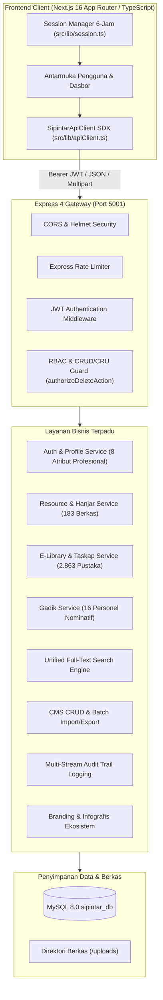

# Panduan Integrasi RESTful API SIPINTAR Sespimma Lemdiklat Polri
**Sistem Informasi Pembelajaran INovatif Terpadu, Adaptif, dan Responsif**  
*Sespimma Sespim Lemdiklat Polri — Proyek Perubahan PKN Tingkat II Angkatan XXIX Nawasena TA 2026*  
**Versi Dokumen:** v2.3.0 (November 2026 - Production Ready)

---

## 1. Ikhtisar Arsitektur & Konvensi Komunikasi

Dokumen ini disusun sebagai **buku panduan integrasi resmi** bagi pengembang antarmuka **Frontend (Next.js 16 App Router / TypeScript)** untuk berkomunikasi dengan **Backend RESTful API** (`sipintarsespimmaAPI`).



---

### A. Informasi Dasar Server
- **Base URL API:** `http://localhost:5001/api/v1`
- **Interactive Swagger UI (Browser):** `http://localhost:5001/docs` atau `http://localhost:5001/api/docs`
- **Spesifikasi OpenAPI 3.0 (JSON):** `http://localhost:5001/openapi.json`
- **Koleksi Postman Resmi:** `collection.json` (v2.2.0, 35 Request Teruji)
- **Format Pertukaran Data:** JSON (`Content-Type: application/json; charset=utf-8`) atau `multipart/form-data` (untuk unggah naskah/buku/foto profil/infografis).
- **Protokol Keamanan:** Helmet HTTP Security Headers, Express Brute-force & Rate Limiting, CORS terisolasi, JWT Bearer Token, dan Audit Trail Logging pada MySQL 8.0 (`activity_logs`, `search_logs`, `verification_logs`).
- **Masa Berlaku Sesi:** 6 Jam (`SESSION_MAX_AGE_MS = 21.600.000 ms`) dengan otomatisasi logout latar belakang secara senyap (*silent background security enforcement*).

---

### B. Header Permintaan Standar (*Request Headers*)
Setiap panggilan ke endpoint terproteksi wajib menyertakan:
```http
Authorization: Bearer <jwt_token_pengguna>
Content-Type: application/json
Accept: application/json
```
> [!IMPORTANT]
> **Catatan Khusus Pengiriman Berkas (`multipart/form-data`):**
> Saat mengirim `FormData` menggunakan `fetch` atau `axios` di browser untuk unggah naskah, foto avatar, atau infografis, **JANGAN** menyetel header `Content-Type` secara manual. Browser akan secara otomatis menetapkan `multipart/form-data; boundary=----WebKitFormBoundary...`.

---

### C. Standarisasi Amplop Respons JSON (*Standardized Response Envelope*)

#### 1. Format Respons Berhasil (HTTP 200 / 201)
```json
{
  "success": true,
  "message": "Deskripsi hasil tindakan berhasil",
  "data": { ... },
  "meta": {
    "page": 1,
    "limit": 10,
    "total": 100,
    "totalPages": 10
  }
}
```
*(Catatan: Field `meta` bersifat opsional dan otomatis disertakan pada endpoint yang memiliki paginasi).*

#### 2. Format Respons Gagal / Validasi (HTTP 400 / 401 / 403 / 404 / 409 / 429 / 500)
```json
{
  "success": false,
  "error": {
    "code": "VALIDATION_ERROR | UNAUTHORIZED | FORBIDDEN | NOT_FOUND | DUPLICATE_ENTRY | RATE_LIMIT_EXCEEDED | INTERNAL_ERROR",
    "message": "Pesan kesalahan dalam bahasa Indonesia yang ramah pengguna",
    "details": [
      { "field": "email", "issue": "Format email kedinasan tidak valid" }
    ]
  }
}
```

---

### D. Akun Pengujian Kedinasan Resmi (*Seed Accounts*)
Semua akun pengujian di bawah ini aktif dengan kata sandi seragam: **`Password123!`**

| No | Peran (*Role*) | NRP / Username | Nama Lengkap & Gelar | Email Kedinasan | Wewenang Utama & Cakupan RBAC |
|---|---|---|---|---|---|
| 1 | **Superadmin CRUD** | `dennyboy` | Denny Chahyo Wiebowo (Superadmin CRUD) | `dennyboy@sespimma.polri.go.id` | **CRUD Penuh** (`can_delete: 1`), Kelola Pengguna, Hapus Data, Ganti Infografis, Ekspor/Impor, Audit Trail |
| 2 | **Admin CRU** | `livi` | Livi (Admin CRU) | `livi@sespimma.polri.go.id` | **CRU Saja** (`can_delete: 0`), Tambah & Edit Data Naskah/Buku, **Dilarang Hapus Data (Delete Blocked 403)**, Mode Peninjau Infografis |
| 3 | **Gadik Madya / Pokja** | `80010001` | AKBP Dewi Susilo Pangestuti, S.Ak. | `dewi.susilo@sespimma.lemdiklat.polri.go.id` | Wewenang Pokja Kurikulum, Akses Naskah Terbatas, Evaluasi Hanjar, Asesor Kompetensi BNSP |
| 4 | **Admin Sistem** | `85071534` | KOMPOL Arya Wicaksana, S.I.K., M.Si. | `arya.wicaksana@sespimma.polri.go.id` | Konfigurasi sistem, manajemen naskah, monitoring aktivitas |
| 5 | **Tim Verifikator** | `78100412` | KBP Bambang Tejo, S.H., M.M. | `bambang.tejo@sespimma.polri.go.id` | Penilaian antrean verifikasi mutu Bag Jarlat (Approve, Revision, Reject) |
| 6 | **Tenaga Pendidik (Gadik)**| `72040311` | AKBP Dr. Hendro Prasetyo, M.Hum. | `hendro.prasetyo@sespimma.polri.go.id` | Unggah naskah draf, kelola materi ajar mandiri |
| 7 | **Pengelola Pustaka** | `198506152010121002` | Dra. Sulastri, M.Lib. | `sulastri.pustaka@sespimma.polri.go.id` | Kelola katalog buku fisik, e-book, dan naskah Taskap |
| 8 | **Peserta Didik (Serdik)** | `89031201` | AKP Hendra Wicaksono, S.T. | `hendra.wicaksono@serdik.sespimma.polri.go.id` | Membaca & streaming naskah publikasi resmi, unduh materi hanjar |
| 9 | **Pimpinan Sespimma** | `68010214` | BRIGJEN POL Raden Mas Daryono | `kasespimma@sespimma.polri.go.id` | Dasbor pemantauan eksekutif & audit oversight naskah draf |

*(Catatan: Tersedia 16 personel Gadik Fungsional dari dokumen resmi NOMINATIF POLRI OKTOBER 2026 yang seluruhnya dapat login menggunakan nomor NRP masing-masing dan kata sandi `Password123!`)*.

---

### E. Matriks Otorisasi Granular: Superadmin CRUD vs Admin CRU

| Aksi / Modul | Endpoint | Superadmin CRUD (`dennyboy`) | Admin CRU (`livi`) |
|---|---|---|---|
| Tambah Naskah / Buku | `POST /admin/resources`, `POST /admin/books` | ✅ Diizinkan (201 Created) | ✅ Diizinkan (201 Created) |
| Baca / Tinjau Data CMS | `GET /admin/*` | ✅ Diizinkan (200 OK) | ✅ Diizinkan (200 OK) |
| Ubah Metadata Naskah/Buku | `PUT /admin/resources/:id`, `PUT /admin/books/:id` | ✅ Diizinkan (200 OK) | ✅ Diizinkan (200 OK) |
| Ubah Status / Arsip | `PATCH /admin/resources/:id/status`, `/archive` | ✅ Diizinkan (200 OK) | ✅ Diizinkan (200 OK) |
| **Hapus Naskah / Buku** | `DELETE /admin/resources/:id`, `DELETE /admin/books/:id` | ✅ **Diizinkan (200 OK)** | ❌ **Ditolak (403 FORBIDDEN)** |
| **Ganti Infografis Manual** | `PUT/POST /admin/settings/infographic` | ✅ **Diizinkan (200 OK)** | ❌ **Ditolak (403 FORBIDDEN)** |
| **Reset Infografis Sistem** | `PUT /admin/settings/infographic` (`action: reset`) | ✅ **Diizinkan (200 OK)** | ❌ **Ditolak (403 FORBIDDEN)** |

---

### F. 4 Klasifikasi Hak Akses Dokumen (*Access Classifications*)
1. `Terbuka`: Naskah dapat dibaca dan diunduh oleh publik/seluruh pengguna yang telah terotentikasi.
2. `Internal`: Terbatas hanya untuk sivitas akademika resmi Sespimma (Serdik aktif, Gadik, dan Staf).
3. `Terbatas`: Dokumen khusus doktrin/intelijen. Hanya dapat diakses oleh Pokja Kurikulum, Gadik pengampu mata ajaran, Verifikator, dan Administrator. (Serdik otomatis menerima HTTP 403 Forbidden).
4. `Metadata Saja`: Hanya judul, sinopsis, penulis, nomor panggil rak, dan metadata yang ditampilkan. **Pengunduhan berkas fisik digital DILARANG KERAS** oleh sistem (berlaku wajib untuk naskah Taskap perorangan siswa dan koleksi buku fisik perpustakaan).

---

### G. 5 Status Siklus Hidup Naskah (*Lifecycle State Machine*)
1. `Draft`: Naskah baru diunggah oleh Gadik/Pokja, belum diverifikasi. Hanya dapat dilihat pemilik, Pokja, dan verifikator.
2. `Diverifikasi`: Naskah telah ditinjau dan sedang menunggu validasi akhir Bag Jarlat.
3. `Dipublikasikan`: Naskah resmi telah disetujui (*Approve*) dan aktif dapat diakses sesuai klasifikasi hak akses.
4. `Tidak Aktif`: Naskah ditolak (*Reject*) atau ditarik sementara dari sirkulasi akademik.
5. `Arsip`: Naskah lawas/kadaluwarsa diarsipkan (*Archive*) untuk preservasi jejak rekam akademik tanpa penghapusan permanen.

---

## 2. Katalog Endpoint Terperinci (14 Modul API)

---

### Modul 1: Sistem & Health Check

#### 1.1 Health Check API & Basis Data
- **Endpoint:** `GET /api/v1/health`
- **Akses:** Publik (Tanpa Token)
- **Deskripsi:** Memeriksa status kesehatan server backend dan ketersediaan koneksi pool basis data MySQL `sipintar_db`.
- **Response Success (HTTP 200 OK):**
```json
{
  "success": true,
  "message": "SIPINTAR API service is healthy and connected to MySQL",
  "data": {
    "status": "healthy",
    "database": "connected",
    "databaseName": "sipintar_db",
    "dbTimestamp": "2026-11-21T06:09:12.000Z",
    "serverTimestamp": "2026-11-21T06:09:12.644Z",
    "uptime": 512,
    "environment": "development"
  }
}
```

---

### Modul 2: Autentikasi, Akun & Profil Personel

#### 2.1 Masuk Akun (*Login*)
- **Endpoint:** `POST /api/v1/auth/login`
- **Akses:** Publik
- **Headers:** `Content-Type: application/json`
- **Request Body:**
```json
{
  "identifier": "dennyboy",
  "password": "Password123!"
}
```
*(Catatan: Field `identifier` dapat berupa nomor **NRP / NIP** maupun alamat **Email** kedinasan).*

- **Response Success (HTTP 200 OK):**
```json
{
  "success": true,
  "message": "Autentikasi berhasil",
  "data": {
    "user": {
      "id": 90,
      "uuid": "usr-superadmin-dennyboy",
      "nrp_nip": "dennyboy",
      "nama_lengkap": "Denny Chahyo Wiebowo (Superadmin CRUD)",
      "email": "dennyboy@sespimma.polri.go.id",
      "pangkat": "Penata Tk. I (PNS)",
      "pangkat_golongan": "KOMPOL / IV-A",
      "jabatan": "Super Administrator CRUD & Analis Sistem SIPINTAR",
      "pendidikan_umum_terakhir": "S2 Magister Teknologi Informasi (M.TI)",
      "pendidikan_kedinasan": "Sespimma Lemdiklat Polri, Akpol 2008, Dikjur Cyber Crime",
      "sertifikasi": "Certified Information Systems Security Professional (CISSP), Asesor BNSP",
      "kompetensi_utama": "Arsitektur Sistem Informasi Kepolisian, Keamanan Siber & Basis Data",
      "kompetensi": "Manajemen Infrastruktur IT, Analisis Kebutuhan Sistem, Integrasi REST API",
      "kompetensi_pendukung": "Audit IT Forensik, Manajemen Proyek Perangkat Lunak, Data Science",
      "role": "admin",
      "role_name": "Superadmin CRUD",
      "can_delete": true,
      "permission_scope": "CRUD",
      "phone_number": "081973001974",
      "avatar_url": null,
      "last_login_at": "2026-11-21T05:50:08.760Z"
    },
    "token": "eyJhbGciOiJIUzI1NiIsInR5cCI6IkpXVCJ9...",
    "token_type": "Bearer",
    "expires_in": "24h"
  }
}
```

- **Response Error (HTTP 401 Unauthorized):**
```json
{
  "success": false,
  "error": {
    "code": "UNAUTHORIZED",
    "message": "Kredensial tidak valid: NRP/NIP/Email atau kata sandi salah",
    "details": []
  }
}
```

#### 2.2 Profil Pengguna yang Sedang Masuk (*Get Current User*)
- **Endpoint:** `GET /api/v1/auth/me`
- **Akses:** Terproteksi (Semua Pengguna Terotentikasi)
- **Headers:** `Authorization: Bearer <token>`
- **Response Success (HTTP 200 OK):** Mengembalikan objek profil pengguna yang lengkap dengan 8 kolom rekam jejak profesional kedinasan.

#### 2.3 Pembaruan Profil Personel & Foto Avatar (*Update Profile*)
- **Endpoint:** `PUT /api/v1/auth/profile`
- **Akses:** Terproteksi (Pengguna Memperbarui Profil Mandiri)
- **Headers:** `Authorization: Bearer <token>`, `Content-Type: application/json`
- **Request Body:**
```json
{
  "nama_lengkap": "AKBP Dewi Susilo Pangestuti, S.Ak.",
  "pangkat": "Ajun Komisaris Besar Polisi",
  "pangkat_golongan": "AKBP / IV-B",
  "jabatan": "Gadik Madya Sespimma Lemdiklat Polri",
  "pendidikan_umum_terakhir": "S1 Akuntansi (S.Ak)",
  "pendidikan_kedinasan": "PKN Tingkat II Angkatan XXIX Nawasena TA 2026, Sespimma Lemdiklat Polri",
  "sertifikasi": "Sertifikasi Asesor Kompetensi BNSP, Pendidik Vokasi Kepolisian",
  "kompetensi_utama": "Manajemen Keuangan Negara & Polri, Tata Kelola Akuntansi Pemerintahan Presisi",
  "kompetensi": "Pemeriksaan Keuangan Internal, Penganggaran Berbasis Kinerja, Evaluasi Hanjar",
  "kompetensi_pendukung": "Analisis Laporan Keuangan, Kepemimpinan Strategis Sespimma, Regulasi Keuangan Negara",
  "phone_number": "081234567890",
  "avatar_url": "data:image/jpeg;base64,/9j/4AAQSkZJRg..."
}
```
*(Catatan: Field `avatar_url` mendukung URL gambar statis atau string Base64 Data URL berukuran wajar).*

- **Response Success (HTTP 200 OK):**
```json
{
  "success": true,
  "message": "Profil berhasil diperbarui",
  "data": {
    "id": 1,
    "nrp_nip": "80010001",
    "nama_lengkap": "AKBP Dewi Susilo Pangestuti, S.Ak.",
    "pangkat": "Ajun Komisaris Besar Polisi",
    "pangkat_golongan": "AKBP / IV-B",
    "jabatan": "Gadik Madya Sespimma Lemdiklat Polri",
    "pendidikan_umum_terakhir": "S1 Akuntansi (S.Ak)",
    "pendidikan_kedinasan": "PKN Tingkat II Angkatan XXIX Nawasena TA 2026, Sespimma Lemdiklat Polri",
    "sertifikasi": "Sertifikasi Asesor Kompetensi BNSP, Pendidik Vokasi Kepolisian",
    "kompetensi_utama": "Manajemen Keuangan Negara & Polri, Tata Kelola Akuntansi Pemerintahan Presisi",
    "kompetensi": "Pemeriksaan Keuangan Internal, Penganggaran Berbasis Kinerja, Evaluasi Hanjar",
    "kompetensi_pendukung": "Analisis Laporan Keuangan, Kepemimpinan Strategis Sespimma, Regulasi Keuangan Negara",
    "phone_number": "081234567890",
    "avatar_url": "data:image/jpeg;base64,/9j/4AAQSkZJRg..."
  }
}
```

#### 2.4 Ganti Kata Sandi Mandiri (*Change Password*)
- **Endpoint:** `POST /api/v1/auth/change-password`
- **Akses:** Terproteksi (Pengguna Terotentikasi)
- **Headers:** `Authorization: Bearer <token>`, `Content-Type: application/json`
- **Request Body:**
```json
{
  "current_password": "Password123!",
  "new_password": "PasswordBaru2026!"
}
```
- **Response Success (HTTP 200 OK):**
```json
{
  "success": true,
  "message": "Kata sandi berhasil diubah. Silakan gunakan kata sandi baru pada sesi login berikutnya."
}
```
- **Response Error (HTTP 400 Bad Request):**
```json
{
  "success": false,
  "error": {
    "code": "INVALID_PASSWORD",
    "message": "Kata sandi saat ini tidak sesuai."
  }
}
```

#### 2.5 Pendaftaran Mandiri Anggota Baru (*Register*)
- **Endpoint:** `POST /api/v1/auth/register`
- **Akses:** Publik (Serdik Baru)
- **Request Body:**
```json
{
  "nrp_nip": "89050612",
  "nama_lengkap": "AKP Bambang Triatmojo, S.H.",
  "email": "bambang.tri@serdik.sespimma.polri.go.id",
  "password": "Password123!",
  "role_id": 1,
  "phone_number": "081234567890"
}
```
- **Response Success (HTTP 201 Created):**
```json
{
  "success": true,
  "message": "Pendaftaran akun berhasil diproses",
  "data": {
    "user_id": 95,
    "nrp_nip": "89050612",
    "nama_lengkap": "AKP Bambang Triatmojo, S.H.",
    "role": "serdik",
    "is_active": 1
  }
}
```

---

### Modul 3: Taksonomi Kategori & Subkategori

#### 3.1 Daftar Seluruh Kategori Taksonomi
- **Endpoint:** `GET /api/v1/categories`
- **Akses:** Publik
- **Response Success (HTTP 200 OK):**
```json
{
  "success": true,
  "message": "Daftar kategori berhasil dimuat",
  "data": [
    { "id": 1, "name": "Gadik & Kompetensi", "slug": "gadik-kompetensi", "description": "Profil tenaga pendidik dan sebaran keahlian instruktur", "icon": "GraduationCap", "display_order": 1, "total_resources": 16 },
    { "id": 2, "name": "Modul & Hanjar", "slug": "modul-hanjar", "description": "Bahan ajar kurikulum 720 JP, handout, dan materi paparan", "icon": "BookOpen", "display_order": 2, "total_resources": 77 },
    { "id": 3, "name": "E-Library/Perpustakaan", "slug": "e-library", "description": "Buku fisik, e-book, jurnal kedinasan, dan karya ilmiah Taskap", "icon": "Library", "display_order": 3, "total_resources": 2863 },
    { "id": 4, "name": "Kurikulum & Standar Layanan", "slug": "kurikulum-standar", "description": "Standar kompetensi kelulusan dan perangkat mata pelajaran", "icon": "Award", "display_order": 4, "total_resources": 12 },
    { "id": 5, "name": "SOP", "slug": "sop", "description": "Standar Operasional Prosedur pengajaran dan ujian", "icon": "CheckSquare", "display_order": 5, "total_resources": 7 },
    { "id": 6, "name": "Pedoman", "slug": "pedoman", "description": "Pedoman akademik, petunjuk administrasi, dan etika profesi", "icon": "FileText", "display_order": 6, "total_resources": 8 },
    { "id": 7, "name": "Manual Book", "slug": "manual-book", "description": "Panduan tata kelola dan operasional sistem SIPINTAR", "icon": "HelpCircle", "display_order": 7, "total_resources": 5 },
    { "id": 8, "name": "Pencarian Terpadu", "slug": "pencarian-terpadu", "description": "Indeks katalog seluruh sumber belajar lintas kategori", "icon": "Search", "display_order": 8, "total_resources": 3051 }
  ]
}
```

#### 3.2 Subkategori Berdasarkan Kategori
- **Endpoint:** `GET /api/v1/categories/:idOrSlug/subcategories`
- **Akses:** Publik

---

### Modul 4: Katalog Sumber Belajar & Naskah Digital (Resources)

#### 4.1 Daftar Katalog Sumber Belajar
- **Endpoint:** `GET /api/v1/resources`
- **Akses:** Terproteksi (Sesuai Role Pengguna)
- **Query Parameters:**
  - `category` (opsional): Slug atau ID kategori (e.g. `modul-hanjar` atau `2`)
  - `status` (opsional): `Dipublikasikan` (default), `Draft`, `Arsip`, atau `all`
  - `access` (opsional): `Terbuka`, `Internal`, `Terbatas`, `Metadata Saja`
  - `search` (opsional): Kata kunci judul atau penulis
  - `tag` (opsional): Tag taksonomi (e.g. `Pangan`, `Manajemen`)
  - `page` (default: 1), `limit` (default: 12)
- **Response Success (HTTP 200 OK):**
```json
{
  "success": true,
  "message": "Katalog sumber belajar berhasil dimuat",
  "data": [
    {
      "id": 1,
      "uuid": "res-uuid-hanjar-001",
      "title": "1. HANJAR SESPIMMA 2025 PERAN POLRI DALAM OPTIMALISASI SEKTOR PANGAN.pdf",
      "category_id": 2,
      "category_name": "Modul & Hanjar",
      "sub_category_name": "Manajemen Fungsi Operasional",
      "author_or_instructor": "Kombes Pol Dr. Asep Suryana, S.I.K.",
      "unit_or_source": "Pokja Hanjar Bag Jarlat Sespimma",
      "access_classification": "Internal",
      "lifecycle_status": "Dipublikasikan",
      "file_path": "/uploads/1. HANJAR SESPIMMA 2025 PERAN POLRI DALAM OPTIMALISASI SEKTOR PANGAN.pdf",
      "file_size": 2411724,
      "file_type": "pdf",
      "has_digital_file": 1,
      "views_count": 142,
      "downloads_count": 38,
      "created_at": "2026-11-17T15:32:00.000Z",
      "tags": ["Pangan", "Ketahanan Nasional", "Binmas"]
    }
  ],
  "meta": { "page": 1, "limit": 12, "total": 77, "totalPages": 7 }
}
```

#### 4.2 Detail Sumber Belajar
- **Endpoint:** `GET /api/v1/resources/:idOrUuid`
- **Akses:** Terproteksi

#### 4.3 Streaming Berkas Digital In-App Reader
- **Endpoint:** `GET /api/v1/resources/:id/file`
- **Akses:** Terproteksi (Token via Header `Authorization` atau Query `?token=<jwt_token>`)
- **Query Parameter:**
  - `download` (opsional): `true` untuk memicu unduhan fisik attachment (`Content-Disposition: attachment; filename=...`), default `false` untuk streaming inline (`Content-Disposition: inline`).
- **Penjagaan Keamanan Ketat (*Security Guards*):**
  - Jika dokumen berklasifikasi **`Metadata Saja`**: Server secara ketat menolak dengan **HTTP 403 FORBIDDEN** (`DOKUMEN_METADATA_SAJA: Dokumen berklasifikasi 'Metadata Saja' tidak memiliki berkas digital yang dapat diunduh`).
  - Jika dokumen berklasifikasi **`Terbatas`** dan diakses oleh **Serdik**: Server menolak dengan **HTTP 403 FORBIDDEN** (`AKSES_TERBATAS: Dokumen ini memerlukan otorisasi khusus Pokja/Pimpinan`).

#### 4.4 Rekomendasi Naskah Terkait
- **Endpoint:** `GET /api/v1/resources/:id/related?limit=4`
- **Akses:** Terproteksi

---

### Modul 5: Direktori Tenaga Pendidik & Gadik Fungsional

#### 5.1 Direktori Personel Tenaga Pendidik
- **Endpoint:** `GET /api/v1/gadik`
- **Akses:** Publik / Terotentikasi
- **Response Success (HTTP 200 OK):** Mengembalikan daftar seluruh 16 personel Gadik Fungsional nominatif resmi Sespimma lengkap dengan pangkat, jabatan, NRP, bidang kepakaran, dan daftar kompetensi.

#### 5.2 Rincian Profil & Naskah Binaan Gadik
- **Endpoint:** `GET /api/v1/gadik/:idOrNrp`
- **Akses:** Publik / Terotentikasi

---

### Modul 6: E-Library & Katalog Perpustakaan (Buku Fisik, E-Book, Taskap, Jurnal)

#### 6.1 Kategori Perpustakaan
- **Endpoint:** `GET /api/v1/library/categories`
- **Akses:** Publik
- **Data Kategori:** `1: Buku Fisik Koleksi Perpustakaan`, `2: E-Book Digital Kedinasan`, `3: Naskah Taskap Siswa Sespimma`, `4: Jurnal & Terbitan Berkala Ilmiah`.

#### 6.2 Katalog Koleksi Perpustakaan & Taskap
- **Endpoint:** `GET /api/v1/library/books`
- **Akses:** Terproteksi
- **Query Parameters:**
  - `category_id` (opsional): `1`, `2`, `3`, `4`, atau `all`
  - `category` (opsional): `buku-fisik`, `ebook`, `taskap`, `jurnal`
  - `search` (opsional): Kata kunci judul, penulis, nomor panggil rak, angkatan siswa
  - `page` (default 1), `limit` (default 20)
- **Sanitasi Khusus Naskah 'Metadata Saja':**
  Seluruh koleksi Buku Fisik dan Taskap Siswa disanitasi: atribut `file_path`, `preview_file_path`, dan `file_url` dihapus dari respons JSON serta `has_digital_file` disetel `0` untuk menjamin kepatuhan zero-leakage.

#### 6.3 Detail Koleksi Buku / Naskah Taskap
- **Endpoint:** `GET /api/v1/library/books/:id`
- **Akses:** Terproteksi

---

### Modul 7: Pencarian Terpadu Ekosistem (Unified Search Engine)

#### 7.1 Pencarian Multi-Entitas Lintas Sistem
- **Endpoint:** `GET /api/v1/search`
- **Akses:** Terproteksi
- **Query Parameters:**
  - `q` (wajib): Kata kunci pencarian (e.g. `Kepemimpinan`, `Hukum`, `Pangan`, `Polri`)
  - `category` (opsional): Slug kategori atau `all`
  - `page` (default 1), `limit` (default 20)
- **Response Success (HTTP 200 OK):**
```json
{
  "success": true,
  "message": "Pencarian terpadu selesai",
  "data": [
    {
      "id": 1,
      "type": "resource",
      "title": "1. HANJAR SESPIMMA 2025 PERAN POLRI DALAM OPTIMALISASI SEKTOR PANGAN.pdf",
      "category": "Modul & Hanjar",
      "author": "Kombes Pol Dr. Asep Suryana, S.I.K.",
      "access_classification": "Internal",
      "relevance_score": 100
    }
  ],
  "meta": { "total": 1, "page": 1, "limit": 20 }
}
```

---

### Modul 8: Tata Kelola Naskah Admin & Gadik (CMS Dokumen)

#### 8.1 Pembuatan Naskah Baru / Draf
- **Endpoint:** `POST /api/v1/admin/resources`
- **Akses:** Admin, Verifikator, Gadik
- **Payload:** `multipart/form-data`
  - `title` (string, wajib)
  - `category_id` (number, wajib)
  - `sub_category_text` (string)
  - `author_or_instructor` (string)
  - `unit_or_source` (string)
  - `access_classification` (`Terbuka` | `Internal` | `Terbatas` | `Metadata Saja`)
  - `file` (berkas biner, opsional: PDF, DOCX, PPTX)

#### 8.2 Pembaruan Metadata & Berkas Pengganti
- **Endpoint:** `PUT /api/v1/admin/resources/:id`
- **Akses:** Admin, Gadik Pemilik

#### 8.3 Pembaruan Status Siklus Naskah Langsung
- **Endpoint:** `PATCH /api/v1/admin/resources/:id/status`
- **Akses:** Admin, Verifikator
- **Request Body:** `{ "status": "Dipublikasikan" }`

#### 8.4 Pengarsipan Naskah (*Soft Delete*)
- **Endpoint:** `PATCH /api/v1/admin/resources/:id/archive`
- **Akses:** Admin, Verifikator

#### 8.5 Penghapusan Naskah Permanen (*Hard Delete - CRUD Only*)
- **Endpoint:** `DELETE /api/v1/admin/resources/:id`
- **Akses:** **Hanya Superadmin CRUD (`dennyboy`)**
- **Penjagaan RBAC:** Akun Admin CRU (`livi`) ditolak dengan **HTTP 403 FORBIDDEN**.

---

### Modul 9: Tata Kelola Koleksi Perpustakaan (CMS Buku & Taskap)

#### 9.1 Tambah Koleksi Buku / Naskah Taskap Baru
- **Endpoint:** `POST /api/v1/admin/books`
- **Akses:** Admin, Pengelola Pustaka
- **Payload:** `multipart/form-data` atau `application/json`

#### 9.2 Pembaruan Metadata Buku & Berkas Digital
- **Endpoint:** `PUT /api/v1/admin/books/:id`
- **Akses:** Admin, Pengelola Pustaka

#### 9.3 Penghapusan Koleksi Pustaka (*CRUD Only*)
- **Endpoint:** `DELETE /api/v1/admin/books/:id`
- **Akses:** **Hanya Superadmin CRUD (`dennyboy`)**
- **Penjagaan RBAC:** Akun Admin CRU (`livi`) ditolak dengan **HTTP 403 FORBIDDEN**.

---

### Modul 10: Antrean Verifikasi Mutu Pembelajaran (Bag Jarlat & Pokja)

#### 10.1 Antrean Verifikasi Penelaahan Naskah
- **Endpoint:** `GET /api/v1/admin/verification/queue`
- **Akses:** Admin, Verifikator

#### 10.2 Keputusan Penilaian Mutu / Review
- **Endpoint:** `POST /api/v1/admin/verification/:id/review`
- **Akses:** Admin, Verifikator
- **Request Body:**
```json
{
  "decision": "approve",
  "notes": "Naskah telah memenuhi kaidah kurikulum dan siap diterbitkan ke peserta didik"
}
```
*(Nilai `decision`: `approve`, `revision`, `reject`).*

---

### Modul 11: Manajemen Pengguna & Hak Akses (User CMS)

#### 11.1 Daftar Akun Pengguna Terdaftar
- **Endpoint:** `GET /api/v1/admin/users`
- **Akses:** Admin

#### 11.2 Pendaftaran Pengguna Baru oleh Admin
- **Endpoint:** `POST /api/v1/admin/users`
- **Akses:** Admin

#### 11.3 Pembaruan Peran (*Role*) Pengguna
- **Endpoint:** `PATCH /api/v1/admin/users/:id/role`
- **Akses:** Admin
- **Request Body:** `{ "role_id": 2 }`

#### 11.4 Pembaruan Status Keaktifan Akun
- **Endpoint:** `PATCH /api/v1/admin/users/:id/status`
- **Akses:** Admin
- **Request Body:** `{ "is_active": 1 }`

---

### Modul 12: Ekspor Data & Impor Massal (Excel / CSV / JSON)

#### 12.1 Ekspor Data Entitas Sistem
- **Endpoint:** `GET /api/v1/admin/export/:entity`
- **Akses:** Admin, Pengelola
- **Parameter `:entity`:** `resources`, `books`, `users`

#### 12.2 Impor Massal Data Multi-Baris
- **Endpoint:** `POST /api/v1/admin/import/:entity`
- **Akses:** Admin, Pengelola
- **Request Body:** `{ "items": [ { ... }, { ... } ] }`

---

### Modul 13: Dasbor Pemantauan & Jejak Audit (Monitoring & Audit Logs)

#### 13.1 Metrik Agregasi & Statistik Sistem
- **Endpoint:** `GET /api/v1/admin/monitoring/stats`
- **Akses:** Admin, Pimpinan

#### 13.2 Jejak Audit Aktivitas, Pencarian & Verifikasi
- **Endpoint:** `GET /api/v1/admin/monitoring/logs`
- **Akses:** Admin, Pimpinan
- **Query Parameter:** `type=activity` | `type=search` | `type=verification`

---

### Modul 14: Pengaturan Branding Sistem & Infografis Arsitektur Ekosistem

#### 14.1 Informasi Infografis Arsitektur Aktif (*Publik*)
- **Endpoint:** `GET /api/v1/settings/infographic`
- **Akses:** Publik (Tanpa Token)
- **Deskripsi:** Mengambil gambar dan metadata infografis arsitektur ekosistem aktif untuk ditampilkan pada halaman muka/login SIPINTAR (`/`).
- **Response Success (HTTP 200 OK):**
```json
{
  "success": true,
  "message": "Pengaturan infografis arsitektur sistem berhasil diambil",
  "data": {
    "image_url": "/infografis-sipintar.jpg",
    "image_full_url": "/infografis-sipintar.png",
    "title": "INFOGRAFIS ARSITEKTUR SUMBER BELAJAR TERPADU",
    "caption": "Visualisasi komprehensif arsitektur ekosistem sumber belajar terpadu Sespimma Lemdiklat Polri: Gadik & Kompetensi, Modul & Hanjar 720 JP, Perpustakaan, Kurikulum, dan SOP Layanan Presisi.",
    "updated_at": "2026-11-21T06:08:13.000Z",
    "updated_by_name": "Denny Chahyo Wiebowo (Superadmin CRUD)"
  }
}
```

#### 14.2 Pembaruan Metadata atau Reset Infografis (*Admin CRUD Only*)
- **Endpoint:** `PUT /api/v1/admin/settings/infographic`
- **Akses:** **Hanya Superadmin CRUD (`dennyboy`)**
- **Headers:** `Authorization: Bearer <crud_token>`, `Content-Type: application/json`
- **Request Body (Update Metadata / URL):**
```json
{
  "title": "INFOGRAFIS ARSITEKTUR SUMBER BELAJAR TERPADU",
  "caption": "Keterangan infografis hasil pemutakhiran manual admin CRUD.",
  "image_url": "/uploads/infografis_custom.jpg"
}
```
- **Request Body (Reset ke Bawaan Resmi Sespimma):**
```json
{
  "action": "reset"
}
```
- **Response Success (HTTP 200 OK):**
```json
{
  "success": true,
  "message": "Gambar dan konfigurasi infografis arsitektur sistem berhasil diperbarui",
  "data": {
    "image_url": "/infografis-sipintar.jpg",
    "image_full_url": "/infografis-sipintar.png",
    "title": "INFOGRAFIS ARSITEKTUR SUMBER BELAJAR TERPADU",
    "caption": "Visualisasi komprehensif arsitektur ekosistem sumber belajar terpadu Sespimma Lemdiklat Polri: Gadik & Kompetensi, Modul & Hanjar 720 JP, Perpustakaan, Kurikulum, dan SOP Layanan Presisi.",
    "updated_at": "2026-11-21T06:08:13.000Z",
    "updated_by_name": "Denny Chahyo Wiebowo (Superadmin CRUD)"
  }
}
```
- **Response Rejection (HTTP 403 Forbidden - Saat Dipanggil oleh Admin CRU `livi`):**
```json
{
  "success": false,
  "error": {
    "code": "FORBIDDEN",
    "message": "Akses ditolak: Akun Anda memiliki wewenang Admin CRU (Create, Read, Update). Tindakan Delete (Hapus) hanya dapat dilakukan oleh Superadmin CRUD (dennyboy).",
    "details": [
      "Izin akun: CRU Saja (Dilarang Hapus Data)"
    ]
  }
}
```

#### 14.3 Unggah Berkas Gambar Infografis Baru (*Multipart / Admin CRUD Only*)
- **Endpoint:** `POST /api/v1/admin/settings/infographic`
- **Akses:** **Hanya Superadmin CRUD (`dennyboy`)**
- **Headers:** `Authorization: Bearer <crud_token>`
- **Payload:** `multipart/form-data`
  - `image` atau `file`: Berkas biner gambar (JPG, JPEG, PNG, WEBP, SVG maksimal 20 MB).
  - `title`: String judul header infografis (opsional).
  - `caption`: String deskripsi/caption infografis (opsional).
- **Response Success (HTTP 200 OK):**
```json
{
  "success": true,
  "message": "Gambar dan konfigurasi infografis arsitektur sistem berhasil diperbarui",
  "data": {
    "image_url": "/uploads/infografis_1795241282167_e135e16d.webp",
    "image_full_url": "/uploads/infografis_1795241282167_e135e16d.webp",
    "title": "INFOGRAFIS ARSITEKTUR SUMBER BELAJAR TERPADU",
    "caption": "Arsitektur ekosistem terpadu Sespimma Lemdiklat Polri versi pembaruan manual Superadmin CRUD",
    "updated_at": "2026-11-21T06:08:02.000Z",
    "updated_by_name": "Denny Chahyo Wiebowo (Superadmin CRUD)"
  }
}
```

---

## 3. Contoh Integrasi Frontend (TypeScript SDK & Next.js)

Berikut adalah implementasi SDK `SipintarApiClient` pada `src/lib/apiClient.ts` untuk mempermudah pemanggilan dari komponen UI Next.js:

```typescript
import { API_BASE_URL, ApiResponse } from '@/lib/apiClient';

// 1. Contoh Pembaruan Profil Personel (8 Atribut)
export async function updatePersonnelCareerProfile(data: {
  nama_lengkap: string;
  pangkat_golongan: string;
  jabatan: string;
  pendidikan_umum_terakhir: string;
  pendidikan_kedinasan: string;
  sertifikasi: string;
  kompetensi_utama: string;
  kompetensi: string;
  kompetensi_pendukung: string;
  phone_number?: string;
  avatar_url?: string;
}) {
  const token = localStorage.getItem('sipintar_auth_token');
  const response = await fetch(`${API_BASE_URL}/auth/profile`, {
    method: 'PUT',
    headers: {
      'Content-Type': 'application/json',
      Authorization: `Bearer ${token}`,
    },
    body: JSON.stringify(data),
  });

  const result: ApiResponse = await response.json();
  if (!response.ok || !result.success) {
    throw new Error(result.error?.message || 'Gagal memperbarui profil personel');
  }
  return result.data;
}

// 2. Contoh Penggantian Manual Gambar Infografis pada CMS (Admin CRUD)
export async function uploadNewInfographicImage(file: File, title?: string, caption?: string) {
  const token = localStorage.getItem('sipintar_auth_token');
  const formData = new FormData();
  formData.append('image', file);
  if (title) formData.append('title', title);
  if (caption) formData.append('caption', caption);

  const response = await fetch(`${API_BASE_URL}/admin/settings/infographic`, {
    method: 'POST',
    headers: {
      Authorization: `Bearer ${token}`,
      // Jangan set Content-Type manual untuk FormData
    },
    body: formData,
  });

  const result: ApiResponse = await response.json();
  if (!response.ok || !result.success) {
    throw new Error(result.error?.message || 'Gagal mengunggah infografis baru');
  }
  return result.data;
}
```

---

## 4. Ringkasan Kelulusan Suite Uji Integrasi (35 Skenario Uji)

Seluruh endpoint pada dokumentasi ini telah diverifikasi melalui pengujian integrasi otomatis end-to-end (`test/api.test.js`) dengan hasil kelulusan **100% (35/35 Passed — Zero Defect)**:

```text
============================================================
  SIPINTAR Sespimma REST API — Integration Test Runner
  Target URL: http://localhost:5001/api/v1
============================================================

  ✔ PASS: 1. System Health Check (/health)
  ✔ PASS: 2. Admin Login with Email & Password (/auth/login)
  ✔ PASS: 3. Serdik Login with NRP (/auth/login)
  ✔ PASS: 4. Rejection of Invalid Password (401 UNAUTHORIZED)
  ✔ PASS: 5. Get Authenticated User Profile (/auth/me)
  ✔ PASS: 6. RBAC Role Verification (Admin 200 vs Serdik 403)
  ✔ PASS: 7. Category & Subcategory Taxonomy (/categories)
  ✔ PASS: 8. Resources Catalog & Pagination (/resources)
  ✔ PASS: 9. Resource Detail & Attached Tags (/resources/:id)
  ✔ PASS: 10. Gadik Fungsional List & Competencies (/gadik)
  ✔ PASS: 11. Library Categories & Physical Book Catalogue (/library/books)
  ✔ PASS: 12. Full-Text Unified Search with Relevance Score (/search)
  ✔ PASS: 13. Security Guard on "Metadata Saja" Documents (Strict 403 FORBIDDEN)
  ✔ PASS: 14. Document File Streaming & Auth Gate (/resources/:id/file)
  ✔ PASS: 15. Verification Queue for Jarlat (/admin/verification/queue)
  ✔ PASS: 16. Monitoring Dashboard Aggregated Metrics (/admin/monitoring/stats)
  ✔ PASS: 17. User Account Management & Role Filtering (/admin/users)
  ✔ PASS: 18. Multi-Stream Audit Logs Trail: Activity, Search & Verification (/admin/monitoring/logs)
  ✔ PASS: 19. Dynamic Taxonomy Tag Filtering on Resources (/resources?tag=...)
  ✔ PASS: 20. Self-Registration of New Serdik Account (/auth/register)
  ✔ PASS: 21. Related Resources Recommendation Algorithm (/resources/:id/related)
  ✔ PASS: 22. Pimpinan Executive Oversight RBAC (Full Draft Audit Access)
  ✔ PASS: 23. Detail Koleksi Buku & Eksemplar Perpustakaan (/library/books/:id)
  ✔ PASS: 24. Siklus Tata Kelola Lengkap: Buat Draf, Ubah Metadata, Verifikasi & Arsip (/admin/resources)
  ✔ PASS: 25. Perlindungan Sampel & Sanitasi Berkas "Metadata Saja" (Strict 403 & No Leaked Paths)
  ✔ PASS: 26. User Status Management & Self-Deactivation Guard (/admin/users/:id/status)
  ✔ PASS: 27. User Role Updating & RBAC Assignment (/admin/users/:id/role)
  ✔ PASS: 28. Interactive Swagger UI & OpenAPI 3.0 Documentation Specification (/docs & /openapi.json)
  ✔ PASS: 29. Flexible Category Slug Filtering & Comprehensive Lifecycle Status Handling (/resources?category=...&status=all)
  ✔ PASS: 30. Detail Profil Tenaga Pendidik & Materi Ajar Binaan (/gadik/:id)
  ✔ PASS: 31. Security Gate on "Terbatas" Classified Documents (Serdik 403 vs Admin 200)
  ✔ PASS: 32. Global 404 Route Handler & Malformed JSON Body Parsing Resilience (404 NOT_FOUND & 400 VALIDATION_ERROR)
  ✔ PASS: 33. Granular RBAC: Superadmin CRUD (dennyboy) vs Admin CRU (livi) with Strict Delete Enforcement
  ✔ PASS: 34. User Profile Details & Self-Password Security (/auth/profile & /auth/change-password)
  ✔ PASS: 35. Infographic Settings Management & RBAC Guard (/settings/infographic & /admin/settings/infographic)

------------------------------------------------------------
  Test Summary: 35 Passed, 0 Failed out of 35 Tests
------------------------------------------------------------
```
