# SIPINTAR — Dokumen Aturan Bisnis & Matriks Peran (Business Rules & Role Matrix)

**Status:** Dokumen Spesifikasi Resmi  
**Versi:** 1.0  
**Tanggal:** 16 November 2026  
**Institusi:** Sespimma Sespim Lemdiklat Polri  
**Basis Sumber:** *Buku Panduan Tata Kelola SIPINTAR* (2026), *Manual Book SIPINTAR* (2026), dan Implementasi Kode Prototipe SIPINTAR  
**Tautan Dokumen Terkait:** [prd.md](file:///Users/masboy/Desktop/PROPER%20AKBP%20DEWI/SIPINTAR/docs/prd.md) | [userflow.md](file:///Users/masboy/Desktop/PROPER%20AKBP%20DEWI/SIPINTAR/docs/userflow.md) | [APIspecs.md](file:///Users/masboy/Desktop/PROPER%20AKBP%20DEWI/SIPINTAR/docs/APIspecs.md) | [database spec.md](file:///Users/masboy/Desktop/PROPER%20AKBP%20DEWI/SIPINTAR/docs/database%20spec.md)

---

## 1. Pendahuluan & Konteks Ekosistem

SIPINTAR (**Sistem Informasi Pembelajaran INovatif Terpadu, Adaptif, dan Responsif**) adalah ekosistem manajemen pengetahuan dan tata kelola sumber belajar digital di lingkungan Sekolah Staf dan Pimpinan Pertama (Sespimma) Sespim Lemdiklat Polri.

Dokumen ini mendefinisikan secara operasional seluruh **aturan bisnis (business rules)**, **taksonomi data**, **siklus hidup berkas (lifecycle)**, **klasifikasi hak akses**, serta **matriks kewenangan peran (Role-Based Access Control / RBAC)** yang menjadi landasan tata kelola informasi dalam kode program dan persiapan arsitektur backend.

---

## 2. Definisi Peran Pengguna (User Roles & Personas)

Sistem SIPINTAR mengenal 6 tingkatan peran hierarki yang mencerminkan struktur operasional dan tata pamong di Sespimma Lemdiklat Polri:

```
┌──────────────────────────────────────────────────────────────┐
│             Pimpinan / Penanggung Jawab Sespimma             │ (Monitoring & Kebijakan)
└──────────────────────────────┬───────────────────────────────┘
                               │
┌──────────────────────────────┴───────────────────────────────┐
│                     Administrator Sistem                     │ (Hak Akses, Konfigurasi, Audit)
└──────────────┬───────────────────────────────┬───────────────┘
               │                               │
┌──────────────┴───────────────┐ ┌─────────────┴───────────────┐
│     Verifikator / Pokja      │ │  Pengelola Data & Pustaka   │ (Kurasi & Sirkulasi)
└──────────────┬───────────────┘ └─────────────┬───────────────┘
               │                               │
┌──────────────┴───────────────┐ ┌─────────────┴───────────────┐
│  Gadik / Tenaga Pendidik     │ │   Serdik (Peserta Didik)    │ (Konsumsi & Kolaborasi)
└──────────────────────────────┘ └─────────────────────────────┘
```

### 2.1. Serdik (Peserta Didik Sespimma)
* **Karakteristik:** Perwira Pertama Polri (Pama) berpangkat AKP/Kompol yang sedang menempuh pendidikan kepemimpinan staf dan pimpinan tingkat pertama di Sespimma.
* **Atribut Identitas:** Nama Lengkap, Pangkat, NRP, Nomor Siswa (Nosis), Angkatan/Sindikat (misal: Sespimma Angkatan 73 TA 2026), Satuan Asal.
* **Kewenangan & Hak:**
  - Menelusuri seluruh sumber belajar berkategori **Terbuka** dan **Internal**.
  - Mengunduh Bahan Ajar (Hanjar), Modul Pelatihan, Lembar Kerja, dan Silabus Kurikulum.
  - Membaca pratinjau E-Book (10–20 halaman pertama) dan melakukan peminjaman buku fisik atau reservasi akses e-book penuh.
  - Meneliti referensi Kertas Karya Perorangan (Taskap) alumni sebelumnya (terbatas pada metadata dan ringkasan eksekutif di perpustakaan).
  - Mengunggah draf Taskap mandiri untuk kepentingan evaluasi akademik.
* **Batasan:**
  - Tidak memiliki akses ke dokumen berklasifikasi **Terbatas**.
  - Tidak berwenang melakukan modifikasi atau penghapusan data umum.
  - Tidak dapat mengunduh naskah digital berstatus **Metadata Saja**.

### 2.2. Gadik / Tenaga Pendidik
* **Karakteristik:** Pejabat fungsional Polri (Kombes Pol, AKBP, Kompol, Iptu), Widyaiswara Madya/Muda/Pratama, Dosen Eksternal, dan Instruktur Pokja yang memiliki Surat Perintah (Sprint) mengajar di Sespimma.
* **Atribut Identitas:** Nama Lengkap (dengan gelar), Pangkat, NRP, Jabatan Fungsional, Kategori Jabatan, Eselon (II B3, III A2, III B, IV B), Golongan Ruang (IV-C, IV-B, IV-A, III-C, III-B), Bidang Kepakaran, Mata Ajar Hanjar yang diampu, Nomor Sprint.
* **Kewenangan & Hak:**
  - Mengunggah dan memperbarui bahan ajar, modul, slide presentasi materi, dan kisi-kisi pembelajaran sesuai mata ajar binaannya.
  - Mengajukan bahan ajar baru ke tahap verifikasi (status `Draft`).
  - Mengakses dokumen internal dan dokumen terbatas pokja yang ditugaskan kepadanya.
  - Memutakhirkan profil keahlian dan kepakaran individu di direktori Gadik.
* **Batasan:**
  - Tidak dapat mempublikasikan materi secara sepihak sebelum diverifikasi oleh Tim Verifikator/Pokja.
  - Tidak berwenang memodifikasi naskah ajar milik Gadik lain tanpa delegasi wewenang.

### 2.3. Pengelola Data & Perpustakaan (Librarian / Data Operator)
* **Karakteristik:** Staf fungsional Subbag Renmin atau Unit Perpustakaan Sespimma yang bertugas mengelola perbendaharaan pustaka cetak dan digital.
* **Kewenangan & Hak:**
  - Input dan katalogisasi data buku fisik, e-book, jurnal ilmiah, dan Taskap.
  - Mengelola lokasi fisik rak (misal: "Lantai 2, Rak B-03 Sespimma"), nomor panggil (*call number*), ketersediaan stok fisik, dan registrasi ISBN.
  - Mengunggah berkas pratinjau e-book (*preview file*) dan berkas utuh (*full digital asset*).
  - Mengelola pencatatan peminjaman fisik serta status ketersediaan buku.
* **Batasan:**
  - Tidak berwenang mengubah kurikulum resmi pendidikan kepolisian atau SOP lembaga di luar lingkup perpustakaan.

### 2.4. Verifikator / Authorized Manager (Tim Pokja / Bag Jarlat)
* **Karakteristik:** Pejabat Bagian Pengajaran dan Latihan (Bag Jarlat) atau Panitia Kerja (Pokja) Kurikulum yang berwenang melegalisasi materi ajar.
* **Kewenangan & Hak:**
  - Memeriksa kelayakan substansi, kepatuhan doktrin kepolisian, hak cipta, dan standar format naskah yang diajukan oleh Gadik.
  - Mengubah status draf menjadi `Diverifikasi` atau `Dipublikasikan`.
  - Mengembalikan naskah (*Reject with Notes*) ke pengusul disertai catatan perbaikan jika materi belum memenuhi standar.
  - Menetapkan klasifikasi akses dokumen (Terbuka, Internal, Terbatas, atau Metadata Saja).

### 2.5. Administrator Sistem (Super Admin)
* **Karakteristik:** Tim Pengelola Teknologi Informasi dan Komunikasi (TIK) Sespimma.
* **Kewenangan & Hak:**
  - Akses menyeluruh ke 4 modul tata kelola: **Manajemen Data**, **Verifikasi**, **Hak Akses**, dan **Monitoring**.
  - Manajemen akun pengguna, pengaturan role, reset otentikasi, dan konfigurasi institusi.
  - Pemantauan log audit (Audit Trail), tracking aktivitas pengguna, serta rekapitulasi utilisasi sumber belajar.
  - Melakukan aksi pengarsipan (*Archiving*) atau penonaktifan (*Deactivation*) materi kedaluwarsa.
* **Batasan:**
  - Wajib mematuhi SOP perlindungan data pribadi dan kerahasiaan materi kepolisian.
  - Semua aksi administratif tercatat permanen di dalam tabel audit log sistem.

### 2.6. Pimpinan / Penanggung Jawab Sespimma (Kasespimma / Waka)
* **Karakteristik:** Kepala Sespimma dan jajaran pimpinan utama Lemdiklat Polri.
* **Kewenangan & Hak:**
  - Akses eksekutif pemantauan performa tata kelola sumber belajar via Dashboard Monitoring.
  - Memantau rekapitulasi nominatif fungsional Gadik, tingkat peminjaman pustaka, serta persebaran materi ajar yang aktif.

---

## 3. Taksonomi Sumber Belajar & Menu Resmi

Sesuai instruksi baku, seluruh terminologi menu dan kategori wajib merujuk pada ketentuan berikut:

| No | Nama Menu & Kategori | Ruang Lingkup Materi | Format Berkas Umum |
|---|---|---|---|
| 1 | **Beranda** | Pintu gerbang utama, metrik ekosistem, pencarian instan, shortcut admin | Web UI Dashboard |
| 2 | **Gadik & Kompetensi** | Direktori profil personel fungsional Polri dan tenaga pendidik | PDF Nominatif, Foto Profil, Portofolio |
| 3 | **Modul & Hanjar** | Bahan ajar pokok, modul ajar, materi presentasi, lembar kerja | PDF, DOCX, PPTX |
| 4 | **E-Library/Perpustakaan** | 1. Koleksi Buku Fisik<br>2. E-Book<br>3. Karya Tulis Kepolisian (Taskap)<br>4. Jurnal Ilmiah Terbitan | PDF, EPUB, Fisik (Rak) |
| 5 | **Kurikulum & Standar Layanan** | Silabus pendidikan, standar kompetensi lulusan (SKL), pedoman mutu | PDF |
| 6 | **SOP** | Standar Operasional Prosedur penyelenggaraan diklat dan sarpras | PDF |
| 7 | **Pedoman** | Pedoman akademik, petunjuk teknis penulisan Taskap, aturan dinas | PDF |
| 8 | **Manual Book** | Panduan operasional penggunaan platform SIPINTAR seluruh peran | PDF, Panduan Interaktif |
| 9 | **Pencarian Terpadu** | Mesin pencari terintegrasi lintas kategori dengan filter multi-kriteria | Multi-format |

Fungsi Administratif Khusus:
1. **Manajemen Data:** Form input materi baru, penyuntingan metadata, pengarsipan berkas.
2. **Verifikasi:** Antrean tinjauan draf, persetujuan publikasi, pengembalian revisi naskah.
3. **Hak Akses:** Matriks kewenangan, pengaturan profil pengguna, audit peran.
4. **Monitoring:** Statistik distribusi naskah, log aktivitas real-time, masa berlaku materi.

---

## 4. Matriks Kewenangan Hak Akses (RBAC Matrix)

Tabel berikut menetapkan hak akses setiap peran terhadap 8 kategori sumber belajar dan fungsi tata kelola sistem:

| Entitas / Modul | Serdik | Gadik | Pengelola Data | Verifikator | Administrator | Pimpinan |
|---|:---:|:---:|:---:|:---:|:---:|:---:|
| **Gadik & Kompetensi** | Lihat (Terbuka) | Lihat & Edit Profil Sendiri | Lihat & Registrasi | Verifikasi Profil | Kelola Penuh | Lihat Eksekutif |
| **Modul & Hanjar** | Lihat & Unduh (Internal) | Buat Draf & Edit Milik Sendiri | Lihat & Katalog | Verifikasi & Publikasi | Kelola Penuh | Lihat |
| **Buku Fisik (Katalog)** | Lihat & Reservasi | Lihat & Reservasi | Kelola Penuh (Stok & Rak) | Lihat & Validasi | Kelola Penuh | Lihat |
| **E-Book (Digital)** | Pratinjau / Pinjam | Baca & Pinjam | Unggah & Kelola File | Validasi Hak Cipta | Kelola Penuh | Baca |
| **Taskap (Karya Tulis)** | Lihat Sinopsis/Metadata | Lihat Sinopsis/Metadata | Registrasi Naskah Fisik/PDF | Otorisasi Akses Khusus | Kelola Penuh | Akses Penuh |
| **Jurnal Ilmiah** | Akses Penuh (Internal) | Unggah Naskah Riset | Kurasi & Terbitkan | Review Ilmiah | Kelola Penuh | Baca |
| **Kurikulum & SKL** | Baca (Internal) | Baca & Acuan Ajar | Kelola Metadata | Otorisasi Kurikulum | Kelola Penuh | Pengesahan |
| **SOP & Pedoman** | Baca (Internal) | Baca (Internal) | Kelola Berkas | Verifikasi Bag Jarlat | Kelola Penuh | Pengesahan |
| **Manual Book** | Baca Panduan | Baca Panduan | Baca Panduan | Baca Panduan | Kelola Versi | Baca |
| **Manajemen Data** | ❌ Dilarang | Input Draf Mandiri | Input Data Pustaka | Tinjau Usulan | Akses Penuh | ❌ Dilarang |
| **Verifikasi Naskah** | ❌ Dilarang | Review Substansi | Validasi Teknis Format | Persetujuan Terbit | Otorisasi Darurat | ❌ Dilarang |
| **Hak Akses & Akun** | ❌ Dilarang | ❌ Dilarang | ❌ Dilarang | ❌ Dilarang | Akses Penuh | ❌ Dilarang |
| **Monitoring & Log** | ❌ Dilarang | ❌ Dilarang | Log Sirkulasi Pustaka | Log Modul Terkait | Akses Penuh | Monitoring Global |

---

## 5. Klasifikasi Akses Data (Access Classification Rules)

SIPINTAR menerapkan 4 tingkat klasifikasi akses perlindungan informasi kepolisian:

```
[TERBUKA]       ──► Siapa saja di dalam jaringan Sespimma / Publik
[INTERNAL]      ──► Seluruh Personel & Serdik terdaftar Sespimma
[TERBATAS]      ──► Tim Pokja, Gadik pengampu tertentu, Pejabat Tertunjuk
[METADATA SAJA] ──► Berkas fisik / Hak cipta dilindungi; berkas utuh tidak diunduh publik
```

### 5.1. Terbuka (Public / Open Internal)
* **Kriteria:** Informasi umum lembaga, pedoman dasar, manual book platform, profil umum tenaga pendidik, dan jurnal publikasi terbuka.
* **Aturan:** Pengguna yang telah berhasil login dapat melihat ringkasan, membaca, dan mengunduh berkas tanpa memerlukan persetujuan tambahan.

### 5.2. Internal (Sespimma/Polri Only)
* **Kriteria:** Bahan Ajar (Hanjar), modul ajar kepemimpinan Polri, lembar latihan taktis, kurikulum akademik, dan SOP operasional pendidikan.
* **Aturan:** Hanya dapat diakses oleh personel yang memiliki akun aktif (Serdik, Gadik, Staf Lemdiklat). Tidak boleh dibagikan ke pihak luar tanpa izin tertulis Kasespimma.

### 5.3. Terbatas (Restricted / Confidential)
* **Kriteria:** Bank soal ujian kepemimpinan, naskah telaahan strategis internal, dokumen evaluasi integritas peserta didik, atau materi intelijen terapan.
* **Aturan:** Hanya akun dengan penugasan spesifik (misal: Tim Verifikator, Pimpinan, atau Pokja pengampu) yang dapat membuka isi dokumen. Pengguna lain hanya melihat label "Akses Terbatas: Hubungi Administrator".

### 5.4. Metadata Saja (Metadata Only / Non-Digital Available)
* **Kriteria Aturan Khusus (Prinsip Buku Panduan Tata Kelola SIPINTAR):**
  1. **Karya Tulis Perorangan (Taskap):** Memuat judul, penulis (alumni serdik), pembimbing, dan abstrak. Berkas digital lengkap **tidak tersedia secara bebas** untuk mencegah plagiarisme.
  2. **Buku Fisik Perpustakaan:** Menampilkan judul, penulis, penerbit, nomor panggil (*call number*), rak penyimpanan fisik, dan ketersediaan buku. Tidak disediakan tombol unduh digital palsu (*no fake download button*).
  3. Dokumen fisik bersejarah atau arsip cetak yang belum selesai melalui proses digitalisasi resmi.

---

## 6. Mesin Status Siklus Hidup Dokumen (Lifecycle State Machine)

Setiap entri sumber belajar dalam SIPINTAR wajib mengikuti alur status berikut:

```mermaid
stateDiagram-v2
    [*] --> Draft : Diunggah oleh Gadik / Pengelola
    Draft --> Diverifikasi : Diajukan ke Tim Verifikator
    Draft --> Tidak_Aktif : Dibatalkan Pengusul
    
    Diverifikasi --> Dipublikasikan : Disetujui Verifikator (Mutu & Format Sah)
    Diverifikasi --> Draft : Ditolak / Perlu Revisi (+ Catatan)
    
    Dipublikasikan --> Arsip : Masa Berlaku Habis (> 3-5 Tahun) / Kurikulum Baru
    Dipublikasikan --> Tidak_Aktif : Penarikan Darurat (Revisi Doktrin)
    
    Tidak_Aktif --> Draft : Diaktifkan Kembali untuk Divalidasi Ulang
    Arsip --> [*] : Disimpan Permanen untuk Keperluan Audit / Sejarah
```



### 6.1. Aturan Transisi Status
1. **Draft:**
   - Dibuat oleh Gadik atau Pengelola Data.
   - Hanya dapat dilihat oleh pembuat dan Administrator.
   - Dapat disunting secara bebas.
2. **Diverifikasi:**
   - Dikunci dari pengeditan langsung oleh pembuat draf.
   - Masuk ke antrean Tim Verifikator.
   - Verifikator memeriksa orisinalitas, kepatuhan format naskah Lemdiklat Polri, dan kejelasan materi.
   - Hasil tinjauan:
     - **Disetujui:** Berubah status menjadi `Dipublikasikan`.
     - **Catatan Revisi:** Berubah kembali menjadi `Draft` disertai rincian revisi pada log audit.
3. **Dipublikasikan:**
   - Dokumen live dan dapat dicari di menu kategori serta **Pencarian Terpadu**.
   - Hak unduh/baca menyesuaikan klasifikasi akses.
4. **Tidak Aktif:**
   - Dokumen dicabut sementara dari peredaran publik karena ada kekeliruan isi atau pembaruan regulasi mendadak.
   - Tidak muncul pada hasil pencarian Serdik.
5. **Arsip:**
   - Dokumen kurikulum/hanjar lama yang telah digantikan oleh edisi terbaru.
   - **Prinsip Utama:** Tidak dilakukan *Hard-Delete* (penghapusan permanen dari basis data) demi menjaga jejak audit akademik (*Academic Traceability*). Berkas dipertahankan dalam status arsip selamanya atau sesuai ketentuan retensi Polri.

---

## 7. Aturan Khusus Setiap Modul

### 7.1. Modul Gadik & Kompetensi
* Data mengacu pada dokumen resmi **Nominatif Polri (Fungsional)** yang diterbitkan secara berkala oleh Bag Renmin Sespimma.
* Field wajib: NRP (8 digit angka unik kepolisian), Pangkat, Kategori Jabatan, Eselon, Golongan Ruang, dan Agama.
* Pemetaan kepakaran: Setiap Gadik dapat memiliki 1 hingga N bidang kepakaran utama (misal: *Analisis Kebijakan Strategis, Manajemen Logistik, Tindak Pidana Korupsi*) dan daftar mata ajar hanjar yang diampu.
* Tombol aksi unduh berkas nominatif resmi (PDF) wajib mengarah pada berkas yang sah dan terverifikasi.

### 7.2. Modul E-Library / Perpustakaan
Sesuai rancangan data kepustakaan, koleksi dibagi menjadi dua struktur tabel relasional utama:
1. **Metadata Deskriptif (`books`):**
   - Mengelola ISBN, Judul Lengkap, Penulis/Penyusun, Penerbit, Tahun Terbit, Sinopsis Komprehensif, Bahasa, Nomor Panggil (*Call Number*), Lokasi Rak Gedung Perpustakaan Sespimma, serta Jumlah Stok Eksemplar.
2. **Metadata Teknis Berkas Digital (`book_files`):**
   - **Pratinjau Bab Awal (`preview_file_path`):** Berkas PDF sampel bab awal (10–20 halaman) yang dapat dibaca bebas oleh seluruh Serdik secara langsung di peramban web.
   - **Berkas Utuh Digital (`file_path`):** Berkas naskah lengkap (Full PDF/EPUB) dengan proteksi otentikasi ketat bagi pengguna yang memiliki hak baca penuh.
   - Menghitung jumlah halaman total dan jumlah halaman pratinjau.

### 7.3. Modul Pencarian Terpadu (Unified Search)
* Memungkinkan penelusuran multi-kriteria secara real-time terhadap seluruh koleksi (Gadik, Modul, Hanjar, Buku Fisik, E-Book, Taskap, SOP, dan Pedoman).
* Bobot pencarian (*relevance weighting*):
  1. Kecocokan pada `Judul / Title` (Bobot Tertinggi).
  2. Kecocokan pada `NRP / Pengarang / Penulis`.
  3. Kecocokan pada `Bidang Kepakaran / Tag / Kata Kunci`.
  4. Kecocokan pada isi `Deskripsi / Sinopsis`.
* Filter wajib: Filter Kategori, Status Lifecycle, Klasifikasi Akses, dan Ketersediaan Berkas Digital.

### 7.4. Modul Monitoring & Audit Trail
* Setiap transaksi perubahan data (Create, Update, Verify, Reject, Archive, Status Change) **wajib** mencatat entri log audit ke database:
  - Waktu kejadian (Timestamp ISO-8601).
  - Identitas pengguna (User ID, Nama, NRP, Role).
  - Jenis aksi (*Action Type*).
  - Target entitas dan ID dokumen.
  - Satuan kerja / Sindikat.
  - IP Address pengguna.

---

## 8. Validasi & Keamanan Data (Security & Validation Rules)

1. **Integritas Otentikasi:** State peran di sisi peramban (*client-side state*) tidak boleh dijadikan satu-satunya batasan keamanan. Pada implementasi backend nanti, setiap request endpoint wajib memverifikasi JWT / Session Token dan role permissions di level server.
2. **Format Penamaan File Upload:**
   - Format yang diterima: `.pdf`, `.docx`, `.pptx`, `.epub`, `.mp4` (video tutorial).
   - Ukuran maksimum file dokumen: 50 MB per naskah.
   - File wajib melalui pemindaian sanitasi virus dan diubah ke nama file anonim acak (*hashed filename*) di penyimpanan aman.
3. **Pencegahan Data Breaches:** Informasi pribadi sensitif personel Polri (seperti nomor telepon pribadi, alamat rumah, atau data perbankan) dilarang dimasukkan ke dalam basis data terbuka SIPINTAR.
4. **Larangan Fake Interactions:** Seluruh interaksi tombol wajib memberikan respon yang transparan kepada pengguna. Jika fitur memerlukan otorisasi fisik (misal: pengambilan buku cetak di perpustakaan), sistem harus menampilkan panduan lokasi fisik yang jelas.
