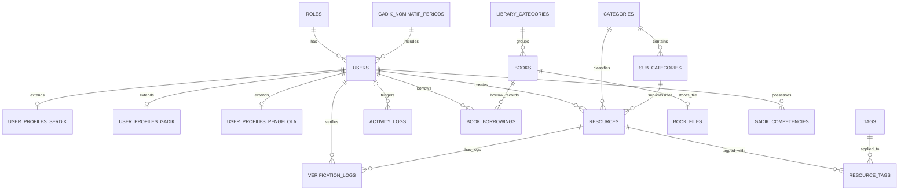

# SIPINTAR — Spesifikasi Basis Data MySQL (Database Specification)

**Status:** Dokumen Spesifikasi Resmi  
**Versi:** 1.0  
**Tanggal:** 16 November 2026  
**RDBMS Target:** MySQL 8.0+ / MariaDB 10.5+  
**Engine:** InnoDB  
**Karakter Set / Collation:** `utf8mb4` / `utf8mb4_unicode_ci`  
**Institusi:** Sespimma Sespim Lemdiklat Polri  
**Tautan Dokumen Terkait:** [business rule.md](file:///Users/masboy/Desktop/PROPER%20AKBP%20DEWI/SIPINTAR/docs/business%20rule.md) | [prd.md](file:///Users/masboy/Desktop/PROPER%20AKBP%20DEWI/SIPINTAR/docs/prd.md) | [APIspecs.md](file:///Users/masboy/Desktop/PROPER%20AKBP%20DEWI/SIPINTAR/docs/APIspecs.md)

---

## 1. Pendahuluan & Prinsip Desain Basis Data

Dokumen spesifikasi basis data ini dirancang berdasarkan struktur kode sumber, tipe data TypeScript (`src/types/index.ts`), mock data operasional Sespimma (`src/data/`), dan aturan tata kelola resmi SIPINTAR.

### Prinsip Utama Perancangan:
1. **Engine InnoDB & ACID Compliance:** Menjamin integritas transaksi data akademik, pencatatan log audit, serta relasi *Foreign Key* yang ketat.
2. **Kepatuhan Collation Multibahasa:** Menggunakan `utf8mb4` dan `utf8mb4_unicode_ci` untuk mendukung karakter simbol kepolisian, tanda baca khusus, dan teks berbobot ilmiah.
3. **Dual Identifier (ID & UUID):** Menggunakan `BIGINT UNSIGNED AUTO_INCREMENT` untuk Primary Key internal guna efisiensi indexing B-Tree dan JOIN, dikombinasikan dengan `VARCHAR(36) UUID` unik untuk identifikasi publik di URL/API agar aman dari *ID enumeration attack*.
4. **Pemisahan Metadata Fisik vs Teknis Digital:** Sesuai prinsip perpustakaan pada *Buku Panduan Tata Kelola SIPINTAR*, informasi bibliografi buku fisik dipisahkan secara modular dari metadata berkas digital (`books` dan `book_files`).
5. **Dukungan Pencarian Teks Cepat (Full-Text Search):** Mengintegrasikan MySQL `FULLTEXT INDEX` pada judul, sinopsis, nama penulis, dan deskripsi untuk mendukung efisiensi modul **Pencarian Terpadu (Unified Search)**.
6. **Audit Trail & Soft Delete:** Penonaktifan materi menggunakan status siklus hidup (`lifecycle_status`) tanpa menghapus data secara permanen (*no premature hard delete*) guna menjaga riwayat rekam jejak akademik.

---

## 2. Diagram Relasi Entitas (Entity-Relationship Diagram)



---

## 3. Kamus Data & Spesifikasi Tabel (Data Dictionary)

### 3.1. Kelompok Manajemen Pengguna & Hak Akses (Auth & RBAC)

#### A. Tabel `roles`
Menyimpan definisi peran hierarki sistem SIPINTAR.
* **Primary Key:** `id`
* **Engine:** InnoDB

| Kolom | Tipe Data | Nullable | Default | Keterangan |
|---|---|:---:|---|---|
| `id` | `INT UNSIGNED` | NO | AUTO_INCREMENT | Identifier peran |
| `role_code` | `VARCHAR(30)` | NO | UNIQUE | Kode sistem: `serdik`, `gadik`, `pengelola`, `verifikator`, `admin`, `pimpinan` |
| `role_name` | `VARCHAR(60)` | NO | - | Nama tampilan peran (contoh: *Peserta Didik (Serdik)*) |
| `description` | `VARCHAR(255)` | YES | NULL | Penjelasan ruang lingkup wewenang |
| `created_at` | `DATETIME` | NO | CURRENT_TIMESTAMP | Waktu pencatatan |

#### B. Tabel `users`
Menyimpan akun pengguna utama (Polri & Tenaga Kependidikan).
* **Primary Key:** `id`
* **Engine:** InnoDB

| Kolom | Tipe Data | Nullable | Default | Keterangan |
|---|---|:---:|---|---|
| `id` | `BIGINT UNSIGNED` | NO | AUTO_INCREMENT | Identifier unik pengguna |
| `uuid` | `CHAR(36)` | NO | UNIQUE | Identifier unik publik (UUID v4) |
| `nrp_nip` | `VARCHAR(20)` | NO | UNIQUE | NRP Anggota Polri (8 digit) atau NIP PNS |
| `nama_lengkap` | `VARCHAR(150)` | NO | - | Nama lengkap beserta gelar akademik/kepolisian |
| `email` | `VARCHAR(100)` | NO | UNIQUE | Alamat email dinas/pribadi |
| `password_hash` | `VARCHAR(255)` | NO | - | Hash sandi (Argon2id / Bcrypt) |
| `role_id` | `INT UNSIGNED` | NO | - | Relasi ke `roles.id` |
| `phone_number` | `VARCHAR(20)` | YES | NULL | Nomor kontak operasional |
| `avatar_url` | `VARCHAR(255)` | YES | NULL | Tautan foto profil resmi |
| `is_active` | `TINYINT(1)` | NO | 1 | Status akun: `1` (Aktif), `0` (Non-aktif) |
| `last_login_at` | `DATETIME` | YES | NULL | Waktu terakhir login |
| `created_at` | `DATETIME` | NO | CURRENT_TIMESTAMP | Waktu pendaftaran |
| `updated_at` | `DATETIME` | NO | CURRENT_TIMESTAMP ON UPDATE CURRENT_TIMESTAMP | Waktu pembaruan profil |

* **Foreign Keys:**
  - `fk_users_role`: `role_id` → `roles(id)` ON UPDATE CASCADE ON DELETE RESTRICT
* **Indexes:**
  - `idx_users_nrp`: `INDEX(nrp_nip)`
  - `idx_users_role`: `INDEX(role_id)`

#### C. Tabel `user_profiles_serdik`
Profil tambahan khusus Peserta Didik Sespimma.
* **Primary Key:** `user_id`

| Kolom | Tipe Data | Nullable | Default | Keterangan |
|---|---|:---:|---|---|
| `user_id` | `BIGINT UNSIGNED` | NO | - | Foreign Key ke `users.id` |
| `nosis` | `VARCHAR(30)` | NO | UNIQUE | Nomor Siswa resmi Serdik Sespimma |
| `pangkat` | `VARCHAR(50)` | NO | 'KOMPOL' | Pangkat: `AKP`, `KOMPOL`, dll. |
| `angkatan` | `VARCHAR(60)` | NO | - | Contoh: *Sespimma Angkatan 73 TA 2026* |
| `sindikat` | `VARCHAR(30)` | YES | NULL | Kelompok belajar/sindikat (contoh: *Sindikat 03*) |
| `satuan_asal` | `VARCHAR(120)` | YES | NULL | Satuan kerja kewilayahan/Mabes asal personel |
| `rencana_judul_taskap` | `TEXT` | YES | NULL | Rencana judul karya tulis perorangan usulan |

#### D. Tabel `user_profiles_gadik`
Profil tenaga pendidik sesuai format nominatif fungsional Polri (Oktober 2026).
* **Primary Key:** `user_id`

| Kolom | Tipe Data | Nullable | Default | Keterangan |
|---|---|:---:|---|---|
| `user_id` | `BIGINT UNSIGNED` | NO | - | Foreign Key ke `users.id` |
| `no_urut_nominatif` | `INT UNSIGNED` | YES | NULL | Nomor urut daftar nominatif dinas |
| `pangkat` | `ENUM('KOMBES POL', 'AKBP', 'KOMPOL', 'IPTU')` | NO | - | Pangkat perwira fungsional |
| `jabatan` | `VARCHAR(150)` | NO | - | Contoh: *ANJAK MADYA SESPIMMA*, *GADIK MADYA* |
| `kategori_jabatan` | `ENUM('Anjak Madya', 'Widyaiswara Madya Tk. III', 'Gadik Madya', 'Widyaiswara Muda Tk. I', 'Widyaiswara Pratama Tk. I')` | NO | - | Kategori jabatan fungsional |
| `agama` | `ENUM('ISLAM', 'KRISTEN', 'KATOLIK', 'HINDU', 'BUDDHA', 'KONGHUCU')` | NO | 'ISLAM' | Agama |
| `eselon` | `ENUM('II B3', 'III A2', 'III B', 'IV B')` | NO | - | Jenjang eselon kepolisian |
| `golongan` | `ENUM('IV-C', 'IV-B', 'IV-A', 'III-C', 'III-B')` | NO | - | Golongan ruang kepangkatan |
| `status_fungsional` | `VARCHAR(50)` | NO | 'Aktif Fungsional' | Status kedinasan tenaga pendidik |
| `no_sprint` | `VARCHAR(80)` | YES | NULL | Nomor Surat Perintah penugasan mengajar |
| `bio` | `TEXT` | YES | NULL | Profil singkat dedikasi dan rekam jejak |

#### E. Tabel `user_profiles_pengelola`
Profil staf pengelola data dan pustakawan Sespimma.
* **Primary Key:** `user_id`

| Kolom | Tipe Data | Nullable | Default | Keterangan |
|---|---|:---:|---|---|
| `user_id` | `BIGINT UNSIGNED` | NO | - | Foreign Key ke `users.id` |
| `unit_kerja` | `VARCHAR(100)` | NO | 'Subbag Renmin / Perpustakaan' | Satker penugasan di lingkungan Sespimma |
| `lingkup_akses` | `VARCHAR(255)` | YES | NULL | Lingkup kewenangan (katalogisasi, upload naskah) |

---

### 3.2. Kelompok Kategori & Taksonomi Sumber Belajar

#### A. Tabel `categories`
Menyimpan 8 menu/kategori resmi platform SIPINTAR.
* **Primary Key:** `id`

| Kolom | Tipe Data | Nullable | Default | Keterangan |
|---|---|:---:|---|---|
| `id` | `INT UNSIGNED` | NO | AUTO_INCREMENT | ID kategori |
| `name` | `VARCHAR(80)` | NO | UNIQUE | Nama resmi kategori (contoh: *Modul & Hanjar*) |
| `slug` | `VARCHAR(80)` | NO | UNIQUE | Slug URL ramah SEO (contoh: `modul-hanjar`) |
| `description` | `VARCHAR(255)` | NO | - | Deskripsi peruntukan kategori |
| `icon_name` | `VARCHAR(40)` | NO | 'file-text' | Identitas ikon Feather/Lucide |
| `display_order` | `TINYINT UNSIGNED` | NO | 1 | Urutan tampil pada navigasi |
| `is_active` | `TINYINT(1)` | NO | 1 | Flag keaktifan kategori |

#### B. Tabel `sub_categories`
Sub-kategori materi belajar.
* **Primary Key:** `id`

| Kolom | Tipe Data | Nullable | Default | Keterangan |
|---|---|:---:|---|---|
| `id` | `INT UNSIGNED` | NO | AUTO_INCREMENT | ID sub-kategori |
| `category_id` | `INT UNSIGNED` | NO | - | Relasi ke `categories.id` |
| `name` | `VARCHAR(100)` | NO | - | Nama sub-kategori (misal: *Bahan Ajar Utama*) |
| `slug` | `VARCHAR(100)` | NO | - | Slug sub-kategori |

---

### 3.3. Kelompok Sumber Belajar Utama (Resources)

#### A. Tabel `resources`
Tabel pusat penyimpan seluruh naskah ajar (Modul, Hanjar, SOP, Pedoman, Kurikulum, Manual Book).
* **Primary Key:** `id`
* **Engine:** InnoDB

| Kolom | Tipe Data | Nullable | Default | Keterangan |
|---|---|:---:|---|---|
| `id` | `BIGINT UNSIGNED` | NO | AUTO_INCREMENT | ID primer internal |
| `uuid` | `CHAR(36)` | NO | UNIQUE | Identifier unik publik (UUID) |
| `title` | `VARCHAR(255)` | NO | - | Judul lengkap naskah / materi ajar |
| `category_id` | `INT UNSIGNED` | NO | - | Relasi ke `categories.id` |
| `sub_category_id` | `INT UNSIGNED` | YES | NULL | Relasi ke `sub_categories.id` |
| `sub_category_text` | `VARCHAR(100)` | YES | NULL | Cadangan label sub-kategori teks langsung |
| `description` | `TEXT` | NO | - | Abstrak, sinopsis, atau deskripsi materi |
| `author_or_instructor` | `VARCHAR(150)` | NO | - | Penyusun/Gadik/Pengampu materi |
| `unit_or_source` | `VARCHAR(150)` | NO | 'Sespimma Sespim Lemdiklat Polri' | Satker atau asal naskah (Bag Jarlat, Pokja, dll.) |
| `lifecycle_status` | `ENUM('Draft', 'Diverifikasi', 'Dipublikasikan', 'Tidak Aktif', 'Arsip')` | NO | 'Draft' | Status siklus hidup dokumen |
| `access_classification` | `ENUM('Terbuka', 'Internal', 'Terbatas', 'Metadata Saja')` | NO | 'Internal' | Klasifikasi kerahasiaan naskah |
| `has_digital_file` | `TINYINT(1)` | NO | 0 | Flag ketersediaan berkas digital (`1` / `0`) |
| `file_format` | `ENUM('PDF', 'DOCX', 'PPTX', 'MP4', 'EPUB')` | YES | NULL | Format berkas digital utama |
| `file_size_bytes` | `BIGINT UNSIGNED` | YES | NULL | Ukuran berkas digital dalam bytes |
| `file_size_label` | `VARCHAR(20)` | YES | NULL | Label ramah baca (contoh: *2.4 MB*) |
| `file_url` | `VARCHAR(255)` | YES | NULL | Lokasi simpan berkas di cloud/server |
| `physical_location` | `VARCHAR(150)` | YES | NULL | Lokasi rak fisik buku / naskah cetak |
| `created_by` | `BIGINT UNSIGNED` | NO | - | ID pembuat draf (`users.id`) |
| `verified_by` | `BIGINT UNSIGNED` | YES | NULL | ID verifikator yang menyetujui (`users.id`) |
| `published_at` | `DATETIME` | YES | NULL | Waktu resmi publikasi naskah |
| `archived_at` | `DATETIME` | YES | NULL | Waktu pemindahan status ke arsip |
| `created_at` | `DATETIME` | NO | CURRENT_TIMESTAMP | Waktu entri draf dibuat |
| `updated_at` | `DATETIME` | NO | CURRENT_TIMESTAMP ON UPDATE CURRENT_TIMESTAMP | Waktu pembaruan metadata |

* **Foreign Keys:**
  - `fk_res_category`: `category_id` → `categories(id)` ON UPDATE CASCADE ON DELETE RESTRICT
  - `fk_res_sub_category`: `sub_category_id` → `sub_categories(id)` ON UPDATE CASCADE ON DELETE SET NULL
  - `fk_res_creator`: `created_by` → `users(id)` ON UPDATE CASCADE ON DELETE RESTRICT
  - `fk_res_verifier`: `verified_by` → `users(id)` ON UPDATE CASCADE ON DELETE SET NULL
* **Indexes:**
  - `idx_res_lifecycle_access`: `INDEX(lifecycle_status, access_classification)`
  - `idx_res_category_status`: `INDEX(category_id, lifecycle_status)`
  - `ft_res_search`: `FULLTEXT(title, description, author_or_instructor)`

#### B. Tabel `tags` & `resource_tags`
Mendukung klasifikasi tag multi-kriteria untuk mempermudah filter pencarian.
* **Tabel `tags`:** `id (INT UNSIGNED)`, `tag_name (VARCHAR(50) UNIQUE)`
* **Tabel `resource_tags`:** `resource_id (BIGINT UNSIGNED)`, `tag_id (INT UNSIGNED)`. Primary Key gabungan `(resource_id, tag_id)`.

#### C. Tabel `verification_logs`
Mencatat riwayat audit setiap kali ada proses verifikasi atau pengembalian revisi dokumen.
* **Primary Key:** `id`

| Kolom | Tipe Data | Nullable | Default | Keterangan |
|---|---|:---:|---|---|
| `id` | `BIGINT UNSIGNED` | NO | AUTO_INCREMENT | ID log verifikasi |
| `resource_id` | `BIGINT UNSIGNED` | NO | - | Foreign Key ke `resources.id` |
| `verifier_id` | `BIGINT UNSIGNED` | NO | - | Foreign Key ke `users.id` (Verifikator) |
| `status_before` | `VARCHAR(30)` | NO | - | Status sebelum aksi (misal: `Draft`) |
| `status_after` | `VARCHAR(30)` | NO | - | Status sesudah aksi (misal: `Dipublikasikan`) |
| `action_result` | `ENUM('Disetujui', 'Revisi', 'Ditolak')` | NO | - | Keputusan verifikasi |
| `notes` | `TEXT` | YES | NULL | Catatan revisi atau instruksi perbaikan |
| `created_at` | `DATETIME` | NO | CURRENT_TIMESTAMP | Waktu peninjauan |

---

### 3.4. Kelompok E-Library / Perpustakaan (Books & Digital Assets)

Sesuai arsitektur data perpustakaan di kode prototipe (`src/types/index.ts` & `src/data/libraryData.ts`), koleksi kepustakaan dibagi menjadi:
1. `library_categories`: Koleksi Buku Fisik, E-Book, Taskap, dan Jurnal Ilmiah.
2. `books`: Metadata deskriptif bibliografis lengkap.
3. `book_files`: Berkas teknis digital (pratinjau sampel bab awal vs berkas naskah utuh).
4. `book_borrowings`: Sirkulasi peminjaman buku fisik atau reservasi e-book.

#### A. Tabel `library_categories`
* **Primary Key:** `id`

| Kolom | Tipe Data | Nullable | Default | Keterangan |
|---|---|:---:|---|---|
| `id` | `VARCHAR(30)` | NO | - | Kode unik: `buku-fisik`, `ebook`, `taskap`, `jurnal` |
| `name` | `VARCHAR(80)` | NO | - | Nama resmi kategori kepustakaan |
| `description` | `VARCHAR(255)` | NO | - | Deskripsi cakupan koleksi |
| `icon_name` | `VARCHAR(40)` | NO | 'book' | Ikon tampilan UI |

#### B. Tabel `books`
Menyimpan metadata deskriptif buku dan karya tulis.
* **Primary Key:** `id`
* **Engine:** InnoDB

| Kolom | Tipe Data | Nullable | Default | Keterangan |
|---|---|:---:|---|---|
| `id` | `BIGINT UNSIGNED` | NO | AUTO_INCREMENT | ID buku internal |
| `uuid` | `CHAR(36)` | NO | UNIQUE | Identifier publik buku (UUID) |
| `isbn` | `VARCHAR(30)` | YES | NULL | Nomor ISBN resmi buku |
| `title` | `VARCHAR(255)` | NO | - | Judul lengkap buku / karya tulis |
| `author` | `VARCHAR(150)` | NO | - | Penulis / penyusun naskah |
| `publisher` | `VARCHAR(120)` | NO | 'Sespimma Lemdiklat Polri Press' | Penerbit buku |
| `published_year` | `SMALLINT UNSIGNED` | NO | - | Tahun publikasi |
| `synopsis` | `TEXT` | NO | - | Ringkasan sinopsis atau abstrak komprehensif |
| `library_category_id` | `VARCHAR(30)` | NO | - | Foreign Key ke `library_categories.id` |
| `sub_category` | `VARCHAR(100)` | YES | NULL | Bidang spesifik (misal: *Logistik & Aset*) |
| `language` | `ENUM('Indonesia', 'Inggris')` | NO | 'Indonesia' | Bahasa pengantar materi |
| `call_number` | `VARCHAR(50)` | NO | - | Nomor panggil buku di rak (misal: *658.7 SUS m*) |
| `physical_location` | `VARCHAR(150)` | NO | - | Contoh: *Gedung Perpustakaan Sespimma, Lantai 1* |
| `stock_total` | `INT UNSIGNED` | NO | 1 | Jumlah total eksemplar fisik |
| `stock_available` | `INT UNSIGNED` | NO | 1 | Jumlah eksemplar fisik yang tersedia |
| `cover_image_url` | `VARCHAR(255)` | YES | NULL | Tautan gambar sampul buku |
| `cover_color` | `VARCHAR(30)` | YES | '#0d2549' | Warna aksen dasar kartu buku |
| `cover_gradient` | `VARCHAR(120)` | YES | NULL | Gradien dekoratif sampul pada antarmuka |
| `lifecycle_status` | `ENUM('Draft', 'Diverifikasi', 'Dipublikasikan', 'Tidak Aktif', 'Arsip')` | NO | 'Dipublikasikan' | Status tata kelola berkas |
| `access_classification` | `ENUM('Terbuka', 'Internal', 'Terbatas', 'Metadata Saja')` | NO | 'Internal' | Klasifikasi hak akses pustaka |
| `created_by` | `BIGINT UNSIGNED` | NO | - | Foreign Key ke `users.id` (Pengelola data) |
| `created_at` | `DATETIME` | NO | CURRENT_TIMESTAMP | Waktu pencatatan buku |
| `updated_at` | `DATETIME` | NO | CURRENT_TIMESTAMP ON UPDATE CURRENT_TIMESTAMP | Waktu pembaruan data |

* **Foreign Keys:**
  - `fk_books_lib_cat`: `library_category_id` → `library_categories(id)` ON UPDATE CASCADE ON DELETE RESTRICT
  - `fk_books_creator`: `created_by` → `users(id)` ON UPDATE CASCADE ON DELETE RESTRICT
* **Indexes:**
  - `ft_books_search`: `FULLTEXT(title, author, synopsis)`
  - `idx_books_category`: `INDEX(library_category_id, stock_available)`

#### C. Tabel `book_files`
Metadata teknis berkas digital e-book dan sample bab pratinjau.
* **Primary Key:** `id`

| Kolom | Tipe Data | Nullable | Default | Keterangan |
|---|---|:---:|---|---|
| `id` | `BIGINT UNSIGNED` | NO | AUTO_INCREMENT | ID file rekaman |
| `book_id` | `BIGINT UNSIGNED` | NO | UNIQUE | Foreign Key 1-to-1 ke `books.id` |
| `file_path` | `VARCHAR(255)` | NO | - | Lokasi berkas digital utuh (akses otorisasi penuh) |
| `preview_file_path` | `VARCHAR(255)` | NO | - | Lokasi berkas pratinjau publik (10–20 halaman awal) |
| `file_format` | `ENUM('PDF', 'EPUB')` | NO | 'PDF' | Format digital buku |
| `file_size_label` | `VARCHAR(20)` | NO | - | Ukuran berkas (contoh: *18.4 MB*) |
| `total_pages` | `INT UNSIGNED` | NO | 0 | Jumlah halaman buku lengkap |
| `preview_pages` | `INT UNSIGNED` | NO | 20 | Batasan halaman sampel pratinjau |
| `download_count` | `INT UNSIGNED` | NO | 0 | Statistik jumlah pengunduhan resmi |
| `created_at` | `DATETIME` | NO | CURRENT_TIMESTAMP | Waktu unggah berkas |

* **Foreign Keys:**
  - `fk_bf_book`: `book_id` → `books(id)` ON UPDATE CASCADE ON DELETE CASCADE

#### D. Tabel `book_borrowings`
Pencatatan sirkulasi peminjaman buku fisik dan otorisasi akses pustaka.
* **Primary Key:** `id`

| Kolom | Tipe Data | Nullable | Default | Keterangan |
|---|---|:---:|---|---|
| `id` | `BIGINT UNSIGNED` | NO | AUTO_INCREMENT | ID peminjaman |
| `book_id` | `BIGINT UNSIGNED` | NO | - | Foreign Key ke `books.id` |
| `user_id` | `BIGINT UNSIGNED` | NO | - | Foreign Key ke `users.id` (Peminjam) |
| `borrow_date` | `DATE` | NO | - | Tanggal peminjaman buku fisik |
| `due_date` | `DATE` | NO | - | Batas waktu pengembalian buku |
| `return_date` | `DATE` | YES | NULL | Tanggal pengembalian aktual |
| `status` | `ENUM('Dipinjam', 'Kembali', 'Terlambat', 'Hilang')` | NO | 'Dipinjam' | Status sirkulasi |
| `notes` | `VARCHAR(255)` | YES | NULL | Catatan kondisi fisik buku saat kembali |

---

### 3.5. Kelompok Gadik & Kompetensi Tambahan

#### A. Tabel `gadik_competencies`
Daftar bidang kepakaran dan mata ajar yang diampu oleh setiap Tenaga Pendidik.
* **Primary Key:** `id`

| Kolom | Tipe Data | Nullable | Default | Keterangan |
|---|---|:---:|---|---|
| `id` | `BIGINT UNSIGNED` | NO | AUTO_INCREMENT | ID entri kompetensi |
| `user_id` | `BIGINT UNSIGNED` | NO | - | Foreign Key ke `users.id` (Gadik) |
| `competency_name` | `VARCHAR(150)` | NO | - | Contoh: *Manajemen Logistik*, *Analisis SWOT* |
| `competency_type` | `ENUM('kepakaran', 'mata_ajar')` | NO | 'kepakaran' | Tipe pemetaan keahlian |

#### B. Tabel `gadik_nominatif_periods`
Mencatat metadata pengesahan lembar nominatif dinas bulanan resmi Sespimma.
* **Primary Key:** `id`

| Kolom | Tipe Data | Nullable | Default | Keterangan |
|---|---|:---:|---|---|
| `id` | `INT UNSIGNED` | NO | AUTO_INCREMENT | ID periode nominatif |
| `period_name` | `VARCHAR(80)` | NO | - | Contoh: *Bulan Oktober 2026* |
| `institution` | `VARCHAR(120)` | NO | 'SESPIM LEMDIKLAT POLRI' | Induk kelembagaan |
| `sub_institution` | `VARCHAR(120)` | NO | 'SEKOLAH STAF DAN PIMPINAN PERTAMA (SESPIMMA)' | Sub-satker pelaksana |
| `total_personel` | `INT UNSIGNED` | NO | 16 | Jumlah personel fungsional pada periode tsb |
| `signed_location` | `VARCHAR(80)` | NO | 'Lembang' | Tempat penandatanganan dinas |
| `signed_date` | `VARCHAR(60)` | NO | 'Oktober 2026' | Tanggal penandatanganan |
| `pejabat_jabatan` | `VARCHAR(100)` | NO | 'PS KASUBBAG RENMIN' | Jabatan pejabat penandatangan |
| `pejabat_nama` | `VARCHAR(150)` | NO | 'SUNU PRIHANDOYO, S.T.' | Nama pejabat penandatangan |
| `pejabat_pangkat` | `VARCHAR(50)` | NO | 'KOMPOL' | Pangkat pejabat penandatangan |
| `pejabat_nrp` | `VARCHAR(20)` | NO | '82050054' | NRP pejabat penandatangan |
| `pdf_url` | `VARCHAR(255)` | NO | - | Tautan unduh dokumen SK nominatif resmi (PDF) |

---

### 3.6. Kelompok Monitoring & Log Aktivitas (Audit Trail)

#### A. Tabel `activity_logs`
Merekam seluruh aktivitas penting pengguna untuk memenuhi standar akuntabilitas kepolisian.
* **Primary Key:** `id`

| Kolom | Tipe Data | Nullable | Default | Keterangan |
|---|---|:---:|---|---|
| `id` | `BIGINT UNSIGNED` | NO | AUTO_INCREMENT | ID log aktivitas |
| `user_id` | `BIGINT UNSIGNED` | YES | NULL | Foreign Key ke `users.id` (NULL jika anonim) |
| `user_name_snapshot` | `VARCHAR(150)` | YES | NULL | Snapshot nama pengguna saat aksi terjadi |
| `role_snapshot` | `VARCHAR(50)` | YES | NULL | Snapshot peran pengguna saat aksi |
| `action_type` | `VARCHAR(50)` | NO | - | Jenis aksi: `LOGIN`, `READ_HANJAR`, `CREATE_DRAFT`, `VERIFY_APPROVE`, `ARCHIVE` |
| `entity_type` | `VARCHAR(50)` | NO | - | Entitas target: `resource`, `book`, `user`, `config` |
| `entity_id` | `VARCHAR(64)` | YES | NULL | ID target yang dikenai aksi |
| `satker_sindikat` | `VARCHAR(100)` | YES | NULL | Satuan kerja atau sindikat pemohon |
| `description` | `VARCHAR(255)` | NO | - | Penjelasan singkat aksi yang dilakukan |
| `ip_address` | `VARCHAR(45)` | YES | NULL | Alamat IPv4 / IPv6 pengguna |
| `user_agent` | `VARCHAR(255)` | YES | NULL | Informasi peramban/klien |
| `created_at` | `DATETIME` | NO | CURRENT_TIMESTAMP | Waktu pencatatan log |

* **Indexes:**
  - `idx_logs_time`: `INDEX(created_at)`
  - `idx_logs_user_action`: `INDEX(user_id, action_type)`

#### B. Tabel `search_logs`
Merekam kata kunci pencarian terpadu untuk keperluan analitik tren kebutuhan belajar.
* **Primary Key:** `id`

| Kolom | Tipe Data | Nullable | Default | Keterangan |
|---|---|:---:|---|---|
| `id` | `BIGINT UNSIGNED` | NO | AUTO_INCREMENT | ID rekaman pencarian |
| `user_id` | `BIGINT UNSIGNED` | YES | NULL | Foreign Key ke `users.id` |
| `query_text` | `VARCHAR(255)` | NO | - | Kata kunci pencarian yang dimasukkan |
| `category_filter` | `VARCHAR(80)` | YES | 'Semua' | Filter kategori yang dipilih |
| `results_count` | `INT UNSIGNED` | NO | 0 | Jumlah hasil yang ditemukan |
| `created_at` | `DATETIME` | NO | CURRENT_TIMESTAMP | Waktu penelusuran |

---

## 4. Skrip DDL MySQL Siap Eksekusi (Complete DDL SQL Script)

Berikut adalah skrip lengkap pembuatan tabel basis data MySQL 8.0:

```sql
-- ==============================================================
-- SIPINTAR — SKRIP DDL DATABASE LENGKAP UNTUK MYSQL 8.0+
-- Disesuaikan dengan Ekosistem Sespimma Sespim Lemdiklat Polri
-- ==============================================================

SET FOREIGN_KEY_CHECKS = 0;

DROP DATABASE IF EXISTS sipintar_db;
CREATE DATABASE sipintar_db
    CHARACTER SET utf8mb4
    COLLATE utf8mb4_unicode_ci;

USE sipintar_db;

-- --------------------------------------------------------------
-- 1. TABEL ROLES
-- --------------------------------------------------------------
CREATE TABLE roles (
    id INT UNSIGNED AUTO_INCREMENT PRIMARY KEY,
    role_code VARCHAR(30) NOT NULL UNIQUE,
    role_name VARCHAR(60) NOT NULL,
    description VARCHAR(255) NULL,
    created_at DATETIME NOT NULL DEFAULT CURRENT_TIMESTAMP
) ENGINE=InnoDB DEFAULT CHARSET=utf8mb4 COLLATE=utf8mb4_unicode_ci;

-- --------------------------------------------------------------
-- 2. TABEL USERS
-- --------------------------------------------------------------
CREATE TABLE users (
    id BIGINT UNSIGNED AUTO_INCREMENT PRIMARY KEY,
    uuid CHAR(36) NOT NULL UNIQUE,
    nrp_nip VARCHAR(20) NOT NULL UNIQUE,
    nama_lengkap VARCHAR(150) NOT NULL,
    email VARCHAR(100) NOT NULL UNIQUE,
    password_hash VARCHAR(255) NOT NULL,
    role_id INT UNSIGNED NOT NULL,
    phone_number VARCHAR(20) NULL,
    avatar_url VARCHAR(255) NULL,
    is_active TINYINT(1) NOT NULL DEFAULT 1,
    last_login_at DATETIME NULL,
    created_at DATETIME NOT NULL DEFAULT CURRENT_TIMESTAMP,
    updated_at DATETIME NOT NULL DEFAULT CURRENT_TIMESTAMP ON UPDATE CURRENT_TIMESTAMP,
    CONSTRAINT fk_users_role FOREIGN KEY (role_id) REFERENCES roles (id) ON UPDATE CASCADE ON DELETE RESTRICT,
    INDEX idx_users_nrp (nrp_nip),
    INDEX idx_users_role (role_id)
) ENGINE=InnoDB DEFAULT CHARSET=utf8mb4 COLLATE=utf8mb4_unicode_ci;

-- --------------------------------------------------------------
-- 3. TABEL PROFIL PENGGUNA (SERDIK, GADIK, PENGELOLA)
-- --------------------------------------------------------------
CREATE TABLE user_profiles_serdik (
    user_id BIGINT UNSIGNED PRIMARY KEY,
    nosis VARCHAR(30) NOT NULL UNIQUE,
    pangkat VARCHAR(50) NOT NULL DEFAULT 'KOMPOL',
    angkatan VARCHAR(60) NOT NULL,
    sindikat VARCHAR(30) NULL,
    satuan_asal VARCHAR(120) NULL,
    rencana_judul_taskap TEXT NULL,
    CONSTRAINT fk_serdik_user FOREIGN KEY (user_id) REFERENCES users (id) ON UPDATE CASCADE ON DELETE CASCADE
) ENGINE=InnoDB DEFAULT CHARSET=utf8mb4 COLLATE=utf8mb4_unicode_ci;

CREATE TABLE user_profiles_gadik (
    user_id BIGINT UNSIGNED PRIMARY KEY,
    no_urut_nominatif INT UNSIGNED NULL,
    pangkat ENUM('KOMBES POL', 'AKBP', 'KOMPOL', 'IPTU') NOT NULL,
    jabatan VARCHAR(150) NOT NULL,
    kategori_jabatan ENUM(
        'Anjak Madya',
        'Widyaiswara Madya Tk. III',
        'Gadik Madya',
        'Widyaiswara Muda Tk. I',
        'Widyaiswara Pratama Tk. I'
    ) NOT NULL,
    agama ENUM('ISLAM', 'KRISTEN', 'KATOLIK', 'HINDU', 'BUDDHA', 'KONGHUCU') NOT NULL DEFAULT 'ISLAM',
    eselon ENUM('II B3', 'III A2', 'III B', 'IV B') NOT NULL,
    golongan ENUM('IV-C', 'IV-B', 'IV-A', 'III-C', 'III-B') NOT NULL,
    status_fungsional VARCHAR(50) NOT NULL DEFAULT 'Aktif Fungsional',
    no_sprint VARCHAR(80) NULL,
    bio TEXT NULL,
    CONSTRAINT fk_gadik_user FOREIGN KEY (user_id) REFERENCES users (id) ON UPDATE CASCADE ON DELETE CASCADE
) ENGINE=InnoDB DEFAULT CHARSET=utf8mb4 COLLATE=utf8mb4_unicode_ci;

CREATE TABLE user_profiles_pengelola (
    user_id BIGINT UNSIGNED PRIMARY KEY,
    unit_kerja VARCHAR(100) NOT NULL DEFAULT 'Subbag Renmin / Unit Perpustakaan Sespimma',
    lingkup_akses VARCHAR(255) NULL,
    CONSTRAINT fk_pengelola_user FOREIGN KEY (user_id) REFERENCES users (id) ON UPDATE CASCADE ON DELETE CASCADE
) ENGINE=InnoDB DEFAULT CHARSET=utf8mb4 COLLATE=utf8mb4_unicode_ci;

-- --------------------------------------------------------------
-- 4. TABEL KATEGORI & SUB KATEGORI
-- --------------------------------------------------------------
CREATE TABLE categories (
    id INT UNSIGNED AUTO_INCREMENT PRIMARY KEY,
    name VARCHAR(80) NOT NULL UNIQUE,
    slug VARCHAR(80) NOT NULL UNIQUE,
    description VARCHAR(255) NOT NULL,
    icon_name VARCHAR(40) NOT NULL DEFAULT 'file-text',
    display_order TINYINT UNSIGNED NOT NULL DEFAULT 1,
    is_active TINYINT(1) NOT NULL DEFAULT 1
) ENGINE=InnoDB DEFAULT CHARSET=utf8mb4 COLLATE=utf8mb4_unicode_ci;

CREATE TABLE sub_categories (
    id INT UNSIGNED AUTO_INCREMENT PRIMARY KEY,
    category_id INT UNSIGNED NOT NULL,
    name VARCHAR(100) NOT NULL,
    slug VARCHAR(100) NOT NULL,
    CONSTRAINT fk_subcat_category FOREIGN KEY (category_id) REFERENCES categories (id) ON UPDATE CASCADE ON DELETE CASCADE,
    INDEX idx_subcat_category (category_id)
) ENGINE=InnoDB DEFAULT CHARSET=utf8mb4 COLLATE=utf8mb4_unicode_ci;

-- --------------------------------------------------------------
-- 5. TABEL RESOURCES (SUMBER BELAJAR PUSAT)
-- --------------------------------------------------------------
CREATE TABLE resources (
    id BIGINT UNSIGNED AUTO_INCREMENT PRIMARY KEY,
    uuid CHAR(36) NOT NULL UNIQUE,
    title VARCHAR(255) NOT NULL,
    category_id INT UNSIGNED NOT NULL,
    sub_category_id INT UNSIGNED NULL,
    sub_category_text VARCHAR(100) NULL,
    description TEXT NOT NULL,
    author_or_instructor VARCHAR(150) NOT NULL,
    unit_or_source VARCHAR(150) NOT NULL DEFAULT 'Sespimma Sespim Lemdiklat Polri',
    lifecycle_status ENUM('Draft', 'Diverifikasi', 'Dipublikasikan', 'Tidak Aktif', 'Arsip') NOT NULL DEFAULT 'Draft',
    access_classification ENUM('Terbuka', 'Internal', 'Terbatas', 'Metadata Saja') NOT NULL DEFAULT 'Internal',
    has_digital_file TINYINT(1) NOT NULL DEFAULT 0,
    file_format ENUM('PDF', 'DOCX', 'PPTX', 'MP4', 'EPUB') NULL,
    file_size_bytes BIGINT UNSIGNED NULL,
    file_size_label VARCHAR(20) NULL,
    file_url VARCHAR(255) NULL,
    physical_location VARCHAR(150) NULL,
    created_by BIGINT UNSIGNED NOT NULL,
    verified_by BIGINT UNSIGNED NULL,
    published_at DATETIME NULL,
    archived_at DATETIME NULL,
    created_at DATETIME NOT NULL DEFAULT CURRENT_TIMESTAMP,
    updated_at DATETIME NOT NULL DEFAULT CURRENT_TIMESTAMP ON UPDATE CURRENT_TIMESTAMP,
    CONSTRAINT fk_res_category FOREIGN KEY (category_id) REFERENCES categories (id) ON UPDATE CASCADE ON DELETE RESTRICT,
    CONSTRAINT fk_res_sub_category FOREIGN KEY (sub_category_id) REFERENCES sub_categories (id) ON UPDATE CASCADE ON DELETE SET NULL,
    CONSTRAINT fk_res_creator FOREIGN KEY (created_by) REFERENCES users (id) ON UPDATE CASCADE ON DELETE RESTRICT,
    CONSTRAINT fk_res_verifier FOREIGN KEY (verified_by) REFERENCES users (id) ON UPDATE CASCADE ON DELETE SET NULL,
    INDEX idx_res_lifecycle_access (lifecycle_status, access_classification),
    INDEX idx_res_category_status (category_id, lifecycle_status),
    FULLTEXT INDEX ft_res_search (title, description, author_or_instructor)
) ENGINE=InnoDB DEFAULT CHARSET=utf8mb4 COLLATE=utf8mb4_unicode_ci;

-- --------------------------------------------------------------
-- 6. TABEL TAGS & RELASI
-- --------------------------------------------------------------
CREATE TABLE tags (
    id INT UNSIGNED AUTO_INCREMENT PRIMARY KEY,
    tag_name VARCHAR(50) NOT NULL UNIQUE
) ENGINE=InnoDB DEFAULT CHARSET=utf8mb4 COLLATE=utf8mb4_unicode_ci;

CREATE TABLE resource_tags (
    resource_id BIGINT UNSIGNED NOT NULL,
    tag_id INT UNSIGNED NOT NULL,
    PRIMARY KEY (resource_id, tag_id),
    CONSTRAINT fk_rt_resource FOREIGN KEY (resource_id) REFERENCES resources (id) ON UPDATE CASCADE ON DELETE CASCADE,
    CONSTRAINT fk_rt_tag FOREIGN KEY (tag_id) REFERENCES tags (id) ON UPDATE CASCADE ON DELETE CASCADE
) ENGINE=InnoDB DEFAULT CHARSET=utf8mb4 COLLATE=utf8mb4_unicode_ci;

-- --------------------------------------------------------------
-- 7. TABEL LOG VERIFIKASI NASKAH
-- --------------------------------------------------------------
CREATE TABLE verification_logs (
    id BIGINT UNSIGNED AUTO_INCREMENT PRIMARY KEY,
    resource_id BIGINT UNSIGNED NOT NULL,
    verifier_id BIGINT UNSIGNED NOT NULL,
    status_before VARCHAR(30) NOT NULL,
    status_after VARCHAR(30) NOT NULL,
    action_result ENUM('Disetujui', 'Revisi', 'Ditolak') NOT NULL,
    notes TEXT NULL,
    created_at DATETIME NOT NULL DEFAULT CURRENT_TIMESTAMP,
    CONSTRAINT fk_vl_resource FOREIGN KEY (resource_id) REFERENCES resources (id) ON UPDATE CASCADE ON DELETE CASCADE,
    CONSTRAINT fk_vl_verifier FOREIGN KEY (verifier_id) REFERENCES users (id) ON UPDATE CASCADE ON DELETE RESTRICT,
    INDEX idx_vl_resource (resource_id)
) ENGINE=InnoDB DEFAULT CHARSET=utf8mb4 COLLATE=utf8mb4_unicode_ci;

-- --------------------------------------------------------------
-- 8. TABEL E-LIBRARY (KEPUSTAKAAN & BUKU)
-- --------------------------------------------------------------
CREATE TABLE library_categories (
    id VARCHAR(30) PRIMARY KEY,
    name VARCHAR(80) NOT NULL,
    description VARCHAR(255) NOT NULL,
    icon_name VARCHAR(40) NOT NULL DEFAULT 'book'
) ENGINE=InnoDB DEFAULT CHARSET=utf8mb4 COLLATE=utf8mb4_unicode_ci;

CREATE TABLE books (
    id BIGINT UNSIGNED AUTO_INCREMENT PRIMARY KEY,
    uuid CHAR(36) NOT NULL UNIQUE,
    isbn VARCHAR(30) NULL,
    title VARCHAR(255) NOT NULL,
    author VARCHAR(150) NOT NULL,
    publisher VARCHAR(120) NOT NULL DEFAULT 'Sespimma Lemdiklat Polri Press',
    published_year SMALLINT UNSIGNED NOT NULL,
    synopsis TEXT NOT NULL,
    library_category_id VARCHAR(30) NOT NULL,
    sub_category VARCHAR(100) NULL,
    language ENUM('Indonesia', 'Inggris') NOT NULL DEFAULT 'Indonesia',
    call_number VARCHAR(50) NOT NULL,
    physical_location VARCHAR(150) NOT NULL,
    stock_total INT UNSIGNED NOT NULL DEFAULT 1,
    stock_available INT UNSIGNED NOT NULL DEFAULT 1,
    cover_image_url VARCHAR(255) NULL,
    cover_color VARCHAR(30) NULL DEFAULT '#0d2549',
    cover_gradient VARCHAR(120) NULL,
    lifecycle_status ENUM('Draft', 'Diverifikasi', 'Dipublikasikan', 'Tidak Aktif', 'Arsip') NOT NULL DEFAULT 'Dipublikasikan',
    access_classification ENUM('Terbuka', 'Internal', 'Terbatas', 'Metadata Saja') NOT NULL DEFAULT 'Internal',
    created_by BIGINT UNSIGNED NOT NULL,
    created_at DATETIME NOT NULL DEFAULT CURRENT_TIMESTAMP,
    updated_at DATETIME NOT NULL DEFAULT CURRENT_TIMESTAMP ON UPDATE CURRENT_TIMESTAMP,
    CONSTRAINT fk_books_lib_cat FOREIGN KEY (library_category_id) REFERENCES library_categories (id) ON UPDATE CASCADE ON DELETE RESTRICT,
    CONSTRAINT fk_books_creator FOREIGN KEY (created_by) REFERENCES users (id) ON UPDATE CASCADE ON DELETE RESTRICT,
    INDEX idx_books_category (library_category_id, stock_available),
    FULLTEXT INDEX ft_books_search (title, author, synopsis)
) ENGINE=InnoDB DEFAULT CHARSET=utf8mb4 COLLATE=utf8mb4_unicode_ci;

CREATE TABLE book_files (
    id BIGINT UNSIGNED AUTO_INCREMENT PRIMARY KEY,
    book_id BIGINT UNSIGNED NOT NULL UNIQUE,
    file_path VARCHAR(255) NOT NULL,
    preview_file_path VARCHAR(255) NOT NULL,
    file_format ENUM('PDF', 'EPUB') NOT NULL DEFAULT 'PDF',
    file_size_label VARCHAR(20) NOT NULL,
    total_pages INT UNSIGNED NOT NULL DEFAULT 0,
    preview_pages INT UNSIGNED NOT NULL DEFAULT 20,
    download_count INT UNSIGNED NOT NULL DEFAULT 0,
    created_at DATETIME NOT NULL DEFAULT CURRENT_TIMESTAMP,
    CONSTRAINT fk_bf_book FOREIGN KEY (book_id) REFERENCES books (id) ON UPDATE CASCADE ON DELETE CASCADE
) ENGINE=InnoDB DEFAULT CHARSET=utf8mb4 COLLATE=utf8mb4_unicode_ci;

CREATE TABLE book_borrowings (
    id BIGINT UNSIGNED AUTO_INCREMENT PRIMARY KEY,
    book_id BIGINT UNSIGNED NOT NULL,
    user_id BIGINT UNSIGNED NOT NULL,
    borrow_date DATE NOT NULL,
    due_date DATE NOT NULL,
    return_date DATE NULL,
    status ENUM('Dipinjam', 'Kembali', 'Terlambat', 'Hilang') NOT NULL DEFAULT 'Dipinjam',
    notes VARCHAR(255) NULL,
    created_at DATETIME NOT NULL DEFAULT CURRENT_TIMESTAMP,
    CONSTRAINT fk_bb_book FOREIGN KEY (book_id) REFERENCES books (id) ON UPDATE CASCADE ON DELETE CASCADE,
    CONSTRAINT fk_bb_user FOREIGN KEY (user_id) REFERENCES users (id) ON UPDATE CASCADE ON DELETE RESTRICT,
    INDEX idx_bb_status (status, due_date)
) ENGINE=InnoDB DEFAULT CHARSET=utf8mb4 COLLATE=utf8mb4_unicode_ci;

-- --------------------------------------------------------------
-- 9. TABEL GADIK KOMPETENSI & PERIODE NOMINATIF
-- --------------------------------------------------------------
CREATE TABLE gadik_competencies (
    id BIGINT UNSIGNED AUTO_INCREMENT PRIMARY KEY,
    user_id BIGINT UNSIGNED NOT NULL,
    competency_name VARCHAR(150) NOT NULL,
    competency_type ENUM('kepakaran', 'mata_ajar') NOT NULL DEFAULT 'kepakaran',
    CONSTRAINT fk_gc_user FOREIGN KEY (user_id) REFERENCES users (id) ON UPDATE CASCADE ON DELETE CASCADE,
    INDEX idx_gc_user_type (user_id, competency_type)
) ENGINE=InnoDB DEFAULT CHARSET=utf8mb4 COLLATE=utf8mb4_unicode_ci;

CREATE TABLE gadik_nominatif_periods (
    id INT UNSIGNED AUTO_INCREMENT PRIMARY KEY,
    period_name VARCHAR(80) NOT NULL,
    institution VARCHAR(120) NOT NULL DEFAULT 'SESPIM LEMDIKLAT POLRI',
    sub_institution VARCHAR(120) NOT NULL DEFAULT 'SEKOLAH STAF DAN PIMPINAN PERTAMA (SESPIMMA)',
    total_personel INT UNSIGNED NOT NULL DEFAULT 16,
    signed_location VARCHAR(80) NOT NULL DEFAULT 'Lembang',
    signed_date VARCHAR(60) NOT NULL DEFAULT 'Oktober 2026',
    pejabat_jabatan VARCHAR(100) NOT NULL DEFAULT 'PS KASUBBAG RENMIN',
    pejabat_nama VARCHAR(150) NOT NULL DEFAULT 'SUNU PRIHANDOYO, S.T.',
    pejabat_pangkat VARCHAR(50) NOT NULL DEFAULT 'KOMPOL',
    pejabat_nrp VARCHAR(20) NOT NULL DEFAULT '82050054',
    pdf_url VARCHAR(255) NOT NULL,
    created_at DATETIME NOT NULL DEFAULT CURRENT_TIMESTAMP
) ENGINE=InnoDB DEFAULT CHARSET=utf8mb4 COLLATE=utf8mb4_unicode_ci;

-- --------------------------------------------------------------
-- 10. TABEL AUDIT TRAIL & PENCARIAN (MONITORING)
-- --------------------------------------------------------------
CREATE TABLE activity_logs (
    id BIGINT UNSIGNED AUTO_INCREMENT PRIMARY KEY,
    user_id BIGINT UNSIGNED NULL,
    user_name_snapshot VARCHAR(150) NULL,
    role_snapshot VARCHAR(50) NULL,
    action_type VARCHAR(50) NOT NULL,
    entity_type VARCHAR(50) NOT NULL,
    entity_id VARCHAR(64) NULL,
    satker_sindikat VARCHAR(100) NULL,
    description VARCHAR(255) NOT NULL,
    ip_address VARCHAR(45) NULL,
    user_agent VARCHAR(255) NULL,
    created_at DATETIME NOT NULL DEFAULT CURRENT_TIMESTAMP,
    CONSTRAINT fk_al_user FOREIGN KEY (user_id) REFERENCES users (id) ON UPDATE CASCADE ON DELETE SET NULL,
    INDEX idx_logs_time (created_at),
    INDEX idx_logs_user_action (user_id, action_type)
) ENGINE=InnoDB DEFAULT CHARSET=utf8mb4 COLLATE=utf8mb4_unicode_ci;

CREATE TABLE search_logs (
    id BIGINT UNSIGNED AUTO_INCREMENT PRIMARY KEY,
    user_id BIGINT UNSIGNED NULL,
    query_text VARCHAR(255) NOT NULL,
    category_filter VARCHAR(80) NULL DEFAULT 'Semua',
    results_count INT UNSIGNED NOT NULL DEFAULT 0,
    created_at DATETIME NOT NULL DEFAULT CURRENT_TIMESTAMP,
    CONSTRAINT fk_sl_user FOREIGN KEY (user_id) REFERENCES users (id) ON UPDATE CASCADE ON DELETE SET NULL,
    INDEX idx_sl_query (query_text(50))
) ENGINE=InnoDB DEFAULT CHARSET=utf8mb4 COLLATE=utf8mb4_unicode_ci;

SET FOREIGN_KEY_CHECKS = 1;
```

---

## 5. Skrip Data Awal / Seeding (Initial Seed SQL)

Berikut skrip pengisian master data awal yang mencerminkan mock data pada prototipe:

```sql
-- ==============================================================
-- SEED DATA AWAL MASTER SIPINTAR
-- ==============================================================

USE sipintar_db;

-- 1. Inisialisasi Peran (Roles)
INSERT INTO roles (id, role_code, role_name, description) VALUES
(1, 'serdik', 'Peserta Didik (Serdik)', 'Peserta pendidikan Sespimma Lemdiklat Polri.'),
(2, 'gadik', 'Tenaga Pendidik (Gadik)', 'Dosen, Widyaiswara, dan instruktur kepolisian.'),
(3, 'pengelola', 'Pengelola Data & Pustaka', 'Pengelola administrasi berkas dan perpustakaan.'),
(4, 'verifikator', 'Tim Verifikator', 'Pejabat Bag Jarlat penilai mutu naskah ajar.'),
(5, 'admin', 'Administrator Sistem', 'Pengelola penuh infrastruktur aplikasi SIPINTAR.'),
(6, 'pimpinan', 'Pimpinan Sespimma', 'Kasespimma / Waka untuk pemantauan eksekutif.');

-- 2. Inisialisasi Kategori Menu Resmi
INSERT INTO categories (id, name, slug, description, icon_name, display_order) VALUES
(1, 'Gadik & Kompetensi', 'gadik-kompetensi', 'Profil fungsional Polri & tenaga pendidik resmi Sespimma Lemdiklat Polri.', 'user-check', 1),
(2, 'Modul & Hanjar', 'modul-hanjar', 'Bahan ajar pokok, modul pelatihan, presentasi ajar, dan lembar kerja.', 'book-open', 2),
(3, 'E-Library/Perpustakaan', 'library', 'Koleksi buku fisik, e-book, karya tulis kepolisian (Taskap), dan jurnal ilmiah.', 'library', 3),
(4, 'Kurikulum & Standar Layanan', 'kurikulum', 'Silabus pendidikan, standar kompetensi lulusan, dan pedoman mutu.', 'award', 4),
(5, 'SOP', 'sop', 'Prosedur operasional standar penyelenggaraan pembelajaran dan sarpras.', 'file-text', 5),
(6, 'Pedoman', 'pedoman', 'Pedoman akademik, petunjuk teknis pelaksanaan diklat, dan regulasi internal.', 'compass', 6),
(7, 'Manual Book', 'manual-book', 'Panduan operasional platform tata kelola sumber belajar digital.', 'help-circle', 7),
(8, 'Pencarian Terpadu', 'search', 'Eksplorasi lintas kategori referensi, modul, tenaga pendidik, dan arsip.', 'search', 8);

-- 3. Inisialisasi Kategori E-Library
INSERT INTO library_categories (id, name, description, icon_name) VALUES
('buku-fisik', 'Koleksi Buku Fisik', 'Buku teks cetak dan monograf referensi di Gedung Perpustakaan Sespimma.', 'book'),
('ebook', 'E-Book', 'Buku digital format PDF/EPUB dengan pratinjau sampel bab awal dan akses penuh.', 'tablet'),
('taskap', 'Karya Tulis Kepolisian (Taskap)', 'Kertas Karya Perorangan peserta didik Sespimma dan pedoman riset terapan.', 'file-text'),
('jurnal', 'Jurnal Ilmiah Terbitan', 'Publikasi berkala ilmiah dan riset empiris kepolisian Sespimma.', 'award');

-- 4. Inisialisasi Periode Nominatif Gadik
INSERT INTO gadik_nominatif_periods (
    period_name, institution, sub_institution, total_personel,
    signed_location, signed_date, pejabat_jabatan, pejabat_nama,
    pejabat_pangkat, pejabat_nrp, pdf_url
) VALUES (
    'Bulan Oktober 2026',
    'SESPIM LEMDIKLAT POLRI',
    'SEKOLAH STAF DAN PIMPINAN PERTAMA (SESPIMMA)',
    16,
    'Lembang',
    'Oktober 2026',
    'PS KASUBBAG RENMIN',
    'SUNU PRIHANDOYO, S.T.',
    'KOMPOL',
    '82050054',
    '/NOMINATIF%20POLRI%20(FUNGSIONAL)%20BLN%20OKTOBER%202026%20.pdf'
);
```

---

## 6. Strategi Pengindeksan & Optimasi Kueri (Indexing & Optimization)

1. **Optimasi Full-Text Search untuk "Pencarian Terpadu":**
   Pada pencarian kata kunci lintas kategori:
   ```sql
   SELECT id, uuid, title, description, author_or_instructor, lifecycle_status, access_classification,
          MATCH(title, description, author_or_instructor) AGAINST (? IN BOOLEAN MODE) AS relevance
   FROM resources
   WHERE lifecycle_status = 'Dipublikasikan'
     AND MATCH(title, description, author_or_instructor) AGAINST (? IN BOOLEAN MODE)
   ORDER BY relevance DESC
   LIMIT 20 OFFSET 0;
   ```
2. **Kueri Filter Cepat Berdasarkan Kategori & Hak Akses:**
   Indeks komposit `idx_res_category_status (category_id, lifecycle_status)` dan `idx_res_lifecycle_access (lifecycle_status, access_classification)` memastikan kueri filter dashboard dan kategori selesai dalam hitungan sub-milidetik tanpa *Full Table Scan*.
3. **Pemisahan Stok Buku vs Sirkulasi Peminjaman:**
   Setiap transaksi peminjaman pada `book_borrowings` memperbarui `books.stock_available` dalam blok transaksi (`START TRANSACTION ... COMMIT`) dengan `FOR UPDATE` untuk mencegah *race condition* pada peminjaman buku fisik populer.
4. **Strategi Partisi (Opsional Masa Depan):**
   Jika tabel `activity_logs` mencapai jutaan baris, partisi MySQL berdasarkan rentang waktu tahunan (`PARTITION BY RANGE (YEAR(created_at))`) dapat diterapkan guna mempermudah pengarsipan data lama.
