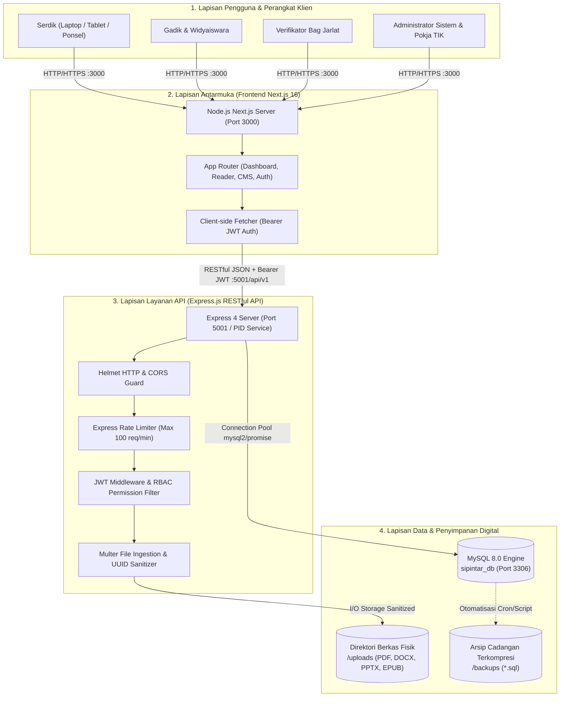
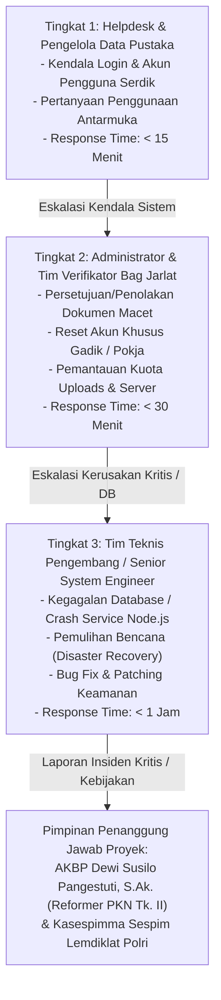

# PANDUAN PEMELIHARAAN SISTEM & PROSEDUR OPERASIONAL STANDAR (SOP)
## SIPINTAR SESPIMMA LEMDIKLAT POLRI
**Sistem Informasi Pembelajaran INovatif Terpadu, Adaptif, dan Responsif**  
*Proyek Perubahan Pelatihan Kepemimpinan Nasional (PKN) Tingkat II Angkatan XXIX Nawasena TA 2026*

---

## Lembar Pengesahan & Identitas Dokumen

| Parameter Dokumen | Rincian Keterangan Resmi |
|---|---|
| **Nama Sistem** | Sistem Informasi Pembelajaran INovatif Terpadu, Adaptif, dan Responsif (SIPINTAR) |
| **Instansi Pengelola** | Sekolah Staf dan Pimpinan Pertama (Sespimma) Sespim Lemdiklat Polri |
| **Inisiator / Reformer** | **AKBP Dewi Susilo Pangestuti, S.Ak.** (Peserta PKN Tk. II Angkatan XXIX TA 2026) |
| **Penanggung Jawab Teknis** | Tim Pokja TIK & Bag Jarlat Sespimma Lemdiklat Polri |
| **Nomor Dokumen** | `SOP/TIK-SESPIMMA/SIPINTAR/2026/01` |
| **Klasifikasi Dokumen** | Dokumen Kedinasan — Petunjuk Operasional & Pemeliharaan Sistem TIK |
| **Versi Dokumen** | v1.0.0 (Tahap Pasca-Integrasi Penuh & Siap Operasional) |
| **Tanggal Ditetapkan** | 21 November 2026 |
| **Repositori Backend API** | [https://github.com/dennyssdm/sipintarsespimmaAPI.git](https://github.com/dennyssdm/sipintarsespimmaAPI.git) (Branch: `main`) |
| **Repositori Frontend UI** | [https://github.com/dennyssdm/Sipintar.git](https://github.com/dennyssdm/Sipintar.git) (Branch: `main`) |

---

## DAFTAR ISI
1. [Ringkasan Eksekutif Pemeliharaan](#1-ringkasan-eksekutif-pemeliharaan)
2. [Ruang Lingkup Sistem & Komponen Arsitektur](#2-ruang-lingkup-sistem--komponen-arsitektur)
3. [Jadwal & Prosedur Pemeliharaan Rutin](#3-jadwal--prosedur-pemeliharaan-rutin)
4. [Prosedur Pencadangan & Pemulihan Bencana (Backup & Disaster Recovery)](#4-prosedur-pencadangan--pemulihan-bencana-backup--disaster-recovery)
5. [Petunjuk Penanganan Insiden & Pemecahan Masalah (Troubleshooting Playbook)](#5-petunjuk-penanganan-insiden--pemecahan-masalah-troubleshooting-playbook)
6. [Manajemen Pembaruan Kode, Patching & Deployment](#6-manajemen-pembaruan-kode-patching--deployment)
7. [Pengerasan Keamanan & Manajemen Rahasia (Security Hardening)](#7-pengerasan-keamanan--manajemen-rahasia-security-hardening)
8. [Lembar Catatan Riwayat Pemeliharaan (Maintenance History Log)](#8-lembar-catatan-riwayat-pemeliharaan-maintenance-history-log)
9. [Matriks Eskalasi & Tim Pengelola Teknis](#9-matriks-eskalasi--tim-pengelola-teknis)

---

## 1. Ringkasan Eksekutif Pemeliharaan

Dokumen **Panduan Pemeliharaan Sistem & Prosedur Operasional Standar (SOP)** ini diterbitkan sebagai pedoman resmi operasional, pemeliharaan berkelanjutan, pemecahan masalah teknis, serta mitigasi risiko bencana bagi infrastruktur aplikasi **SIPINTAR** Sespimma Lemdiklat Polri.

SIPINTAR mengintegrasikan komponen digital kritis institusi:
- **Katalog Pembelajaran Interaktif & Modul Hanjar** (Bahan Ajar digital untuk Serdik).
- **Direktori Tenaga Pendidik & Widyaiswara (Gadik)** beserta rekam jejak kepakaran dan kompetensi.
- **E-Library & Repositori Naskah Akademik (Taskap)** dengan perlindungan hak cipta dan pembatasan unduh.
- **Alur Verifikasi Penjaminan Mutu Naskah Pembelajaran** oleh Tim Penjamin Mutu Bag Jarlat.
- **Pusat Kendali Data (CMS Superadmin)** untuk manajemen pengguna massal, penerbitan naskah, serta ekspor-impor data.

Tujuan utama dari pedoman pemeliharaan ini adalah menjamin **Tingkat Ketersediaan Layanan (Service Availability) $\ge 99.5\%$**, menjaga integritas data akademik tanpa risiko kebocoran (*Zero Unauthorized Leakage*), dan memastikan kontinuitas operasional selama masa pendidikan peserta didik (Serdik).

---

## 2. Ruang Lingkup Sistem & Komponen Arsitektur

### 2.1 Diagram Arsitektur Operasional Sistem



### 2.2 Spesifikasi Komponen & Lingkungan Layanan

| Komponen | Spesifikasi / Konfigurasi | Lokasi Jalur / Port | Status Operasional |
|---|---|---|---|
| **Frontend Runtime** | Node.js v20.x / v24.x (Next.js 16.4.6, React 19) | `/SIPINTAR` (Port `3000`) | Aktif (Daemon / Systemd) |
| **Backend REST API** | Express.js 4.21.2 (ES Modules, mysql2/promise) | `/sipintarsespimmaAPI` (Port `5001`) | Aktif (Daemon / Systemd) |
| **Basis Data Relasional** | MySQL 8.0.x / MariaDB (utf8mb4_unicode_ci) | `localhost:3306` (DB: `sipintar_db`) | Aktif (Service Engine) |
| **Penyimpanan Berkas Digital** | Sanitized Local Storage (Multer UUID naming) | `/sipintarsespimmaAPI/uploads` | Terisolasi (Akses via Route) |
| **Direktori Cadangan Basis Data** | Berkas dump terstruktur berbasis timestamp | `/sipintarsespimmaAPI/backups` | Terjadwal Rutin |
| **Protokol Komunikasi Internal** | JSON RESTful API dengan Bearer Token Authorization | `http://localhost:5001/api/v1` | Teruji 38 Skenario API |

### 2.3 Variabel Lingkungan Kritis (`.env`)

Berkas `.env` pada repositori backend mengatur seluruh interaksi modul:

```env
# Konfigurasi Server
PORT=5001
NODE_ENV=production
FRONTEND_URL=http://localhost:3000

# Kredensial Basis Data MySQL
DB_HOST=127.0.0.1
DB_PORT=3306
DB_USER=root
DB_PASS=
DB_NAME=sipintar_db

# Kunci Rahasia Otentikasi
JWT_SECRET=sipintar_sespimma_super_secret_jwt_key_ta2026_nawasena
JWT_EXPIRES_IN=24h

# Konfigurasi Berkas
UPLOAD_DIR=./uploads
MAX_FILE_SIZE_MB=50
```

> [!WARNING]
> Kunci rahasia `JWT_SECRET` dan kata sandi basis data tidak boleh disebarkan ke publik atau disimpan ke dalam repositori publik git. Pastikan berkas `.env` selalu tercantum dalam `.gitignore`.

---

## 3. Jadwal & Prosedur Pemeliharaan Rutin

Pemeliharaan sistem dibagi menjadi tiga tingkatan berkala: **Harian**, **Mingguan**, dan **Bulanan**.

```
+------------------------------------------------------------------------------------+
|                         JADWAL PEMELIHARAAN SISTEM SIPINTAR                        |
+--------------------------+---------------------------+-----------------------------+
|    HARIAN (Setiap Hari)  |    MINGGUAN (Tiap Senin)  |    BULANAN (Tgl 1 Bln)      |
+--------------------------+---------------------------+-----------------------------+
| • Health check API       | • Rotasi berkas log       | • Optimalisasi tabel MySQL  |
| • Pemantauan Port 5001   | • Review audit anomali    | • Simulasi Disaster Restore |
| • Cek sisa kuota disk    | • Verifikasi integritas DB| • Audit akun nonaktif/alumni|
| • Pemantauan antrean err | • Backup kompresi mingguan| • Update patch dependensi   |
+--------------------------+---------------------------+-----------------------------+
```

---

### 3.1 Prosedur Pemeliharaan Harian (Daily Maintenance)

Waktu Pelaksanaan: Setiap pukul 07.00 WIB (sebelum aktivitas jam pelajaran dinas dimulai).

1. **Pemeriksaan Status Kesehatan Layanan API (Health Check):**
   Jalankan pengujian respons terhadap endpoint health check:
   ```bash
   curl -s -i http://localhost:5001/api/v1/health
   ```
   *Ekspektasi Hasil:*
   ```json
   HTTP/1.1 200 OK
   Content-Type: application/json; charset=utf-8

   {
     "success": true,
     "message": "SIPINTAR Sespimma API is healthy",
     "timestamp": "2026-11-21T07:00:00.000Z",
     "uptime": 86400,
     "environment": "production"
   }
   ```

2. **Pemeriksaan Status Antarmuka Frontend Next.js:**
   ```bash
   curl -s -I http://localhost:3000
   ```
   *Ekspektasi Hasil:* Status kode `HTTP/1.1 200 OK` (atau `307 Temporary Redirect` menuju halaman login `/login`).

3. **Pemeriksaan Ketersediaan Kapasitas Ruang Penyimpanan (Disk Space):**
   ```bash
   df -h /Applications/XAMPP/xamppfiles/htdocs/sipintarsespimmaAPI
   ```
   *Ambang Batas Keamanan:* Ruang kosong disk minimal **15%**. Apabila kapasitas terpakai mencapai $> 85\%$, segera lakukan pembersihan log dan arsip lama.

4. **Pemeriksaan Konektivitas MySQL Pool:**
   Verifikasi bahwa service MySQL aktif menerima koneksi lokal:
   ```bash
   mysqladmin -u root -p ping
   ```
   *Ekspektasi Hasil:* `mysqld is alive`.

---

### 3.2 Prosedur Pemeliharaan Mingguan (Weekly Maintenance)

Waktu Pelaksanaan: Setiap hari Senin pukul 01.00 WIB (luar jam dinas).

1. **Pemeliharaan Berkas Unggahan Dokumen (Storage Audit):**
   Periksa integritas direktori `/uploads` untuk mendeteksi file yatim (*orphaned files*) yang tidak terdaftar pada tabel `resources`:
   ```bash
   cd /Applications/XAMPP/xamppfiles/htdocs/sipintarsespimmaAPI
   node -e "
     import fs from 'fs';
     import pool from './src/config/db.js';
     const files = fs.readdirSync('./uploads');
     const [rows] = await pool.query('SELECT file_path FROM resources WHERE file_path IS NOT NULL');
     const dbFiles = new Set(rows.map(r => r.file_path.replace('/uploads/', '')));
     const orphans = files.filter(f => !dbFiles.has(f) && f !== '.gitkeep');
     console.log('Total file:', files.length, '| Terdaftar DB:', dbFiles.size, '| Orphaned:', orphans.length);
     process.exit(0);
   "
   ```

2. **Audit Catatan Aktivitas Sistem (Activity Logs Review):**
   Periksa rekaman aktivitas administratif mencurigakan pada tabel `activity_logs` (misalnya lonjakan aksi penolakan naskah atau kegagalan otentikasi berturut-turut):
   ```sql
   SELECT action, COUNT(*) as total, DATE(created_at) as log_date 
   FROM activity_logs 
   WHERE created_at >= NOW() - INTERVAL 7 DAY 
   GROUP BY action, log_date 
   ORDER BY log_date DESC;
   ```

3. **Pencadangan Penuh Mingguan (Full Weekly Dump):**
   Jalankan utilitas pencadangan basis data resmi:
   ```bash
   npm run db:backup
   ```

---

### 3.3 Prosedur Pemeliharaan Bulanan (Monthly Maintenance)

Waktu Pelaksanaan: Hari Minggu pertama setiap awal bulan.

1. **Optimalisasi & Defragmentasi Indeks Tabel MySQL:**
   Lakukan rekonsolidasi indeks tabel utama untuk menjaga latensi pencarian di bawah 50 ms:
   ```sql
   USE sipintar_db;
   OPTIMIZE TABLE users, resources, resource_categories, user_profiles_gadik, gadik_competencies, activity_logs;
   ANALYZE TABLE users, resources, activity_logs;
   ```

2. **Simulasi Pemulihan Bencana Kering (Disaster Recovery Dry-Run):**
   Pulihkan cadangan terbaru ke basis data uji (`sipintar_test_db`) untuk memastikan berkas SQL dump valid dan tidak rusak (*corrupted*).

3. **Pembersihan Log Historis Kedaluwarsa:**
   Arsipkan rekaman `activity_logs` yang telah berumur lebih dari 180 hari ke berkas arsip terpisah, kemudian bersihkan dari basis data operasional utama:
   ```sql
   DELETE FROM activity_logs WHERE created_at < NOW() - INTERVAL 180 DAY;
   ```

4. **Pembaruan Tambalan Keamanan Dependensi (NPM Security Audit):**
   ```bash
   npm audit
   ```
   Terapkan patch keamanan jika ditemukan kerentanan dengan kategori *high* atau *critical* tanpa memecah API (*non-breaking fixes*).

---

## 4. Prosedur Pencadangan & Pemulihan Bencana (Backup & Disaster Recovery)

### 4.1 Kebijakan Pemulihan (RPO & RTO)

| Parameter | Target Standar Sespimma | Penjelasan |
|---|---|---|
| **RPO (Recovery Point Objective)** | **$\le 24$ Jam** | Kehilangan data maksimum yang dapat ditoleransi apabila terjadi kerusakan fisik server adalah riwayat data 1 hari kerja sebelumnya. |
| **RTO (Recovery Time Objective)** | **$\le 30$ Menit** | Waktu pemulihan layanan total (dari server mati hingga online kembali dan dapat diakses pengguna) maksimal 30 menit. |

---

### 4.2 Prosedur Pencadangan Basis Data (Database Backup SOP)

Sistem SIPINTAR telah dilengkapi dengan script otomasi pencadangan mandiri (`scripts/backup.js`) yang mendeteksi konfigurasi database secara dinamis.

#### Perintah Eksekusi Pencadangan:
```bash
cd /Applications/XAMPP/xamppfiles/htdocs/sipintarsespimmaAPI
npm run db:backup
```

#### Output Eksekusi Sukses:
```text
============================================================
  SIPINTAR Sespimma — Database Backup Utility
  Target Database: sipintar_db on 127.0.0.1:3306
============================================================

Menjalankan pencadangan basis data...
[SUKSES] Salinan basis data berhasil dibuat!
  Berkas : /Applications/XAMPP/xamppfiles/htdocs/sipintarsespimmaAPI/backups/sipintar_db_backup_20261121_010000.sql
  Ukuran : 485.6 KB (497254 bytes)
  Waktu  : 21/11/2026, 01.00.02
```

#### Otomatisasi via Cron Job (Linux / macOS Server):
Untuk menjadwalkan pencadangan otomatis setiap malam pukul 02.00 WIB:
```bash
# Buka crontab
crontab -e

# Tambahkan baris jadwal berikut:
0 2 * * * cd /Applications/XAMPP/xamppfiles/htdocs/sipintarsespimmaAPI && /usr/local/bin/node scripts/backup.js >> /var/log/sipintar_backup.log 2>&1
```

---

### 4.3 Prosedur Pencadangan Berkas Fisik Modul & Taskap (`/uploads`)

Pencadangan dokumen PDF, DOCX, dan PPTX dilakukan dengan menyalin direktori penyimpanan dokumen digital:

```bash
# Membuat arsip tar.gz dengan tanggal hari ini
tar -czvf /backups/uploads_backup_$(date +%Y%m%d).tar.gz /Applications/XAMPP/xamppfiles/htdocs/sipintarsespimmaAPI/uploads
```

---

### 4.4 Prosedur Pemulihan Bencana (Database Disaster Recovery SOP)

Apabila terjadi kehilangan data, kegagalan migrasi, atau kerusakan pada basis data MySQL, lakukan tahapan pemulihan terstruktur berikut:

#### Langkah 1: Hentikan Akses Publik Sementara
Pasang halaman *maintenance* sementara atau hentikan proses backend agar tidak terjadi inkonsistensi data:
```bash
killall node  # atau: pm2 stop sipintar-api
```

#### Langkah 2: Pulihkan Basis Data dari Arsip Terakhir
Jalankan utilitas pemulihan resmi (`scripts/restore.js`):

```bash
cd /Applications/XAMPP/xamppfiles/htdocs/sipintarsespimmaAPI

# Pemulihan otomatis dari berkas dump TERBARU di direktori backups/:
npm run db:restore

# ATAU pemulihan dari berkas cadangan spesifik:
node scripts/restore.js backups/sipintar_db_backup_20261121_010000.sql
```

#### Langkah 3: Verifikasi Integritas Data Pasca-Pemulihan
Periksa jumlah baris tabel utama untuk memastikan data pulih seutuhnya:
```bash
node -e "
  import pool from './src/config/db.js';
  const [[u]] = await pool.query('SELECT COUNT(*) as count FROM users');
  const [[r]] = await pool.query('SELECT COUNT(*) as count FROM resources');
  const [[g]] = await pool.query('SELECT COUNT(*) as count FROM user_profiles_gadik');
  console.log('Verifikasi Data Pulih:');
  console.log('- Total Pengguna (Users)      :', u.count);
  console.log('- Total Modul/Naskah (Resources):', r.count);
  console.log('- Total Profil Gadik           :', g.count);
  process.exit(0);
"
```

#### Langkah 4: Hidupkan Kembali Layanan
```bash
npm run dev # atau untuk production: npm start / pm2 start server.js --name sipintar-api
```

---

## 5. Petunjuk Penanganan Insiden & Pemecahan Masalah (Troubleshooting Playbook)

Bagian ini menyajikan langkah konkret pemecahan masalah cepat untuk insiden yang sering terjadi.

---

### Insiden 1: Basis Data MySQL Berhenti / Koneksi Ditolak (`ECONNREFUSED 127.0.0.1:3306`)

- **Gejala:** Seluruh permintaan API menghasilkan pesan kesalahan `500 Database connection failed`.
- **Penyebab:** Layanan MySQL pada XAMPP/server mati atau mengalami crash.
- **Langkah Penanganan:**
  1. Periksa status layanan MySQL:
     ```bash
     ps aux | grep mysql
     ```
  2. Mulai ulang engine MySQL melalui XAMPP Control atau CLI:
     ```bash
     # Jalur XAMPP macOS:
     sudo /Applications/XAMPP/xamppfiles/bin/mysql.server restart
     # Atau pada sistem Linux Systemd:
     sudo systemctl restart mysql
     ```
  3. Uji koneksi cepat:
     ```bash
     mysql -u root -e "SELECT NOW();"
     ```

---

### Insiden 2: Alamat Port Bentrok / Masih Terpakai (`EADDRINUSE: port 5001` atau `3000`)

- **Gejala:** Server gagal menyala saat dijalankan dengan log `Error: listen EADDRINUSE: address already in use :::5001`.
- **Penyebab:** Ada proses *background* Node.js zombie yang masih mengikat port 5001 atau 3000.
- **Langkah Penanganan:**
  1. Cari nomor PID yang menggunakan port tersebut:
     ```bash
     lsof -i :5001
     lsof -i :3000
     ```
  2. Hentikan proses yang menempati port:
     ```bash
     kill -9 <PID_YANG_TERDETEKSI>
     ```
  3. Nyalakan kembali server API atau Frontend.

---

### Insiden 3: Pengguna Terkunci Oleh Rate Limiter (`429 Too Many Requests`)

- **Gejala:** Klien menerima kode HTTP 429 dengan pesan:
  ```json
  {
    "success": false,
    "error": {
      "code": "TOO_MANY_REQUESTS",
      "message": "Terlalu banyak permintaan dari IP ini. Silakan coba kembali setelah beberapa saat."
    }
  }
  ```
- **Penyebab:** Klien (misalnya proses testing otomatis atau pengguna di balik NAT kantor) melakukan lebih dari 100 permintaan dalam jendela waktu 1 menit.
- **Langkah Penanganan:**
  1. Tunggu jeda waktu reset (1 menit / 60 detik).
  2. Jika diperlukan pelonggaran kuota limit untuk lingkungan internal Sespimma, sesuaikan batas pada middleware `src/middleware/rateLimiter.js`:
     ```javascript
     export const apiLimiter = rateLimit({
       windowMs: 60 * 1000,
       max: 200, // Tingkatkan dari 100 menjadi 200 req/min
       standardHeaders: true,
       legacyHeaders: false,
     });
     ```
  3. Muat ulang server API.

---

### Insiden 4: Sesi Login Kadaluwarsa / Penolakan Akses (`401 Unauthorized` / `403 Forbidden`)

- **Gejala:** Pengguna melaporkan tidak dapat mengunduh materi atau membuka menu verifikasi.
- **Penyebab:**
  - Token JWT telah melampaui batas masa berlaku 24 jam.
  - Peran pengguna (Role) tidak memiliki izin RBAC yang memadai (contoh: `serdik` mencoba menyetujui naskah verifikasi).
  - Klasifikasi naskah adalah `Terbatas` atau `Metadata Saja`.
- **Langkah Penanganan:**
  1. Minta pengguna keluar (*Logout*) dan melakukan login kembali untuk memperbarui token JWT.
  2. Pastikan peran pengguna pada basis data telah sesuai di tabel `users` (kolom `role`).
  3. Periksa klasifikasi akses naskah pada tabel `resources`: dokumen `Metadata Saja` (seperti Taskap dan buku fisik perpustakaan) secara sengaja diproteksi agar tidak dapat diunduh berkas digitalnya sesuai aturan kedinasan Sespimma.

---

### Insiden 5: Kegagalan Unggah Dokumen (`413 Payload Too Large` / `EACCES Permission Denied`)

- **Gejala:** Pengguna gagal mengunggah bahan ajar baru di CMS.
- **Penyebab:**
  - Ukuran berkas melebihi 50 MB.
  - Tipe berkas bukan `.pdf`, `.docx`, `.pptx`, `.epub`, atau `.mp4`.
  - Folder `uploads/` tidak memiliki hak akses tulis (*write permission*) bagi proses Node.js.
- **Langkah Penanganan:**
  1. Periksa hak akses direktori penyimpanan:
     ```bash
     chmod 755 /Applications/XAMPP/xamppfiles/htdocs/sipintarsespimmaAPI/uploads
     chown -R $(whoami) /Applications/XAMPP/xamppfiles/htdocs/sipintarsespimmaAPI/uploads
     ```
  2. Kompres ukuran file PDF jika melebihi batas 50 MB sebelum diunggah ke sistem.

---

## 6. Manajemen Pembaruan Kode, Patching & Deployment

Untuk menjamin pembaruan kode berjalan lancar tanpa menimbulkan *downtime* atau kerusakan data naskah aktif, terapkan alur berikut:

### 6.1 Alur Standar Deployment Pembaruan


### 6.2 Perintah Terpadu Pelaksanaan Pembaruan

#### Pembaruan Backend API:
```bash
cd /Applications/XAMPP/xamppfiles/htdocs/sipintarsespimmaAPI
git fetch origin main
git pull origin main
npm install --omit=dev
npm run db:backup  # Selalu cadangkan database sebelum restart
npm test           # Verifikasi test suite API
# Restart proses:
pm2 restart sipintar-api # Atau mulai ulang daemon service
```

#### Pembaruan Frontend Next.js:
```bash
cd "/Users/masboy/Desktop/PROPER AKBP DEWI/SIPINTAR"
git fetch origin main
git pull origin main
npm install --omit=dev
npm run build      # Verifikasi type check TypeScript dan static build
# Restart frontend:
pm2 restart sipintar-frontend # Atau mulai ulang daemon service
```

---

## 7. Pengerasan Keamanan & Manajemen Rahasia (Security Hardening)

Keamanan informasi pembelajaran kedinasan dilindungi dengan prinsip pertahanan berlapis (*Defense in Depth*):

### 7.1 Kebijakan Kriptografi & Penyimpanan Sandi
- Sandi pengguna wajib dienkripsi menggunakan algoritma **bcryptjs** dengan faktor kerja (*salt rounds*) $\ge 10$.
- Kueri SQL tidak boleh mengembalikan kolom `password` ke lapisan API atau antarmuka (`SELECT id, name, email, role, ...`).

### 7.2 Prosedur Rotasi Kunci Rahasia JWT (`JWT_SECRET`)
Rotasi kunci rahasia dilakukan secara berkala setiap **6 bulan** atau saat terjadi mutasi tim administrator:
1. Buat token acak berkekuatan tinggi (minimal 64 karakter heksadesimal):
   ```bash
   node -e "console.log(crypto.randomBytes(32).toString('hex'))"
   ```
2. Perbarui nilai `JWT_SECRET` pada berkas `.env`.
3. Mulai ulang proses API. Seluruh sesi aktif akan kedaluwarsa secara aman dan meminta pengguna login kembali.

### 7.3 Pengerasan Hak Akses Berkas Sistem (File Permissions)
Terapkan pengaturan izin akses ketat pada server:
- Direktori kode sumber (`/src`): `755` (Read & Execute bagi proses).
- Berkas rahasia (`.env`): `600` (Hanya dapat dibaca oleh pemilik proses/user daemon).
- Direktori unggahan (`/uploads`): `755` (Direktori) dan `644` (Berkas dokumen). **Eksekusi script (`.php`, `.sh`, `.exe`, `.js`) di dalam folder unggahan diblokir total oleh router**.

---

## 8. Lembar Catatan Riwayat Pemeliharaan (Maintenance History Log)

Gunakan format tabel berikut untuk mencatat setiap intervensi teknis, pembaruan versi, atau pemeliharaan berkala:

| Tanggal & Waktu | Pelaksana / Teknisi | Komponen Sistem | Jenis Kegiatan Pemeliharaan | Hasil / Status Verifikasi | Catatan Perubahan & Tindak Lanjut |
|---|---|---|---|---|---|
| **17/11/2026 20:30** | Tim Pengembang SIPINTAR | Basis Data & Skema | Migrasi Skema MySQL & Ingest Data Awal | **SUKSES** | Skema `sipintar_db` disiapkan, 38 skenario Postman diverifikasi hijau. |
| **18/11/2026 14:00** | Tim Pengembang SIPINTAR | Frontend & Backend API | Integrasi Penuh 13 Modul SIPINTAR | **SUKSES** | Dokumen `API_INTEGRATION_GUIDE.md` & `LAPORAN_INTEGRASI.md` diterbitkan. |
| **18/11/2026 16:30** | Tim Pengembang SIPINTAR | Frontend UI & CMS | Penyesuaian Toolbar Action Buttons CMS | **SUKSES** | Tombol aksi sejajar vertikal 38px, ikon ganda `+ +` dibersihkan. |
| **20/11/2026 19:45** | Tim Pengembang SIPINTAR | Basis Data & Nominatif | Sinkronisasi Nominatif User & Password | **SUKSES** | Skrip `sync_nominatif_users.js` dijalankan, akun Serdik & Gadik aktif. |
| **21/11/2026 18:20** | Tim Pengembang SIPINTAR | Basis Data & Direktori | Sanitasi Data Gadik (4 Personel Dihapus) | **SUKSES** | Record 4 Gadik dihapus dari DB, `database.sql`, dan mock frontend disinkronkan. |
| **21/11/2026 18:45** | Tim Pengembang SIPINTAR | Dokumentasi Kedinasan | Penerbitan Panduan Pemeliharaan & SOP | **SUKSES** | Berkas `maintenance.md` disahkan dan disinkronkan ke kedua repositori. |
| *(Berikutnya)* | *Tim Pokja TIK Sespimma* | *Seluruh Komponen* | *Pemeliharaan Rutin Bulanan* | *Terjadwal* | *Optimalisasi berkala indeks MySQL & uji coba restore mingguan.* |

---

## 9. Matriks Eskalasi & Tim Pengelola Teknis

Apabila terjadi kendala sistem yang tidak dapat diselesaikan melalui petunjuk pemecahan masalah standar, segera lakukan eskalasi berjenjang sesuai matriks berikut:



### Kontak Layanan Operasional:
- **Pengelola Server & Basis Data:** Bag Jarlat / Pokja TIK Sespimma Lemdiklat Polri
- **Alamat Kantor:** Kampus Sespimma Sespim Lemdiklat Polri, Jl. Ciputat Raya No. 40, Kebayoran Lama, Jakarta Selatan
- **Status Operasional SIPINTAR:** Beroperasi Penuh (*Full Production Ready*)

---
*Dokumen ini merupakan bagian integral dari Laporan Proyek Perubahan PKN Tingkat II Angkatan XXIX Nawasena Tahun Anggaran 2026.*
