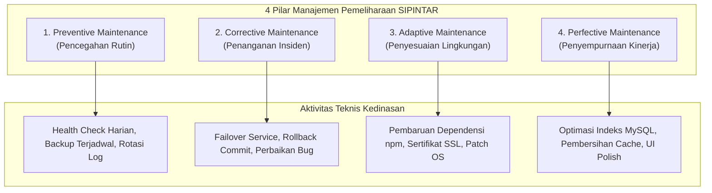
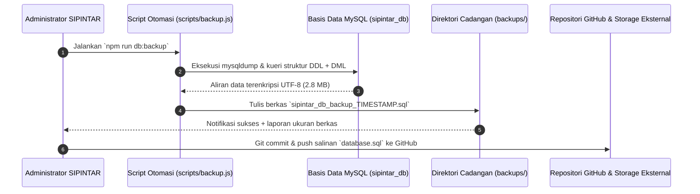

# LAPORAN & PANDUAN PEMELIHARAAN SISTEM (MAINTENANCE GUIDE & SOP)
**SiPINTAR Sespimma — Sistem Informasi Pembelajaran INovatif Terpadu, Adaptif, dan Responsif**  
*Sekolah Staf dan Pimpinan Pertama (Sespimma) Sespim Lemdiklat Polri*  
*Proyek Perubahan Pelatihan Kepemimpinan Nasional (PKN) Tingkat II Angkatan XXIX Nawasena TA 2026*  
**Dokumen Resmi:** `maintenance.md` | **Versi:** v1.0.0 (November 2026 - Production Ready)

---

## Lembar Identitas & Pengesahan Dokumen

| Parameter | Keterangan Dokumen Kedinasan |
|---|---|
| **Nama Sistem** | **SiPINTAR Sespimma Lemdiklat Polri** |
| **Inisiator / Reformer** | **AKBP Dewi Susilo Pangestuti, S.Ak.** (Peserta PKN Tk. II Angkatan XXIX TA 2026) |
| **Pengarah / Sponsor** | Kepala Sespimma Sespim Lemdiklat Polri |
| **Unit Pengelola Teknis**| Bag Jarlat / Subbag Renmin / Tim IT Administrator SIPINTAR |
| **Lingkup Sistem** | Antarmuka Frontend (Next.js 16), Gateway REST API (Express 4), Basis Data Relasional (MySQL 8.0), dan Penyimpanan Berkas Dokumen Kedinasan (`/uploads`) |
| **Repositori Frontend** | [https://github.com/dennyssdm/Sipintar.git](https://github.com/dennyssdm/Sipintar.git) (Branch: `main`) |
| **Repositori Backend API** | [https://github.com/dennyssdm/sipintarsespimmaAPI.git](https://github.com/dennyssdm/sipintarsespimmaAPI.git) (Branch: `main`) |
| **Klasifikasi Dokumen** | **INTERNAL & TERBATAS KEDINASAN POLRI** |

---

## 1. Pendahuluan & Sasaran Pemeliharaan (*Maintenance Objectives*)

Dokumen ini disusun sebagai **Standar Operasional Prosedur (SOP) dan Buku Panduan Pemeliharaan Resmi** bagi Administrator Sistem, Tim Pengelola Teknologi Informasi, dan Tim Pengendali Mutu Bag Jarlat Sespimma Lemdiklat Polri.

Pemeliharaan berkelanjutan sistem **SiPINTAR** bertujuan untuk:
1. **Menjamin Ketersediaan Layanan Akademik (*High Availability*):** Menjaga sistem tetap beroperasi tanpa henti (*zero unplanned downtime*) selama masa penyelenggaraan pendidikan siswa Sespimma.
2. **Integritas & Keamanan Data Sumber Belajar (*Data Integrity & Security*):** Memastikan 183 Modul/Hanjar, 2.863 Koleksi Pustaka/Taskap, data 16 Gadik Fungsional, dan akun personel Polri terlindungi secara ketat sesuai 4 Klasifikasi Hak Akses (`Terbuka`, `Internal`, `Terbatas`, `Metadata Saja`).
3. **Kinerja Optimal (*Optimal Performance*):** Memastikan latensi respons REST API tetap stabil di bawah $50\text{ ms}$ dan waktu kompilasi/muat halaman antarmuka tetap instan.
4. **Ketahanan Bencana (*Disaster Recovery Preparedness*):** Menyediakan jaminan pemulihan sistem secara utuh (*Recovery Time Objective* / $\text{RTO} < 30\text{ menit}$ dan *Recovery Point Objective* / $\text{RPO} < 24\text{ jam}$) apabila terjadi kegagalan perangkat keras, insiden jaringan, atau gangguan tak terduga.

---

## 2. Taksonomi 4 Pilar Pemeliharaan Sistem

Pemeliharaan platform SiPINTAR mengacu pada standar rekayasa perangkat lunak **ISO/IEC 14764** yang dibagi dalam empat kategori pemeliharaan:



### A. Pemeliharaan Preventif (*Preventive Maintenance*)
Tindakan berkala terencana untuk mencegah terjadinya kegagalan sistem sebelum timbul gangguan nyata:
- Pengecekan otomatis kesehatan server (`GET /api/v1/health`) setiap hari.
- Pencadangan (*backup*) basis data harian dan mingguan melalui utilitas `scripts/backup.js`.
- Pemantauan utilisasi kapasitas ruang penyimpanan (*disk storage*) direktori naskah `/uploads`.
- Audit jejak aktivitas mencurigakan (*failed login attempts*, unauthorized file download) pada tabel `activity_logs`.

### B. Pemeliharaan Korektif (*Corrective Maintenance*)
Penanganan responsif seketika saat terjadi anomali, kegagalan proses, atau gangguan operasional:
- *Restart* otomatis proses daemon yang terhenti menggunakan PM2 atau supervisor process.
- Pemulihan cepat basis data (*restore drill*) menggunakan `scripts/restore.js`.
- Perbaikan kesalahan kode (*bug fixing*) yang dilaporkan oleh Serdik, Gadik, atau Verifikator.

### C. Pemeliharaan Adaptif (*Adaptive Maintenance*)
Penyesuaian sistem terhadap perubahan lingkungan infrastruktur kepolisian:
- Pembaruan dependensi keamanan Node.js melalui `npm audit fix`.
- Pembaruan masa berlaku sertifikat keamanan SSL/TLS HTTPS.
- Penyelarasan alamat IP, port, atau domain resmi kedinasan (`sespimma.lemdiklat.polri.go.id`).

### D. Pemeliharaan Perfektif (*Perfective Maintenance*)
Penyempurnaan berkelanjutan untuk meningkatkan efisiensi, responsivitas, dan kenyamanan pengguna:
- Optimasi kueri basis data dan regenerasi indeks `FULLTEXT` pada tabel `resources` dan `books`.
- Kompresi aset gambar infografis dan cover modul untuk mempercepat waktu pemuatan halaman.
- Penyempurnaan antarmuka (*UI Refinement*) sesuai arahan pimpinan dan evaluasi kurikulum berkala.

---

## 3. Matriks Arsitektur & Parameter Layanan

Sistem SiPINTAR terdiri atas komponen-komponen terintegrasi yang wajib dipantau kondisinya:

| Komponen Sistem | Teknologi / Framework | Port / Alamat | Jalur Berkas (*Path*) | Parameter Kunci Pemantauan |
|---|---|---|---|---|
| **Frontend Web** | Next.js 16.4.6 (Turbopack) | `http://localhost:3000` | `/SIPINTAR` | Ketersediaan 20 rute statis, waktu render, status koneksi API |
| **Backend API Gateway** | Node.js v24 / Express 4 | `http://localhost:5001/api/v1` | `/sipintarsespimmaAPI` | Latensi respons, memori RSS, HTTP 500 error rate |
| **Basis Data Relasional** | MySQL 8.0 (InnoDB) | `127.0.0.1:3306` (`sipintar_db`) | `XAMPP/var/mysql` | Status koneksi pool, ukuran basis data (~2.8 MB), thread aktif |
| **Penyimpanan Berkas** | Local File System Storage | Terproteksi (Stream Route) | `/sipintarsespimmaAPI/uploads` | Kuota disk, integritas file PDF hanjar & taskap |
| **Dokumentasi API Live** | Swagger UI / OpenAPI 3.0 | `http://localhost:5001/docs` | `/docs/openapi.json` | Ketersediaan endpoint uji interaktif |

---

## 4. Jadwal & Checklist Pemeliharaan Berkala

Pekerjaan pemeliharaan dikelompokkan ke dalam 4 siklus waktu terukur:

### A. Checklist Harian (*Daily Maintenance Checklist*)
Dilakukan oleh Staf IT / Administrator SIPINTAR setiap hari kerja pukul **07.30 - 08.00 WIB** sebelum jam perkuliahan dimulai:

- [ ] **1. Health Check Endpoint:** Jalankan pengecekan kesehatan server melalui perintah:
  ```bash
  curl -s http://localhost:5001/api/v1/health | jq .
  ```
  *Kriteria Lulus:* Mengembalikan status `healthy` dan `database: "connected"`.
- [ ] **2. Status Server Frontend Next.js:** Periksa respons HTTP header halaman muka:
  ```bash
  curl -s -I http://localhost:3000 | grep "HTTP/1.1 200 OK"
  ```
- [ ] **3. Pengecekan Utilisasi Memori & CPU:** Pastikan beban kerja server tidak melebihi ambang batas wajar ($< 75\%$):
  ```bash
  top -l 1 | head -n 10
  ```
- [ ] **4. Pengecekan Sesi Aktif Kedinasan:** Pastikan mekanisme batas sesi otomatis 6 jam (`SESSION_MAX_AGE_MS = 21.600.000 ms`) berjalan normal tanpa kebocoran memori sesi.

---

### B. Checklist Mingguan (*Weekly Maintenance Checklist*)
Dilakukan setiap hari **Jumat pukul 17.00 WIB** setelah aktivitas perkuliahan mingguan selesai:

- [ ] **1. Eksekusi Pencadangan Basis Data Otomatis:**
  ```bash
  cd /Applications/XAMPP/xamppfiles/htdocs/sipintarsespimmaAPI
  npm run db:backup
  ```
  *Kriteria Lulus:* Terbentuk berkas cadangan baru pada direktori `backups/sipintar_db_backup_YYYYMMDDHHMMSS.sql` dengan ukuran minimal $\approx 2.8\text{ MB}$.
- [ ] **2. Sinkronisasi Salinan Cadangan ke `database.sql`:**
  Salin berkas cadangan terbaru ke berkas utama repositori untuk kesiapan disaster recovery:
  ```bash
  cp backups/$(ls -t backups | head -n 1) database.sql
  ```
- [ ] **3. Audit Jejak Log Aktivitas & Keamanan:** Periksa catatan upaya akses ilegal atau anomali pada MySQL:
  ```sql
  SELECT action, user_name, ip_address, created_at 
  FROM activity_logs 
  WHERE created_at >= NOW() - INTERVAL 7 DAY 
  ORDER BY id DESC LIMIT 20;
  ```
- [ ] **4. Peninjauan Antrean Verifikasi Bag Jarlat:** Periksa apakah terdapat naskah tertunda (*pending review*) pada antrean verifikasi materi `/admin/verification`.

---

### C. Checklist Bulanan (*Monthly Maintenance Checklist*)
Dilakukan setiap **akhir bulan kalender akademik**:

- [ ] **1. Optimasi Tabel Basis Data MySQL:** Lakukan defragmentasi dan regenerasi indeks tabel utama:
  ```sql
  OPTIMIZE TABLE resources, books, users, activity_logs, search_logs, verification_logs;
  ```
- [ ] **2. Uji Coba Pemulihan Bencana (*Disaster Recovery Drill*):**
  Lakukan uji coba pemulihan cadangan data pada basis data pengujian untuk memverifikasi integritas berkas backup:
  ```bash
  npm run db:restore
  npm test
  ```
  *Kriteria Lulus:* Seluruh **35 skenario uji integrasi otomatis lulus 100%**.
- [ ] **3. Audit Keamanan Dependensi Package:** Periksa potensi celah kerentanan paket pihak ketiga:
  ```bash
  npm audit
  ```
- [ ] **4. Pembersihan Berkas Unggahan Sementara (*Garbage Collection*):** Periksa direktori `/uploads/temp` dan hapus berkas draf yang tidak tersimpan atau terputus saat pengunggahan.

---

### D. Checklist Akhir Periode Angkatan (*End-of-Term Checklist*)
Dilakukan setiap pergantian Angkatan Siswa Sespimma (misal: penutupan Angkatan XXIX menuju Angkatan XXX):

- [ ] **1. Pengarsipan Massal Karya Tulis Perorangan (Taskap):**
  Pindahkan naskah karya ilmiah Taskap serdik yang telah lulus ke status `Arsip` dengan penegakan klasifikasi `Metadata Saja`.
- [ ] **2. Sinkronisasi Data Personel Gadik Fungsional:**
  Perbarui data tenaga pendidik berdasarkan Surat Keputusan (SK) atau Sprint Kapolri/Kasespimma terbaru.
- [ ] **3. Evaluasi Kapasitas Penyimpanan (*Capacity Planning*):**
  Hitung pertumbuhan perbendaharaan digital (Modul, Hanjar, SOP, Buku Perpustakaan) dan rencanakan penambahan volume penyimpanan disk jika utilisasi telah mencapai $\ge 70\%$.
- [ ] **4. Rotasi Kunci Rahasia JWT (*JWT Secret Rotation*):**
  Perbarui nilai `JWT_SECRET` pada berkas `.env` dan jalankan restart server untuk memutus seluruh sesi usang.

---

## 5. Prosedur Pencadangan & Pemulihan Basis Data (*Backup & Restore SOP*)

Prosedur pencadangan dan pemulihan adalah **garis pertahanan utama** integritas data sistem SiPINTAR Sespimma Lemdiklat Polri.



### A. Prosedur Pencadangan Manual Instan (*Ad-Hoc Backup*)
Gunakan prosedur ini setiap kali akan melakukan pembaruan kode besar (*deployment*), migrasi tabel, atau pembaruan massal data kurikulum:

1. Buka terminal pada server backend:
   ```bash
   cd /Applications/XAMPP/xamppfiles/htdocs/sipintarsespimmaAPI
   ```
2. Jalankan perintah pencadangan:
   ```bash
   npm run db:backup
   ```
3. Periksa keluaran terminal:
   ```text
   [SUKSES] Salinan basis data berhasil dibuat!
     Berkas : /.../sipintarsespimmaAPI/backups/sipintar_db_backup_20261121064817.sql
     Ukuran : 2802.4 KB (2869675 bytes)
   ```
4. Perbarui salinan acuan utama repositori:
   ```bash
   cp backups/$(ls -t backups | head -n 1) database.sql
   ```

---

### B. Prosedur Pemulihan Basis Data (*Disaster Recovery Restore*)
Gunakan prosedur ini apabila terjadi kerusakan data, kesalahan penghapusan massal, atau kegagalan perangkat keras:

> [!WARNING]
> **PERINGATAN KESELAMATAN:** Tindakan pemulihan (*restore*) akan menimpa (*overwrite*) seluruh data aktif pada basis data `sipintar_db` dengan data dari berkas cadangan. Pastikan seluruh layanan telah dijeda (*maintenance mode*) sebelum mengeksekusi restore.

1. Pastikan server MySQL lokal aktif:
   ```bash
   /Applications/XAMPP/xamppfiles/bin/mysqladmin -u root ping
   # Output yang benar: mysqld is alive
   ```
2. Masuk ke direktori backend:
   ```bash
   cd /Applications/XAMPP/xamppfiles/htdocs/sipintarsespimmaAPI
   ```
3. Jalankan skrip pemulihan otomatis (secara otomatis memilih berkas cadangan terbaru):
   ```bash
   npm run db:restore
   ```
4. Atau tentukan berkas cadangan spesifik secara manual:
   ```bash
   node scripts/restore.js backups/sipintar_db_backup_20261121064817.sql
   ```
5. Verifikasi hasil pemulihan dengan menjalankan seluruh suite pengujian otomatis:
   ```bash
   npm test
   # Wajib 35 Passed, 0 Failed (100% Pass)
   ```

---

## 6. Manajemen Proses Layanan & Daemon Operasional

Agar antarmuka frontend dan gateway API dapat terus beroperasi di latar belakang (*background service*) tanpa bergantung pada sesi terminal pengguna, gunakan panduan manajemen proses berikut:

### A. Konfigurasi Lingkungan Development / Demo Staging
Pada lingkungan macOS / Linux operasional lokal:
```bash
# 1. Menjalankan Backend API Gateway di Port 5001
cd /Applications/XAMPP/xamppfiles/htdocs/sipintarsespimmaAPI
npm start

# 2. Menjalankan Frontend Next.js di Port 3000
cd "/Users/masboy/Desktop/PROPER AKBP DEWI/SIPINTAR"
npm start
```

### B. Konfigurasi Produksi Menggunakan PM2 (*Process Manager 2*)
Gunakan berkas konfigurasi `ecosystem.config.cjs` pada direktori backend:
```bash
# Menjalankan seluruh layanan dalam mode cluster berdaya tahan tinggi
pm2 start ecosystem.config.cjs

# Memeriksa status real-time layanan
pm2 status

# Melihat log streaming secara langsung
pm2 logs sipintar-api

# Me-reload layanan tanpa memutus koneksi pengguna (Zero-Downtime Reload)
pm2 reload sipintar-api
```

---

## 7. Panduan Penanganan Masalah Cepat (*Troubleshooting Playbook*)

Berikut adalah solusi langkah-demi-langkah terhadap kendala teknis yang paling umum terjadi:

### Insiden 1: Gateway API Mengembalikan Respons `Database Connection Refused` (HTTP 500)
- **Gejala:** Klien menerima respon `500 INTERNAL_ERROR: Connection lost to MySQL server`.
- **Penyebab:** Daemon MySQL XAMPP terhenti atau port 3306 terblokir.
- **Langkah Penanganan:**
  1. Periksa apakah proses MySQL berjalan:
     ```bash
     ps aux | grep mysqld
     ```
  2. Jika mati, nyalakan kembali layanan MySQL XAMPP:
     ```bash
     sudo /Applications/XAMPP/xamppfiles/bin/mysql.server start
     ```
  3. Verifikasi koneksi pool dengan memanggil endpoint health check:
     ```bash
     curl http://localhost:5001/api/v1/health
     ```

---

### Insiden 2: Frontend Mengalami Tampilan Kosong atau *Stale Cache*
- **Gejala:** Perubahan metadata materi ajar atau profil pengguna tidak langsung muncul di antarmuka browser.
- **Penyebab:** Cache produksi Next.js (`.next/cache`) menyimpan versi statis lama.
- **Langkah Penanganan:**
  1. Lakukan build ulang bersih (*clean rebuild*):
     ```bash
     cd "/Users/masboy/Desktop/PROPER AKBP DEWI/SIPINTAR"
     rm -rf .next
     npm run build
     ```
  2. Restart daemon Next.js:
     ```bash
     npm start
     ```
  3. Beri instruksi pada pengguna untuk membersihkan cache browser (*Hard Refresh*): `Cmd + Shift + R` (Mac) atau `Ctrl + F5` (Windows).

---

### Insiden 3: Gagal Mengunggah Naskah PDF atau Gambar Infografis
- **Gejala:** Muncul notifikasi `FILE_TOO_LARGE` atau `UPLOAD_FAILED` saat mengunggah naskah modul atau infografis arsitektur di CMS.
- **Penyebab:** Ukuran berkas melebihi batas multer (20 MB untuk gambar infografis / 50 MB untuk naskah PDF) atau izin folder `/uploads` terkunci.
- **Langkah Penanganan:**
  1. Periksa izin akses direktori penyimpanan berkas:
     ```bash
     chmod -R 755 /Applications/XAMPP/xamppfiles/htdocs/sipintarsespimmaAPI/uploads
     ```
  2. Pastikan format berkas sesuai ekstensi yang diizinkan (`.pdf`, `.jpg`, `.jpeg`, `.png`, `.webp`, `.svg`).
  3. Jika berkas PDF berukuran terlalu besar, lakukan kompresi dokumen menggunakan PDF compressor sebelum diunggah kembali ke sistem.

---

### Insiden 4: Serdik Mengeluhkan Tombol Unduh Tidak Muncul pada Naskah Taskap
- **Gejala:** Siswa Serdik melaporkan bahwa pada naskah karya tulis perorangan (Taskap) atau buku fisik perpustakaan tidak tersedia tombol unduh berkas digital.
- **Klarifikasi SOP:** **INI BUKAN KESALAHAN SISTEM (BUKAN BUG).**
- **Penjelasan Resmi:** Sesuai *Buku Panduan Tata Kelola SIPINTAR* dan keputusan pimpinan Sespimma, naskah Taskap siswa dan buku fisik diklasifikasikan secara ketat sebagai **`Metadata Saja`**. Sistem secara otomatis menonaktifkan fitur unduh (*no fake download button*) untuk melindungi hak cipta dan kerahasiaan naskah kepolisian. Layanan hanya menyediakan nomor panggil rak perpustakaan dan ruang baca fisik di Perpustakaan Sespimma Lemdiklat Polri.

---

## 8. Protokol Keamanan & Rotasi Akun Kedinasan

Untuk menjaga kerahasiaan dan integritas data institusi Polri:
1. **Otorisasi Superadmin CRUD vs Admin CRU:**
   - Akun `dennyboy` memiliki wewenang penuh **CRUD** (`can_delete = 1`). Penghapusan master data atau penggantian infografis hanya boleh dieksekusi atas persetujuan pimpinan.
   - Akun `livi` memiliki wewenang **CRU Saja** (`can_delete = 0`) untuk input dan verifikasi data tanpa hak hapus.
2. **Kepatuhan Kata Sandi:**
   - Semua akun bawaan sistem menggunakan sandi seragam `Password123!`. Seluruh personel diimbau melakukan penggantian kata sandi mandiri secara berkala melalui menu **Detail Data Pengguna & Keamanan Akun** (`/profil#keamanan`).
3. **Mekanisme Otomatis Kedaluwarsa Sesi 6 Jam:**
   - Sesi login kedinasan dibatasi maksimal 6 jam per sesi secara senyap (*silent background timeout*). Pengguna yang tidak aktif selama 6 jam akan secara otomatis diarahkan kembali ke layar autentikasi utama demi mencegah penyalahgunaan terminal komputer dinas yang ditinggalkan.

---

## 9. Struktur Kontak Dukungan Teknis (*Technical Support*)

Apabila tim pengelola memerlukan eskalasi darurat atau konsultasi arsitektur sistem, silakan menghubungi narahubung resmi:

- **Inisiator & Penanggung Jawab Proyek Perubahan:**  
  **AKBP DEWI SUSILO PANGESTUTI, S.Ak.**  
  *Gadik Madya Sespimma Sespim Lemdiklat Polri / Peserta PKN Tingkat II Angkatan XXIX Nawasena TA 2026*  
  Alamat Kantor: Kampus Sespimma Sespim Lemdiklat Polri, Jl. Ciputat Raya No. 40, Kebayoran Lama, Jakarta Selatan.  
  Email Kedinasan: `dewi.susilo@sespimma.lemdiklat.polri.go.id`

- **Super Administrator Sistem & Analis Arsitektur:**  
  **DENNY CHAHYO WIEBOWO (Superadmin CRUD)**  
  Email: `dennyboy@sespimma.polri.go.id` | Kontak: `081973001974`

- **Administrator Konten & Verifikator Akademik:**  
  **LIVI (Admin CRU)**  
  Email: `livi@sespimma.polri.go.id`

---

*Dokumen panduan pemeliharaan ini disahkan dan berlaku sejak tanggal penerbitan resmi, serta wajib dievaluasi secara berkala sekurang-kurangnya 1 (satu) kali setiap akhir semester akademik Sespimma Lemdiklat Polri.*
