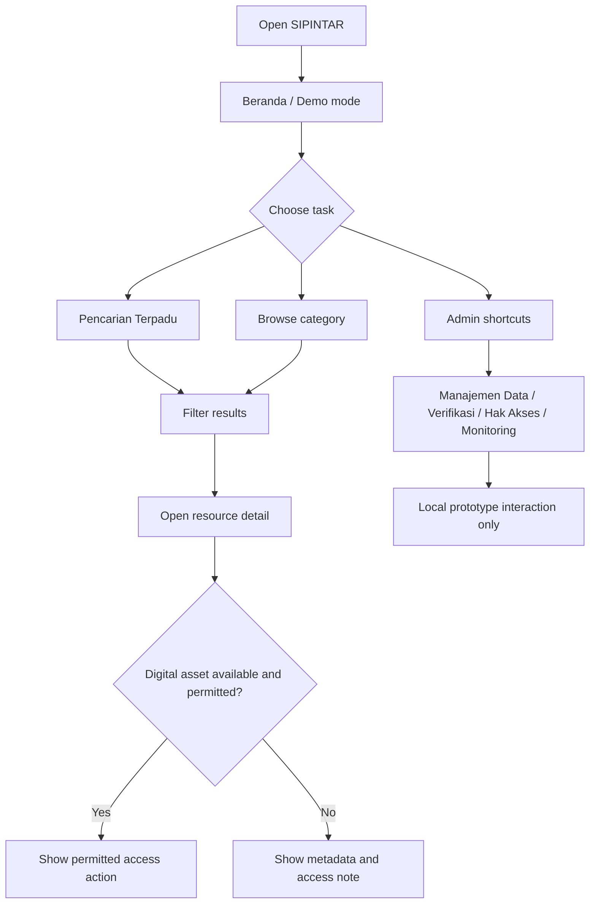

# SIPINTAR — User Flows

**Status:** Draft v1.0 — prototype flows only  
**Important:** These describe intended UI behavior. Authentication and permission enforcement are not implemented in Phase 1.

## 1. Visitor/internal user — discover a resource

1. Open SIPINTAR.
2. If not authenticated in the eventual production system, show the approved login gate. In the frontend prototype, dashboard access may be shown in demo mode, clearly labeled.
3. Open Beranda.
4. Choose a category card or enter a keyword in Pencarian Terpadu.
5. Optionally filter by category: Gadik, Modul, Hanjar, Buku, Taskap, Referensi lainnya.
6. Review result title, category, metadata, verification status, and access classification.
7. Open detail view.
8. If a permitted digital asset is explicitly available, show the relevant access action; otherwise show metadata/status only.
9. Return to results or dashboard.

**Failure paths:** no results → suggest clearing filters or broadening query; inaccessible item → explain access is restricted and direct the user to the authorized process; missing digital file → show metadata without a misleading download button.

## 2. Gadik — find competence information

1. Open Gadik & Kompetensi.
2. Search by name, competence, or expertise.
3. Review matching profiles.
4. Open a profile to inspect permitted fields: name, role/unit, primary competence, expertise/material, and learning contribution.
5. Use available contact/action only if approved in the real product; do not invent contact data.

## 3. Find Modul/Hanjar

1. Open Modul & Hanjar.
2. Choose a category if present.
3. Enter title, subject/field, or keyword.
4. Open a result.
5. Read metadata and access classification.
6. Open/download material only when a real file is available and access is permitted.

## 4. Find a library book

1. Open E-Library/Perpustakaan.
2. Search title, author, category, or keyword.
3. Open a result.
4. Check author, category, shelf/location, availability/status, and digital-access status.
5. If no digital file is available, use the physical location/status information; do not imply the book is digitized.

## 5. Admin — create and publish a resource (future functional prototype)

1. Authorized administrator opens Manajemen Data.
2. Select Tambah Data and resource type.
3. Enter required metadata, source/owner, classification, and status.
4. Save as Draft.
5. Submit for verification.
6. Verifier reviews accuracy, completeness, relevance, ownership/source, and access rights.
7. If approved, mark Diverifikasi and publish.
8. If not approved, return for correction with a reason.
9. Monitor update date and active/inactive/archive status.

Phase 1 may demonstrate these steps locally with mock state. Do not imply server persistence.

## 6. Admin — update or archive

1. Search/select existing record.
2. Edit relevant metadata.
3. Re-check source, completeness, access classification, and update date.
4. Save local draft.
5. Re-verify if required by governance rules.
6. Mark Tidak Aktif or Arsip when appropriate; avoid hard-delete as the default because the manual recommends retaining traceability subject to retention policy.

## 7. User — switch theme and navigate on mobile

1. Use the theme toggle in the app header/profile area.
2. Theme changes immediately and preserves contrast.
3. On mobile, open the navigation drawer.
4. Choose menu item.
5. Drawer closes after navigation; focus returns sensibly to the trigger.

## 8. Flow diagram

## 9. Flow validation checklist

- [ ] Search is reachable from every primary page.
- [ ] User can return to results without losing context unnecessarily.
- [ ] No-results and inaccessible-resource states are understandable.
- [ ] Digital availability is distinct from metadata availability.
- [ ] Admin draft and verification states are distinct.
- [ ] Theme toggle works on all routes.
- [ ] Mobile navigation is operable by keyboard and touch.
